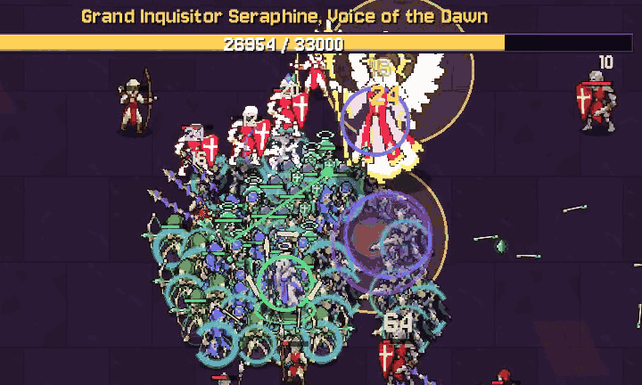

# Necropathy



**Necropathy** is a dark-fantasy bullet-heaven / horde-survival roguelite in the
vein of *Vampire Survivors*, with one twist: **the army is your weapon**. You play
a necromancer hunted by the Crimson Covenant, a fanatical holy order. You only
move. Your shadow spells fire automatically, and an **autonomous undead horde**
of Skeleton Warriors, Skeletal Archers, Undead Mages and the two priest orders,
Grave Menders and Crypt Warders (plus Corpse Abominations, Grave Rogues, Crypt
Gargoyles, Frost Wraiths, Bone Hounds, Banshees and Corpse Catapults), follows,
fights, heals, shields, holds the line and regroups without any commands from
you. Late in a run your summons can evolve into Death Knights, Liches, Profane
Bishops, Shadow Reapers, Cathedral Horrors, Hellhounds, Keening Ladies and
Ossuary Engines.

This repository holds the game's three campaign stages, *The Desecrated
Graveyard*, *The Crimson March* (unlocked by slaying Sir Alaric) and *The
Sanctum of Judgment* (unlocked by slaying Marshal Vael), built in Godot 4.3
with no addons. The art is true pixel art (PNGs in `assets/`; the code
drawings remain as the fallback for any missing image), and the sound and
music are synthesized at startup. Latest release notes:
[`docs/release_notes/v0.7.0.md`](docs/release_notes/v0.7.0.md).

Design documents:
- [`docs/Gravebound_Complete_Game_Design_and_Horde_Spec.txt`](docs/Gravebound_Complete_Game_Design_and_Horde_Spec.txt):
  the raw spec and **source of record**. It contains the GDD (Part I) and the
  horde AI technical spec with its numbers (Part II).
- [`docs/GDD.md`](docs/GDD.md): a formatted version of the same spec.

Code comments cite the spec as `GDD §N`.

---

## How to play

### Option A: download a ready-made build (no Godot needed)

- **Releases:** on GitHub, open **Releases** and download `Necropathy-windows.zip` (or `-linux.zip`), unzip it, and run
  `Necropathy.exe`. Windows SmartScreen may warn that the app is unrecognized because it is unsigned. Click
  **More info → Run anyway**.
- **Latest commit:** open **Actions → CI**, click the newest green run, and download the `Necropathy-windows`
  artifact at the bottom of the page. You must be signed in to GitHub.
- **In a browser:** the `Necropathy-web` artifact (or `Necropathy-web.zip` in a release) is the Web build; see
  [Play in the browser](#play-in-the-browser-web-build).

### Option B: run from source in Godot

1. Download **Godot 4.3** (the standard build, not .NET) from
   <https://godotengine.org/download/archive/4.3-stable/>.
2. Start Godot and choose **Import**, then select this folder's `project.godot`.
3. Press **F5** (or the ▶ Play button). Choose **Play** on the main menu, then
   a stage.

The project uses the GL Compatibility renderer, so it runs on almost any GPU.

### Controls

| Action | Keyboard / mouse | Controller |
|---|---|---|
| Move | WASD or arrow keys | Left stick / D-pad |
| Menu / card navigation and confirm | Mouse, arrow keys, Enter / Space | D-pad or left stick, **A** |
| Stage select (after **Play**) | Left / right between stages (the diorama follows the focused stage's mood), Enter marches, Esc goes back | D-pad / stick, **A**, **B** |
| Pre-run setup: character, skin, Hyper, ultimate, difficulty, run modifiers | Arrows move between the character tiles, difficulty cards, modifier tiles, the hero panel's skin / Hyper tiles and title row, the ultimate tiles under the modifiers, and the buttons; Enter chooses / toggles; Esc goes back | D-pad / stick, **A**, **B** |
| Pick a level-up card | Click, or keys **1 / 2 / 3** | Focus + **A** |
| Level-up: Reroll all cards (2 per run) | **R**, or the Reroll button | **X**, or focus the button + **A** |
| Level-up: Banish a card (2 per run) | **B**, then pick the card (**B** / **Esc** cancels) | **LB**, then pick the card (**LB** / **B** cancels) |
| Level-up: Skip (unlimited, heals 8% HP) | **N**, or the Skip button | **RB**, or focus the button + **A** |
| Shadow Bolt aim: Nearest / Strongest | **T** | **Y** |
| Grave Step (dash) | **Shift** | **RB** |
| Ultimate (Dread Rally or the one chosen before the run, when its soul meter is full) | **Space** | **LB** |
| Pause (Resume / Recipes / Settings / Feedback / Restart / Main Menu) | **Esc** (Esc again resumes) | **Start** (**B** or Start resumes) |
| Results card (end of a run): Restart / Main Menu | **R** / **Esc**, or the buttons | **X** / **B**, or focus + **A** |
| Feedback (main menu, pause menu, results card; shown once the owner's form link is set) | Click it, or move the focus to it and press Enter: the feedback form opens in your browser (a new tab on the Web build) with a short report filled in; the game stays where it was (a paused run stays paused) | Focus + **A** (in a browser a controller press may be stopped by the pop-up blocker) |
| Recipes (evolutions you have discovered) | **Recipes** in the pause menu; arrows move over the grid, Esc / Back closes | D-pad / stick move; **B** closes |
| Debug overlay (FPS, counts, unit FSM states) | **F3** | — |
| Ossuary (Soul Ash upgrades) | **Ossuary** in the main menu; arrows move, Enter buys; Esc closes | D-pad / stick move, **A** buys, **B** closes |
| Settings (Audio / Video / Controls tabs: volume, fullscreen, zoom Normal / Close, effects Full / Reduced, shake, damage numbers, reduce motion, keys) | **Settings** in the main or pause menu; **Q / E** switch tabs; Esc / Back closes | Focus + **A**; **LB / RB** switch tabs; **B** closes |
| Codex (achievements, spells, summons, the Covenant) | **Codex** in the main menu; **Q / E** switch tabs, arrows move through the tiles, Esc / Back closes | **LB / RB** switch tabs; D-pad / stick move; **B** closes |
| Credits (and the Godot / font licences) | **Credits** in the main menu; **Q / E** switch Credits / Licences, Up / Down scroll, Esc / Back closes | **LB / RB**, D-pad up / down, **B** closes |
| Confirm dialogs (Quit, pause Restart / Main Menu, Reset keys, the Ossuary's Refund all) | Cancel is focused; Enter on the other button confirms; Esc cancels | **A** confirms the focused button, **B** cancels |
| Rebind a key (in Settings) | Select a binding, then press the new key | **B** cancels |

On-screen hints show these controls as small key / button chips drawn from your
**current** bindings and the **last device you used**: keycaps for the keyboard,
Xbox-style **A / B / X / Y**, **LB / RB**, **Start** and stick chips for a
controller. They switch the moment you touch the other device and follow rebinds
at once. Every menu screen shows them in a bottom hint strip or on its
buttons (main menu, stage select, pre-run setup, Ossuary, Settings, Codex,
Credits, pause, Recipes), and so do
the level-up panel (the 1 / 2 / 3 card keys and the Reroll / Banish / Skip
buttons), the chest Claim button, the results card's Restart / Main Menu
buttons and the HUD's Shadow Bolt aim line and ability keys. The HUD carries no permanent
controls line any more, and its difficulty / modifiers box only appears when the
run differs from the standard one (another difficulty, a run modifier, Hyper,
the Pact or the Oath). The F3 debug overlay still works but is no longer
advertised on screen.

**Phones and tablets (touch, in the browser).** Menus are played by tapping
(buttons, cards, tiles, tabs; sliders drag; the Codex lists scroll with a
finger). In a run, semi-transparent controls appear (thumb-sized at any screen
size; numbers in `touch_data.gd`):

| Action | Touch |
|---|---|
| Move | Put a thumb anywhere on the **left half** of the screen: a joystick appears under it (it follows the thumb if you slide far) |
| Grave Step (dash) | The big button at the **bottom right** (its charges as pips, darkened while it recharges) |
| Ultimate (Dread Rally or your chosen one) | The button **left of it**: it shows your ultimate's icon, fills with the soul meter and gets a bright green border when ready |
| Shadow Bolt aim | The small button **above the ultimate** (shown while you have the bolt; the HUD line says which aim) |
| Pause | The button in the **top-right corner** |
| Ossuary | Tap a tile to see it, tap it **again** to buy |

The controls use the same input actions as the keys, so cooldowns and every
rule are unchanged, and several fingers work at once. Key
chips are hidden on a touch device; pressing a key or a pad button brings them
back and hides the touch controls (and a touch brings the touch controls back).
On a phone held upright a "Turn your device" screen covers the game (a running
game pauses). See *Play in the browser* for the phone details.

You don't aim or cast anything yourself. Spells, summons, targeting, healing and
replacing fallen units all happen automatically (GDD §4, §21). The only two
buttons you press in a fight are the dash and the ultimate (below).

### Grave Step and Dread Rally (dash and ultimate)

- **Grave Step** (Shift / RB) is a 110 px shadow step over 0.15 s in the
  direction you move (or the way you last moved when standing still), with
  0.2 s of invulnerability. It passes through enemies but not obstacles: the
  step stops short of a gravestone or wall and always ends on free ground. It
  has a 5 s cooldown and is available from the first run; the Ossuary sells a
  second charge (**Twin Shadow**) and a shorter cooldown (**Restless Shade**,
  5 → 3.5 s). The army follows as it does when you walk. A violet shadow
  trail marks the step.
- **Dread Rally** (Space / LB) has no cooldown: its **soul meter fills from
  kills** (1 point per kill, 8 per elite or Crimson March structure, 60 for
  the stage boss; 240 to fill, about 60-90 s of mid-game fighting). It stays
  full until you use it, and kills made during a rally do not charge it.
  Casting it calls the army: every summon outside its formation band
  returns to you and the whole army moves +120% faster for 1.5 s, every
  summon heals 30% of its max HP, **every fallen summon rises again at once**
  (the whole army comes back beside you at full HP, owner decision Oct 2026),
  and for 8 s the army deals **+40% damage**
  with **+40% attack speed**. Enemies within 120 px are knocked back (heavier
  ones less, bosses barely).
- Both live in the HUD's bottom centre, either side of the ability bar: the
  Grave Step icon with one pip per charge (it darkens and counts down while
  no charge is ready) and the Dread Rally icon with its meter (a pulsing
  border and READY under the icon when full, the buff time while it runs).
  Their key chips sit above the icons and follow your rebinds and device. Everything runs on game time, so pauses, level-ups and
  chests freeze the cooldown, the meter and the buff, and the Space / A that
  confirms a card or closes a chest never casts the rally.

### Ultimates (content wave 2)

Dread Rally is one of four ultimates. All four use the **same soul meter** (240 points, filled by
kills as above, no charge while one runs), the same key / button and the same HUD slot; you pick
one on the **pre-run setup screen** (the row of four tiles under the skins: icon and one word, the
chosen one framed in gold, a locked one padlocked with how to earn it; the full effect is the
tooltip). The choice is remembered, kept by Restart and open to every character; the HUD icon, the
touch button and the pause screen's **Ultimate** line show it. Dread Rally stays the default and is
always open; the other three are earned by achievements (their lock rows come with the achievement
rewards; until then they are open). Numbers in `scripts/data/ultimate_data.gd`.

| Ultimate | What it does | The right pick for |
|---|---|---|
| **Dread Rally** | Raises every fallen summon, heals the army 30%, +40% damage and attack speed for 8 s, knockback, the Rally Barrage | All-rounder: rescues a broken army |
| **Sovereign's Decree** | For 8 s every summon **taunts** the foes within 150 px and takes **50% less damage**; you **cannot be targeted** (foes turn on your summons, and any hit that still reaches you, a projectile already flying, a boss attack, a hazard, does nothing) | Bosses and swarms that dive you |
| **Eclipse** | **Darkness for 4 s**: every foe on screen **freezes** (bosses and minibosses are only slowed 60%, never frozen; the Reckoning and structures are immune), and every foe it caught takes **+30% damage** from the cast until 6 s after the darkness (bosses too) | An emergency brake when surrounded |
| **Grave Tide** | For **10 s** every foe that dies **rises as a Risen** fighting for you for 12 s (Restless Dead and the Grave Herald make them last longer); never a boss, miniboss, Reckoning foe or structure; at most 24 at once | Snowballing a big wave into an army |

### Online co-op (in development)

Two players, each on their own screen, browser or desktop, through a small relay server (`docs/coop/DESIGN.md`).
The lobby, the connection and the co-op run itself (deterministic lockstep, below) are in; the partner's HUD bar
and edge arrow come with the co-op HUD branch.

- **Host:** title screen → **Co-op** → **Host**. The lobby shows a 5-letter code: press **Copy** (or **Share** on a
  phone, which also sends a link that opens the game with the code filled in) and send it to your friend.
- **Join:** title screen → **Co-op** → **Join**, then tap the code's letters on the pad (or type them) and **Join**.
- **In the lobby** each player picks their own character, skin, ultimate and title with **Setup** (from their own
  unlocks; their Ossuary upgrades come along). The host also picks the stage (**Stage**), the difficulty, the
  modifiers and Hyper; the guest sees those read-only. The guest presses **Ready**, then the host **Start**.
  **Leave** asks first. Both players need the same build: the lobby compares the version number plus the
  commit CI exported (`CoopNet.game_version()`, `build_id.txt`), so after an update both reload the page.
- **In the run** each machine runs the whole game of both players and only the inputs travel (`CoopLockstep`):
  your moves and presses reach the game about 70-120 ms later on both screens (the input delay adapts to the
  ping). A level-up opens your own cards while your partner picks theirs (the game waits for both: "Your
  partner is choosing a card"); a treasure chest holds the game while its opener looks at it; either player's pause (Esc,
  a turned phone, a tab in the background) pauses both, and either can resume. If the partner's game stops
  answering for about 1.5 s a "Waiting for partner: Connection is slow" panel shows; after 10 s, or when they leave (the pause
  menu's **Leave**), a bot takes over their necromancer and you play on. The run cannot be restarted (Again and
  Next lead back to the menu). If the two games ever stop matching (a **desync**, checked every second) the run
  ends for both and each keeps the Soul Ash earned. Each device saves only its own player's Soul Ash (from your
  own kills, plus the run's time, boss and objectives), achievements, unlocks, recipes and Codex.
- **Local testing** without Cloudflare: `python3 tools/coop_relay.py` runs the relay on port 8765; start the game
  with `-- --relay=ws://127.0.0.1:8765` (desktop) or add `?relay=ws://127.0.0.1:8765` to the Web build's address.
- **Tests:** `python3 tools/coop_relay_check.py http://127.0.0.1:8765` (relay protocol), `python3
  tools/coop_net_test.py` (two headless games: lobby, join by code, start, 10,000 frames each way) and
  `node tools/coop_lobby_shots.mjs` (the lobby screens in the Web build in headless Chromium, desktop and phone).
  The **determinism gate**: `python3 tools/coop_lockstep_gate.py` (two headless games play one whole co-op run
  through the lockstep, each with its own army bot, and must agree on every checksum; `--delay-ms 40 --jitter-ms 25
  --real-time --speed 1` adds latency, `--kill-join-at 300` is the drop test) and `node tools/coop_web_lockstep.js
  build/web web-web OUT` (two Web pages). Both players must be on the **same platform** (both in a browser, or both
  on the same desktop system): the Web build and a desktop build do not compute exactly alike, so the lobby refuses
  the mix.
- **In the run** (as it lands): your partner's plate (name, HP, bust) sits under the kill count; an edge arrow with
  his face points at him when he is off screen, and his name floats over him when he is on it. A downed
  necromancer gets a crimson marker, a faint circle showing how close to stand and a green ring that fills while
  the partner stands inside it (about 3 s); the downed player sees "Your partner can raise you". A small "Waiting for
  partner" panel shows while the game waits for your friend, and the results card shows both players, yours
  first. Screenshots: `node tools/coop_hud_shots.mjs phone defeat` (Web build) or `--coop-shots=` (see the autotest
  table).
- **The relay** is a Cloudflare Worker (`server/relay`, protocol in `server/relay/PROTOCOL.md`) deployed by CI's
  `deploy-relay` job; one-time owner setup in `docs/coop/RELAY_SETUP.md`.

### Feedback

A **Feedback** button sits in three places: the main menu (with a quill icon, above Quit), the pause menu
(between Settings and Restart; the run stays paused) and the results card (a small dim button at the end
of the Restart / Main Menu and Next / Again / Menu rows). It opens the owner's Google Form in the browser
(a new tab on the Web build; the game keeps its state) with its "Details (filled in by the game)" question
filled in by a short plain report: the game version, the platform, the browser (Web), the screen size and
touch; where the button was pressed (on the pause menu and the results card also the stage, the time, the
character, the difficulty, Hyper and the modifiers; the results card adds victory / defeat, kills, level and
the boss); and the Effects / Reduce motion / Volleys settings. Nothing personal and nothing from the save.
The form's link and its field id are `FORM_URL` and `DETAILS_ENTRY` in `scripts/data/feedback_data.gd`;
while `FORM_URL` is empty the buttons are not shown at all (and the menu is exactly as before). On the Web
build the tab is opened inside the browser's own release of the click, tap or key, so pop-up blockers let
it through (a press that drags off the button opens nothing); a controller press cannot count as a gesture
for the browser, so there the tab may be blocked.

### Audio, Feel & Settings

- **Audio, with no audio files.** `Synth` builds every sound effect and a 12 s
  dark D-minor ambient loop for runs (drone, choir pad, heartbeat) as 16-bit PCM
  `AudioStreamWAV`s on worker threads at startup. The main thread is blocked
  for under 1 ms; all sounds are ready in about 0.15–0.3 s and the music in
  about 0.3–0.5 s. The Web build has no worker threads, so there
  `StartupSynth` renders the same samples in 6 ms per-frame steps instead
  (the UI sounds first, each sound playable as soon as it exists; the loop's
  recipe is a list of small jobs in `RunLoopSynth`). Recipes and voice limits live in `scripts/data/sound_data.gd`.
  The `Sfx` autoload creates the **Master / Music / SFX** buses and plays
  sounds from a pool of 24 voices. Each sound also has its own voice cap,
  cooldown and priority, so 150 enemies dying at once play only a few voices.
  In headless runs everything runs except actually starting the players.
- **Menu theme ("Grave Lullaby").** The main menu and every screen opened
  from it (stage select, pre-run setup, Ossuary, settings, Codex, Credits)
  have their own music: a 51.2 s loop in D minor at 75 BPM, 16 bars in an
  A / B form. A (bars 1-8, i–VI–III–VII then i–VI–iv–V) is a music-box
  motif over an "ooh" choir pad and a soft pedal organ; a lute-like harp
  joins in bar 5. B (bars 9-16, iv–i–VI–III–iv–bII–V) is a sung "aah" lead
  over flowing harp arpeggios, peaking on the Neapolitan E-flat and pulling
  back to the top through a timpani roll. A deep church bell tolls each
  phrase, and a wind and candle-crackle bed runs throughout, in a dark
  cathedral reverb. `MenuThemeSynth` renders the score in
  `scripts/data/menu_theme_data.gd` the same no-files way. It runs lazily,
  only once the menu asks for it, so the autotest never pays for it: on a
  worker thread on desktop (about 1.5 s of compute, so the theme fades in
  that long after launch), in 4 ms per-frame steps on the Web. The result is
  bit-identical either way. The loop is seamless: note tails wrap to the
  top, and the reverb and wind are primed with the loop's end. It is
  22.05 kHz mono (2.3 MB) and matched in loudness to the in-run loop.
  `Sfx.play_music()` crossfades the two tracks on real time: the menu theme
  fades out as Play's fade through black starts and the in-run loop fades
  in (2.5 s); returning to the menu fades the run music out (1 s) and the
  theme back in from its top (2 s). The Music volume slider sets both.
- **Feel (`Juice` autoload).** Trauma-based screen shake (bigger for boss
  impacts and player damage), plus a short hit-stop on Hammerfall impacts,
  boss kills and elite kills. Hit-stop is off under `--autotest` and while
  the game is paused. Also: death pops, XP sparkles, a red hurt vignette, and
  floating damage numbers. Particles and numbers are drawn by one node from
  fixed ring buffers, and hits on the same enemy merge into one number.
  `Juice` gets most events from the run's existing signals and stats.
  Gameplay code only calls it in a few one-line hooks.
- **UI motion and sounds (`UiMotion`, numbers in `ui_motion_data.gd`).** Every
  screen fades in while its panel rises a few px and grows into place (about
  0.18 s), and fades out quickly when it closes; level-up cards and chest rows
  enter one after another; a hovered or focused card or tile lifts 3 px and
  brightens; buttons squash a little while held; the end screen's Soul Ash
  rolls up with ticks; and the switch between the menu and a run (and
  Restart) fades through black. Motion runs on real time while the game is
  paused, never touches the game's time scale, and is instant under
  `--autotest` and with **Reduce motion**. UI sounds: hover and confirm
  clicks on every button, a **back** sound for Back / Cancel buttons and for
  Esc / pad B inside a screen, soft **panel open / close** whooshes, a
  bone-chime **purchase** in the Ossuary, a dull **denied** thud for what
  can't be bought or is locked, and a **tick** for count-ups.
- **In-run screens (numbers in `in_run_ui_data.gd`).** Colour carries meaning:
  gold for evolutions, chests and victory, crimson for danger and defeat,
  soul-teal for what is new or focused.
  - **Level-up:** two columns of violet light rise beside the cards as the
    panel opens. Each card shows its key chip and kind tag (and **NEW** for a
    new item), a 64 px icon, the name, **level pips** (owned levels violet, the
    level this card grants soul-teal), its one-sentence description and stat
    changes, and, once you have discovered it, the evolution recipe as icons.
    Evolution cards are gold, with a vortex collapsing into their icon and a
    gold sheen.
  - **Treasure chest:** the chest rattles, bursts open and lifts its lid on a
    band of light with turning rays; then the rewards rise one by one as
    centred rows (icon, name, level change, level pips). An evolution reward
    is a gold row with its own burst and sheen. Confirm skips the reveal, then
    claims.
  - **Pause:** the run on the left (stage, time left, character, the
    difficulty and modifiers when not standard, your spells and passives with
    their levels, your army with unit counts) and the
    buttons on the right; the run controls as chips underneath.
  - **Results card (end screen):** a gold *Victory* or crimson *Defeat*
    ribbon, your character (or skin) on the stage's floor, the time survived,
    kills, level and the boss as tiles, your build and army as icons, the
    Soul Ash rolling up while each bonus line ticks in, and every unlock of
    the run (character, stage, skin, Hyper, achievements) as a gold plate.
  - **HUD:** one banner at a time on a ribbon (gold for an evolution or a
    synergy, crimson for Covenant and boss events, violet otherwise), always
    one line (a long event splits at its colon into a headline and a smaller
    line), fading and rising in and out; later banners queue briefly. Banners
    hide while a level-up, chest, pause or end screen is open and carry on
    afterwards. The XP bar sits in its frame with room for its numbers; the HP
    bar has quarter notches and a pale trail where HP was just lost.
  - **Chest beacon** (owner request): a gold chevron bobs over every chest
    lying in the world, above the crowd, and a gold glow with a pulse ring
    marks the ground under it. A chest off screen (one you walked past, or one
    just beyond the edge) gets a gold badge with a pointer on the screen edge,
    turned toward it; it fades and shrinks a little with distance but never
    disappears. The badges keep below the top bars (lower while a boss or
    miniboss bar shows), above the ability bar, out of the army list's corner
    and, on a phone or tablet, out of the joystick's and buttons' corners; at
    most four show (nearest first, close ones merge into one with a pip per
    extra chest). They hide while a level-up, chest, pause or end screen is
    open. Motion holds still with Reduce motion; Effects: Reduced drops the
    pulse rings. Always on (no setting: the Video tab has no marker toggles).
- **Settings (`Settings` autoload, `SettingsMenu`).** Four tabs (Q / E or
  LB / RB): **Audio** (Master / Music / Effects sliders), **Video**
  (fullscreen, **Volleys** = the bullet heaven pass, the camera zoom Normal / Close,
  **Effects** Full / Reduced, screen shake, damage numbers, Reduce motion = instant
  UI motion), **Save** (Backup / Restore save codes, see *Play in the browser*) and
  **Controls**: the keyboard key of
  Move up / down / left / right, Shadow Bolt aim, Grave Step, Ultimate,
  Pause, in two groups (Move, Actions),
  each shown as a key chip you can rebind next to its fixed controller
  binding (a pad chip, read-only), plus **Reset keys**. Arrow keys and
  controller bindings stay fixed, and binding a key that is already in use
  swaps the two keys. A hint strip at the bottom shows the controls of the
  device in use. Everything works with a controller. Settings are saved
  to `user://settings.cfg` when the menu closes and loaded at startup
  (`[audio]` volumes, `[feel] screen_shake` / `damage_numbers` /
  `reduce_motion`, `[video] fullscreen` / `zoom` / `effects`, `[input]` key bindings).
- **Effects: Full / Reduced** (for weak devices; a phone or tablet starts on
  Reduced, a desktop on Full, until you choose). Reduced spawns 40% of the
  cosmetic particles, shows only the big damage numbers (40+ or boss hits),
  stops drawing cosmetic effects (pops, slashes, rings, beams) beyond 70 at
  once (telegraphs always draw) and halves the screen shake. It is purely
  visual: a run plays out exactly the same (checked: same-seed autotest
  summaries are identical with Reduced forced on), and the autotest always
  uses Full.

### Bullet heaven pass (Volleys)

A pass kept after the owner played it (GDD §15.0 "Volleys kept"), on by default and switched with **Settings → Video → Volleys** (from the next
run; GDD §15.0 "Bullet heaven pass", numbers in `scripts/data/volley_data.gd`):

- **Summon volleys.** From class **Lv 3** every summon class adds a glowing signature volley to its
  attack, with more shots at Lv 5: Warriors throw bone-shard fans off the line, Archers multishot,
  Mages' orbs fork into sparks, Menders release seeking soul sparks, Warders shatter barrier shards,
  Abominations' stomps throw flesh chunks, Rogues end a dash in thrown daggers, Gargoyles' dives burst
  into stone shards, Frost Wraiths fire ice cones, Bone Hounds howl ghost wolves, Banshees' Dirge turns
  into rings, and catapult boulders burst into bone fragments. Each summon evolution has a showpiece
  (the Death Knight's sword wave, the Gravebow's arrow rain, the Lich's spiral and so on).
- **Spell echoes.** From **Lv 3** every owned spell releases a themed echo volley on its own cooldown.
- **Rally Barrage.** Dread Rally makes every summon fire its volley at once, and volleys come twice
  as often while the rally lasts.
- **Denser fodder.** 25% more soldiers with 20% less HP each. Every kill keeps its full XP (owner
  decision: a build that completes a little earlier is fine).

Volley shots split the attack's damage rather than adding to it, and a volley lands at most two hits on
a boss or miniboss. With Volleys off nothing of the pass runs (no volleys, the usual fodder); the army still stands in the Bone Ring.

The shots are pixel-art sprites (bone shards, orbs, daggers, sparks, sound crescents, stone feathers and
the Death Knight's sword wave) tinted in each class's colour and drawn as additive glow; every hit
bursts into a small starburst and every volley opens with a rune-ring flash (`assets/sprites/volleys/`,
`effects/volley_hit` and `volley_flash`; ART_BIBLE "Volley shots and bursts").

### Act II: the Ancient Eye (in development)

After Grand Inquisitor Seraphine falls, Act II opens: the necromancer's dead start hearing a
song from under the sea, and **the Ancient Eye**, a cult of a dead god dreaming in the deep,
fights you **for the dead** (GDD §15.0 "Act II: the Ancient Eye"). The stage select shows one
act at a time (Q / E, LB / RB, or the Act tabs). Its three stages, Gullhaven Harbour, the
Hollow Archive and Ul-Thalos, the Risen Spire, each unlocked by the previous boss, are
playable (balance-checked by the bots; your playtest decides the rest). The act's shared rules:

- **Claims.** A summon that dies near a Chanter of the Eye (the leader of an Initiate squad)
  rises for 15 s as a hostile **Drowned Thrall** wearing its own sprite, tinted drowned teal.
  Kill it and its soul comes back as Dread Rally charge; your replenishment is unchanged, so
  nothing is lost for good. Kill the Chanters first.
- **Dread.** A 0–100 meter under your HP bar. The Eye's hazards raise it, every kill lowers it
  by 1, and each 25 Dread makes you take 5% more damage (+20% at 100). The screen edges darken
  with it (lighter with Reduce motion or Effects = Reduced); it never takes control away.
- **Unlockable spells and passives.** Act II's spells are unlocked by slaying its bosses and
  its two counter-passives by its achievements; once unlocked, the spells can be offered on
  every stage, the counter-passives only in Act II. The end screen shows a plate for each
  unlock, and the Codex (its new **Ancient Eye** tab too) names the condition of a locked one.
- **Music.** Act II runs play their own loop, "Below the Tide".
- **The Fallen Seraph** (Seraphine's gift). Slaying Grand Inquisitor Seraphine once unlocks a
  new summon class, the **Fallen Seraph**, and its passive **Fallen Grace**; both are offered on
  every stage from then on (a save that already slew her has them at once). See *Summon
  classes* and *Evolutions & Synergies*.

### Act III: the Electronic Empire (foundation, not yet playable)

When Vhal'Neth falls, the beacons of Ul-Thalos are seen from far away: **the Electronic Empire**,
a machine power that conquered death with steel, comes for the necromancer who lit them (GDD §15.0
"Act III foundation (phase 1)"). Its citizens are rebuilt, not reborn, and most of its soldiers
fight from range. The stage select has an **Act III** tab with its three stages, **the Scrap
Wastes**, **the Assembly Halls** and **the Iron Citadel** (bosses Kestrel the Dead Pixel, the
Motherboard, Deus Ex Machina with Varn, the Root User); each is unlocked by the previous boss, and
all three show "Coming soon" until their stages are built (phase 2). The act's shared rules:

- **Line of Fire: your dead are cover.** Every Empire shot is a real projectile that stops on the
  first summon in its path; a Bone Wall stops it, a Warder's barrier absorbs it, the Orb Shield
  intercepts it. You are hit only by the shots that find a gap. Mortars (arcing shots) fly over
  everything.
- **Lock-On: the big shots are telegraphed.** A Spotter paints a thin red line on you or a summon
  for 1.5 s, then fires a heavy rail shot down it. Step out of the line (Grave Step), put a summon
  in it, or kill the Spotter first. Spotters glow red and the army targets them first. At most
  three lines at once.
- **Steel has no soul.** Machines (drones, turrets, mechs) leave nothing to raise: no Corpse
  Explosion corpse, no Risen, no Lich or Grave Tide raise. A **cyborg** raised as a Risen keeps its
  rifle and fires for you as a **Grave Gunner**. Dread Rally still charges from every kill.
- **The Purge Protocol.** At 0:00 kill-drones pour in from every edge while orbital strikes land
  on red circles, faster each minute.
- **Act V music and sounds.** "The Setting Sun" (`SoundData.SUN_SCORE`: a D "in" scale pad, taiko patterns, a
  plucked koto and a breathy shakuhachi) and the eight Shogunate sounds (`SoundData.SHOGUNATE_SOUNDS`) render
  lazily the same way once a stage uses `"music": "sun"`.
- **Music.** (Act IV's "Hymn of Bronze", a war drum under a Dorian pad with a plucked lyre and brass
  swells, and its eight Pantheon sounds are rendered lazily the same way: `SoundData.BRONZE_SCORE`,
  `PANTHEON_SOUNDS`; the stages switch to it with `"music": "bronze"`.) Act III runs play their own loop, "Iron Requiem" (a pulsing low synth, metallic hits
  and a cold arpeggio), and the Empire's weapons have their own synthesized sounds.

The shared kinds so far: the **Scout Drone** (fast flying fodder with short zaps), the **Line
Trooper** (a cyborg rifleman firing three-round bursts from 400 px while it marches) and the
**Spotter** (an elite marksman with the Lock-On rail). The Codex has an **Empire** tab.

### Stage 7: the Scrap Wastes (Act III, built, not yet playable)

The Empire's old battlefield: slag hills, fallen war titans and red signal masts (GDD §15.0 "The
Scrap Wastes (Act III phase 2)"). Four zones on the clock: **the Slag Fields** (open ground), **the
Wreck Gullies** (narrow lanes between fallen titans), **Pylon Ridge** and **the Outer Wall**.

- **Signal Pylons.** Tall masts with a Soul Ash bounty. While one stands, the Empire's shooters near
  it fire from 30% farther; tear it down and their range in that area shrinks for the rest of the run.
- **Scrap storms.** Every few minutes a dust storm rolls in for 20 s and halves the Empire's sight
  (every shooter's reach): close in on the riflemen. Your own army's ranges are unchanged.
- **Its kinds.** The **Aegis Bot** walks in front of the riflemen behind a frontal energy shield that
  stops your arrows, bolts, spears and volley shots (it breaks after a while and comes back): hit it
  from the side, with area spells, melee or stomps. The **Mortar Walker** lobs shells onto red
  landing circles over your army (arcs ignore Line of Fire: keep moving).
- **The Trojan Horse** (miniboss, 9:00 left): a horse-shaped drone tank whose slow homing rockets
  burst on the first undead in their path (your army intercepts and shoots them down); it stomps,
  and badly damaged its hull splits open and Scout Drones pour out. Its chest drops when it falls.
- **Kestrel, the Dead Pixel** (3:00 left): a cyborg sniper who leaps between perches and paints
  **three Lock-On lines at once** (their rails come one after another), releases **decoy drones**
  (holograms of her that draw your army's fire) and, at the end, drops the rifle for **twin
  blades** and charges down a telegraphed lane (a Warrior, Golem or Abomination in her path stops
  her). Slaying her unlocks **Death Ray** and **Conductive Marrow**.
- **Static in the Wastes** (clear the Scrap Wastes) unlocks **Lead-Lined Bones** (ranged hits on your
  summons deal less; offered only in Act III).
- **Death Ray** (a spell, offered on every stage once unlocked): a violet soul laser sweeps a full
  circle around you every 6-7 seconds, out to about 310 px at Lv 5; each beam kill sparks lightning to
  a nearby foe. **Event Horizon** (Lv 5 + Conductive Marrow Lv 5, from a chest): two opposite beams,
  and every kill sets off chain lightning through up to 4 foes. Its character is **the Lightning
  Abbess** (innate *Storm Litany*: beam kills spark to one more foe; Hyper skin *Gilded Stormbride*,
  and the Untouchable and Deathlord skins).

### Stage 8: the Assembly Halls (Act III, built, not yet playable)

<!-- --- Act III: the Assembly Halls --- -->
The Empire's factory, where the dead are rebuilt as soldiers (GDD §15.0 "The Assembly Halls (Act III
phase 2)"; `scripts/data/stages/assembly_stage.gd`). It is built but still shows "Coming soon" on the
stage select until the act is released. The clock drives four zones: **the Loading Docks** (20:00,
crates and fuel drums), **the Conveyor Floor** (15:00), **the Fabricator Hall** (10:00) and **the
Furnace** (5:00). The Motherboard arrives with 3:00 left.

- **Conveyors.** Belts on the Conveyor Floor and in the Fabricator Hall carry everyone standing on
  them (you, your summons, enemies) along the belt. Neighbouring lanes run in opposite directions.
  Flying units are not carried. The push goes through `TerrainSlow`, the one ground-effect path.
- **Fabricators.** Sets of two or three fabricators power up at 17:30, 14:00, 9:45 and 6:50. Each
  one builds an Empire soldier every few seconds until you smash it. Every fabricator you smash
  makes the waves and the trickle a little thinner, and pays XP and Soul Ash. Smash every
  fabricator in one run to earn the achievement **Cold Assembly**.
- **Furnace channels.** Molten channels in the Fabricator Hall and the Furnace run on a fixed,
  staggered rhythm: dormant, then a warning glow, then burning. A burning channel hurts everyone
  standing in it, enemies too (the stage boss takes half).
- **The Beta Build** (miniboss, 9:00). A half-finished war machine with a claw swipe and rivet
  sprays. It patches itself while fabricators still stand, so smash them first.
- **The Motherboard** (boss). A walking factory with two crane arms:
  - it grabs your summons and hurls them at you;
  - it drops press-stamps on telegraphed squares;
  - at Full Load it magnet-pulls the army out of the ring and builds its own turrets;
  - below a quarter of its HP it overclocks, with faster specials and more stamps.
- **New kinds.** The **Arc Engineer** repairs damaged machines and jams your summons (they deal
  less damage while jammed). The **Juggernaut** is a flamethrower walker with flat armour, which
  shrugs off light hits.

**Rewards** (unlocked by slaying the Motherboard; offered on every stage):
- **Hollow Puppet** (spell). It seizes the strongest nearby non-boss foes. Each one fights for you
  as a temporary summon for 8 s, then dies, and its XP drops where it falls. It evolves into
  **Puppet King** with its paired passive **Strings of the Dead**: two puppets at a time, and each
  puppet bursts when it dies. Strings of the Dead makes every temporary summon taunt nearby foes
  and rise with more HP.
- **Grave Drone** (summon class). Hovering skull drones fire bone darts from inside the ring.
  They fly over the belts, and they still stop Empire shots. They evolve into the **Wraith Drone**
  with **Overclock**, which makes every ranged summon attack faster.
- **The Marionette**, Hollow Puppet's character. Her innate, *Puppeteer*: puppets last 25% longer
  and hit 25% harder. She has Hyper, Untouchable and Deathlord skins.
- **Signal Ghost** (passive, Act III only). Lock-On lines take longer to paint on you. It is
  unlocked by **Cold Assembly**.

### Stage 4: Gullhaven Harbour (Act II)

A fishing town at low tide, at night, where the Ancient Eye has lived in the open for
generations (GDD §15.0 "Gullhaven Harbour (Act II phase 2)"; `scripts/data/stages/harbour_stage.gd`).
Like the Crimson March and the Sanctum, the clock drives four zones: **the Mudflats** (20:00),
**the Fish Market** (15:00, narrow lanes between the stalls), **the Chapel of the Deep** (10:00)
and **the Seawall** (5:00, high tide). Abbot Merrow arrives with 3:00 left.

- **The tide** (`TideDirector`). The town floods more each zone (about 4% of the ground at the
  start, 40% in the Chapel); in the Seawall only a long strip of dry stone stays above water.
  **Water slows everyone in it by 25%**: you, your dead and the cultists alike, except the
  Deep Kin, the Harbourmaster, the Heralds and Merrow, who swim. Every 4 minutes (from 14:30) a
  **tide surge** is telegraphed (a band with drifting chevrons), then a wave sweeps along it,
  shoving everything it passes and flooding the band for a while. At the Reckoning the sea
  takes everything but the seawall's top.
- **Bell buoys** (17:30, optional). Three buoys out on the flats toll up small squads while you
  are near; each one you sink makes every later scripted wave 12% smaller and the trickle 5%
  thinner.
- **Smugglers' caches** (14:00 and 8:20). Locked crates at the end of dry piers (a narrow lane
  out into the water); break one and it drops a treasure chest.
- **The Eye's kinds.** **Deep Kin** (a bruiser: a telegraphed leap onto your front rank),
  **Tide Callers** (fishwives who raise a line of water that throws your dead back),
  **Netcasters** (a net pins one summon in place for 3 s; kill the caster to cut it), the
  **Harbourmaster** miniboss at 9:00 left (an anchor sweep that drags what it hits toward him
  and an anchor hurl that reels in the first body it strikes; it drops the miniboss chest),
  plus the Initiates and the Chanters' Claims. The Reckoning sends **Heralds of the Deep**.
- **Abbot Silas Merrow, Voice of the Deep.** Robed, he preaches from a pulpit (**Sermon**: every
  cultist around him hits harder, walks faster and takes less damage; hit him hard enough to
  break it off) and throws a **Brine Wave**. Below 60% HP he undergoes **The Change**: robes
  shed, he fights with long whipping limbs (**Limb Lash**, three lanes; **Whirl**, a circle).
  Below 30% he calls **High Water**: the dry ground shrinks to the seawall's edge.
- **Unlocks.** Slaying Merrow unlocks the spell **Undertow** and its paired passive **Salt of
  the Deep**; clearing the stage earns the achievement **Low Tide**, which unlocks the Act II
  counter-passive **Brinewalker**.

**Undertow** (spell, every stage once unlocked): a wave rolls out toward your aim over a 120°
cone, hurting and shoving back every foe in it; every third wave leaves shallow water that slows
foes for 3 s. **Maelstrom** (evolution, with **Salt of the Deep** at Lv 5): every wave ends in a
whirlpool that drags the cone into one knot and grinds it (bosses and minibosses are slowed,
never dragged). **Salt of the Deep**: slowed, chilled and frozen foes take +6% damage a level
(+30% at Lv 5). **Brinewalker** (Act II only): water and ink slow you 20% less a level (not at
all at Lv 5), and your summons too from Lv 3. Undertow's character is **the Brine Widow**
(innate **Riptide**: every second wave leaves shallows; +6% spell area, -5 max HP), earned by
reaching Lv 5 with Undertow.

### Stage 5: The Hollow Archive

The buried library and observatory where the Eye keeps its god's scripture (GDD §15.0 "Act II:
the Hollow Archive"; `archive_stage.gd`, `ArchiveDirector`, `RiftDirector`). Unlocked by slaying Abbot Merrow; ×2.0 Soul
Ash. Four zones on the clock:

- **The Reading Halls** (20:00): rows of long shelves split the field into aisles.
- **The Ink Wells** (15:00): pools of black ink in the floor. Standing in ink slows you by 30%
  and raises your Dread; Ink Wraiths rise out of the wells.
- **The Orrery** (10:00): a huge brass orrery rises around you. Its arms are moving walls: they
  rest, the next sweep glows for 2 s, then they turn 45°, sweeping you and the army along (never
  into a wall). Walk too far away and it folds and rises around you again.
- **The Unwritten Stacks** (5:00): a **rift** every 45 s. A rift glows for 3 s, then tears open
  behind your army and spits the Eye out next to you; it closes by itself after 10 s, or sooner
  if the army breaks it. Single rifts also open earlier as a warning.

**Forbidden tomes** (optional): five lecterns over the run (2:30, 7:00, 12:00), each guarded by a
Scribe. Stand on one for 1.5 s to burn its tome: a free level-up card, but +20 Dread. Unburned,
a tome seals itself after 90 s. Burn all five in one run for the achievement **Nothing
Unwritten** (it unlocks the Iron Mind passive).

**The Archive's kinds** (any stage can spawn them; `scripts/enemies/eye/`):
**Scribe of the Unwritten** (inks a curse on up to three cultists around it: for 10 s each is a
claimer, so a summon dying near it rises as a Drowned Thrall; kill Scribes first), **Ink Wraith**
(a fast flanker that slips through shelves and every obstacle and rises out of ink), **Pilgrim of
the Spore** (leaves spore clouds that raise your Dread and choke the undead inside; bursts into a
big one when it dies), **Gibbering Mass** (a tank that splits into two smaller masses when it
dies, and each of those once more), the **Librarian** miniboss at 9:00 (a floating eye in
tendrils: a slow, telegraphed beam turns the summons it crosses around for 2 s, a tendril lash
throws the crowd back; HUD bar, guaranteed chest) and the Reckoning's **Unwritten**.

**The Archivist, Keeper of the Unwritten** (3:00 left; `boss_archivist.gd`, `archivist_data.gd`):
**Recitation** (pages rise around her, hover, then home on you; one that hits you or a summon
bursts into a short-lived ink pool), **Footnotes** (from 60% HP she splits into three; only the
one casting a shadow takes damage, blows on the copies are wasted), **Erasure** (the field's edge
closes in 60 px every 20 s, telegraphed, down to 260 px; you and your army are pushed back
inside), faster at 25% (the Last Page). Slaying her unlocks **Forbidden Verse** and
**Marginalia**.

**Forbidden Verse** (`forbidden_verse.gd`, rules in `verse_data.gd`; unlocked by the Archivist,
then offered on every stage): three pages orbit you, cutting what they pass and inscribing it;
every few seconds they sweep wide. An inscribed enemy that dies (to anything) bursts into ink.
Evolution **The Unwritten Word** (with **Marginalia** at Lv 5): six pages, and each ink burst can
set off one more. **Marginalia**: every on-death effect hits harder, +8% a level (ink bursts,
Corpse Explosion, Grave Eruption, the frozen shatter, bone shrapnel, Doom Brand and Legion bursts,
Soul Rapture). **Iron Mind** (Act II only): Dread rises 10% slower a level, and at Lv 5 kills calm
it twice as fast. Its character, **the Heretic Scribe** (innate Illuminated Margins: ink bursts
reach 30% farther; −10 HP, +5% move speed), unlocks the first time Forbidden Verse reaches Lv 5.

### How a run works

- A **20:00 countdown** runs at the top of the screen.
- You start with **Shadow Bolt** and **2 Skeleton Warriors**. Covenant soldiers
  close in, and each one drops an **XP crystal** when it dies. Walk near a
  crystal and it flies to you.
- Each **level-up pauses the game** and offers **3 cards**: new or upgraded
  summon classes, spells, or passives. Every card shows the level change
  (`Lv 2 -> Lv 3`) and the exact stat changes (for example `Max HP 66 -> 76`).
- The waves follow the GDD Graveyard timeline at its real times: recruits from
  0:00, archers and footmen at 3:00, a Chaplain elite at 5:00, Purifiers at
  8:00, a grave consecration at 10:00, Templar Knights at 13:00, the major
  assault at 15:00 and the final preparation wave at 16:00. Smaller waves fill
  the gaps, density ramps up in steps with short lulls after the big beats,
  and enemies get tougher over time.
- **Level-ups slow down over the run.** The first comes after about 20-25 s
  and a focused build has every slot maxed (plus its evolution) at about
  16:00 (level-ups plus about 5 treasure-chest upgrades); a scattered build
  is still filling in its last levels at 20:00.
- **Sir Alaric, the Gravebreaker** arrives with **3:00 left** (17:00). He
  telegraphs two attacks:
  - **Hammerfall**: a gold warning circle appears, then the smash lands there.
  - **Divine Charge**: a gold warning lane appears, then he dashes along it.

  Killing him drops a large burst of XP crystals, but it does not end the run.
- When the timer reaches **0:00** you have survived. **THE RECKONING** begins:
  waves of *Inquisitors of the End* arrive every 10 s, each wave larger and
  tougher than the last. Normally they will kill you.
- How the run ends:
  - Dying **after 0:00** is a victory: a short **last stand** plays, then the
    gold **victory card** (see "The victory screen" below).
  - Dying **before 0:00** shows a crimson **Defeat** card.

### The victory screen

A won run (the necromancer falls after 0:00) ends on a moment (content wave 2,
GDD §15.0 "Victory screen (content wave 2)"; texts, timings and sizes in
`scripts/data/victory_data.gd`):

- **The last stand** (about 3 s, real time). The death is already counted and
  the world is frozen; the screen drains of colour, the surviving army turns
  outward and kneels in the Bone Ring (nearest first, rippling out), a gold wash
  rises and the stage's title card fades in. Any key, button, click or tap skips
  it. It is skipped entirely with **Reduce motion** and under the autotest, and it
  never touches the run (it only draws).
- **The victory card.** The stage's own title and, when its boss fell, the boss's
  line:

  | Stage | Title | Line when the boss fell |
  | --- | --- | --- |
  | The Desecrated Graveyard | The Graveyard Is Yours | Sir Alaric's oath dies with him. |
  | The Crimson March | The March Ends in Ash | Marshal Vael's banners burn. |
  | The Sanctum of Judgment | The Dawn Goes Out | The relic lies shattered. |
  | Gullhaven Harbour | The Tide Turns | Abbot Merrow sinks with his sermon. |
  | The Hollow Archive | The Last Page Burns | The Archivist's book is closed. |
  | Ul-Thalos | The Dead God Serves | Vhal'Neth kneels. |

  (With the boss alive the line is the act's: "You outlasted the Covenant / the
  Eye. The Reckoning claimed you at last.") Under the title is a slot for the
  player's title (empty until the achievement-reward titles fill it). The card
  shows the **stage seal** (the stage-select scene, stamped in gold with the Hyper
  badge on a Hyper clear), the **time past 0:00** with the stage's **Best** record
  and a **New record** ribbon when you beat it (saved per stage in Meta's
  `[stages]` records as `<stage>_best_reckoning`), enemies slain and level, the
  **highlights** (the summon class that dealt the most damage, up to three
  evolutions with their game times, chests opened, the largest army, the boss
  kill time), the unlock plates and the Soul Ash breakdown as on any results
  card, and three buttons: **Next** (N / pad Y: the next stage with the same
  pre-run choices; only when that stage is unlocked and playable), **Again**
  (R / pad X) and **Menu** (Esc / pad B). The defeat card is unchanged.

### The army formation: the Bone Ring

You don't control units one by one: the army always stands in the **Bone Ring**
around you (GDD §15.0 "Bone Ring is the only formation"; the four switchable
stances of earlier builds are gone). Blockers, flankers and ranged units stand
evenly spaced on a closed circle, interleaved, and the priests and the Corpse
Catapults stand inside it, so every volley flies outward in all directions.
The ring is 60 px out for a small army and widens with the army (about 24 px
of ring per unit) up to 150 px; past that it stands two deep. Units fight what
reaches the ring and chase up to 210 px from you (times Bound Souls) before
they turn back to their post. The formation only changes numbers the horde AI
already uses (where each unit's post is, how far units chase, how hard they
pull back); every unit keeps its own AI. The hard recall (650 px, the teleport
back) never changes. A summon that is trying to rejoin you but is wedged (it
moves less than 12 px in 3 s, e.g. caught between a tree and a Covenant
watchtower) gets the same teleport back to its post (the *stall recall*; the
autotest's summons line counts them).

- The ring gives no stat bonus (its -10% army damage taken exists in
  `scripts/data/stance_data.gd` but is switched off, `BONUSES_ENABLED`).
- Saves that bought the retired *Spearhead Doctrine* (Ossuary) get its
  **200 Soul Ash** back once, when the save loads.

### Summon classes

All classes run the same shared AI (formation band, target scoring, leash and
recall, replacement queue). The GDD's single Undead Priest is **split into two
classes**, the Grave Mender and the Crypt Warder (user request; they can later
merge into the Profane Bishop, see *Evolutions & Synergies*). The four later
classes add one special action each (`scripts/horde/behaviors/`). Every class
number is in `scripts/data/unit_data.gd`.

| Class | Population (Lv 1 → 5) | Replaced every | Role | Special |
|---|---|---|---|---|
| Skeleton Warrior | 2 → 8 | 5 s | Frontline blocker | Physically blocks enemies (they move at 60%); shield bash. Evolves into the **Death Knight** |
| Skeletal Archer | 1 → 5 | 8 s | Ranged DPS | Holds its ground and fires; pierce at Lv 4. Evolves into the **Gravebow** |
| Undead Mage | 1 → 3 | 12 s | AoE caster | Explosions on the best cluster. Evolves into the **Lich** |
| Grave Mender | 1 → 2 | 15 s | Healer | Heals allies and you (the old priest heal, §31) |
| Crypt Warder | 1 → 2 | 15 s | Warder | Wards you when you are threatened; instant barriers on threatened allies |
| Profane Bishop | 3 (merge only) | 12 s | Support | Never offered on a card: created when Menders and Warders merge. Heals, wards, barriers and a heal / burn aura |
| **Corpse Abomination** | 1 → 3 | 20 s | Tank | A wider, heavier blocker (enemies touching it move at 45%). **Stomp**: a telegraphed bone-green ring, then damage and knockback to everything around it, with a shockwave and screen shake. Evolves into the **Bone Colossus** |
| **Grave Rogue** | 1 → 4 | 9 s | Assassin | Hunts Chaplains, archers and the back of the crowd. **Dash Strike**: a telegraphed violet lane, then a dash through it that hits every enemy in the lane and makes them bleed; it never ends inside an obstacle and runs back to formation |
| **Crypt Gargoyle** | 1 → 3 | 12 s | Skirmisher | Claws. **Swoop**: takes off (airborne: flies over obstacles and bodies, can't be hit, drawn above its shadow), dives onto a cluster for AoE damage, lands on a free spot |
| **Frost Wraith** | 1 → 3 | 14 s | Ice caster | Frost bolts **chill** (slow, frost film). **Deep Freeze**: a telegraphed circle, then every enemy inside is frozen (Stasis rules: Sir Alaric only briefly, Reckoning enemies immune) |
| **Bone Hound** | 3 → 9 | 6 s | Pack hunter | Cheap, fast (122 px/s) skeletal hounds, the biggest pack in the army; melee, never kite. **Pack Hunt**: the pack shares a target (archers, casters, priests and banner bearers first), and every other hound biting the same foe adds +15% to a bite (at most +45%). Evolves into **Hellhounds** |
| **Banshee** | 1 → 3 | 14 s | Debuffer | A floating spectral caster with shriek bolts; enemies **can** hit it (it is not airborne like a swooping Gargoyle, it just keeps its distance). **Dirge** every 6 s: a telegraphed wail around its target that slows foes 30% and cuts the damage of their hits by 25% for 4 s (bosses and minibosses half; Reckoning enemies and structures immune). Evolves into the **Keening Lady** |
| **Corpse Catapult** | 1 → 3 | 18 s | Siege artillery | Posts behind you and holds its ground. **Bone Barrage**: lobs a bone boulder (235 px reach) on an arc with a landing telegraph; it splashes 50 px around the landing point. Targets structures (outposts, generators, carts, ward crystals, altars), elites, minibosses and the densest packs first. Evolves into the **Ossuary Engine** |
| **Fallen Seraph** (Act II unlock) | 1 → 3 | 15 s | Diver | Unlocked by slaying Seraphine once. A hovering corrupted angel that throws black feather blades (its volley: fans of feather blades); enemies **can** hit her (she is not airborne, she keeps a little distance). **Dive** every 7 s: she rises, dives onto the densest pack within 40-220 px (4+ foes within 40 px, or an elite / miniboss / the boss), strikes everything within 40 px and lays a **ring of black feathers** that cuts outward to 85 px, hitting each foe it passes once; then she flies back to her post. Evolves into the **Seraph of Ruin** |
| **Bone Golem** (unlock: Bone Legion) | 1 → 2 | 24 s | Anchor | Unlocked by the **Bone Legion** achievement (Warriors slay 1,000 foes), with its passive Grave Masonry; offered on every stage. A slow fortress of bone and grave dirt (420 HP, 48 px/s; it lumbers faster only to rejoin its post on the Bone Ring), the biggest body in the army and a blocker. Its **slam** (32 dmg every 2.2 s, long arms) hits its target and 70% of that to every foe within 40 px; from Lv 3 every slam throws a ring of bone shards. **Ossuary Hunger**: a summon of yours that dies within 140 px is absorbed by the nearest Golem: +4% max HP each, up to +60%, and it is drawn up to 25% bigger. **Bulwark** every 12 s (with 3+ foes within 80 px, or an elite): it plants for 3 s: it cannot walk but still slams, nothing shoves it or walks through it, and every foe within 120 px targets it (bosses, Reckoning foes and structures ignore it). Evolves into the **Ossuary Titan** |

- **Global capacity bonuses** (Grave Dominion, Legion of Bone) give every GDD
  class the full bonus, and the Mender and Warder each count as a class; the
  merged Bishop gets it once. Low-population later classes take only part of
  it (Abomination, Banshee and Catapult 40%, Frost Wraith 50%, Rogue,
  Gargoyle and Bone Hound 60%, rounded down).
- **Synergies and achievements**: The Unholy Host and Dread Sovereign need the
  GDD's four roles (Warriors, Archers, Mages and either priest order, or the
  Bishop); the later classes are never required. March of the Deathless
  counts any 3 classes.
- **Evolutions only touch their own classes**: Death Knight (Warriors), Lich
  (Mages), Profane Bishop (Menders + Warders), Gravebow (Archers), Bone
  Colossus (Abominations), Shadow Reaper (Rogues), Cathedral Horror
  (Gargoyles), Winter Revenant (Frost Wraiths), Hellhound (Bone Hounds),
  Keening Lady (Banshees) and Ossuary Engine (Catapults). Forbidden Knowledge and
  Dark Benediction boost only Mages and the support classes. (The
  Gravebow's curse is the one exception that helps everyone: a cursed foe
  takes more damage from every undead source.)
- **Interactions**: an enemy touching several blockers (Warriors, Death
  Knights, Abominations) gets the strongest slow, never a product of them.
  Shieldwall barriers stay on Warriors (and Death Knights); Warder and Bishop
  ally barriers can land on any threatened ally, Abominations included. A
  Gargoyle in flight is out of reach of enemies and allies alike: it can't be
  hit, healed or given a barrier until it lands. A Banshee only looks
  airborne (it floats over a shadow): it can be hit, healed and shielded. A
  weakened foe (Dirge) shows a pale veil arc; its slow is the strongest of
  its slows, never a product, and slows never make an enemy flee. The
  Dirge's damage cut applies to every hit an enemy strikes itself (soldier
  swings, arrows and charges, Sanctum kit hits, Vael's cleave, Seraphine's
  fans and barrages), not to scripted boss and stage hazards (Hammerfall,
  holy circles, beams, holy ground).

### Evolutions & Synergies

- **Evolutions** (GDD §6.1): once a spell reaches **Lv 5**, its paired
  passive is **also at Lv 5** (owner rule: every evolution, spell or summon,
  needs its paired passive maxed) **and the run has reached 8:00 elapsed** (12:00
  left on the timer), the **next treasure chest** grants its evolution first
  (the GDD's "special elite reward"); while an evolution waits, a chest drops
  within about 40 s. Evolutions never appear on level-up cards, and no card
  spells out a recipe: a card shows its recipe as icons only once you have
  discovered it (see *Recipe book* below). The evolution replaces the spell in its slot. The whole eligibility
  check is `AbilityManager.ready_evolutions()` with its numbers in
  `EvolutionData` (`BASE_LEVEL_REQUIRED`, `PASSIVE_LEVEL_REQUIRED`,
  `MIN_ELAPSED`).

| Spell | + Passive (its standalone effect) | = Evolution |
|---|---|---|
| Shadow Bolt | Soul Conduit (+10–50% spell damage) | **Void Barrage**: 4 rapid piercing void bolts that split into 3 shards on impact |
| Shadow Orb Shield | Warding Ritual (−5–25% damage taken) | **Eclipse Ward**: 6-orb rotating eclipse barrier with periodic damage pulses that push foes back |
| Shadow Blast | Abyssal Focus (−5–25% spell cooldowns) | **Abyssal Detonation**: a blast that pulls foes inward, then a second detonation |
| Bone Spear | Shade Stride (+3–15% move speed) | **Ossuary Lance**: great barbed lances thrown ahead of you *and* behind, pierce 8, knock foes back |
| Soul Siphon | Vampiric Rite (+0.2–1.0 HP/s regeneration) | **Soul Rapture**: 5 braided soul tethers; a tethered foe bursts when it dies; spare lifesteal heals your most wounded summon |
| Corpse Explosion | Necrotic Expanse (+5–25% spell area) | **Grave Eruption**: bigger bursts that leave bone-spike fields (damage + slow); foes an eruption kills erupt in turn |
| Plague Cloud | Lingering Malediction (+10–50% spell durations) | **Pestilence**: black clouds that creep after foes, Rot +25%, and end in a Death Nova (double damage to rotting foes) |
| Death Mark | Grim Ledger (+5–25% damage to elites, minibosses and bosses, every source) | **Doom Brand**: 3 brands per cast; a branded death also detonates (4× tick damage, radius 60) |
| Bone Wall | Grave Dominion (+1–5 capacity per class) | **Charnel Bastion**: a ring of bone walls around you that bursts into shrapnel (30 dmg) when it falls |
| Soul Chains | Spirit Binding (+8–40% duration of every slow, chill, freeze and stun) | **Chains of the Damned**: up to 8 jumps, and every struck foe is yanked toward the first |
| Wither | Necrotic Vigor (+15–75% minion HP) | **Necrotic Blight**: a wider aura that heals you 0.6 HP per foe inside each pulse (cap 3 HP/s) |
| Raise Dead | Restless Dead (+10–50% temporary-summon life, +8–40% their damage) | **Legion of Bones**: 6 skeletons per cast that burst into bone shards (32 dmg, radius 60) when they crumble or fall |

- **Summon evolutions** (user request; GDD §4.2 / §6.1 name one per class).
  They use the spell evolutions' delivery: once the recipe holds **and** the
  run has reached 8:00 elapsed, the next treasure chest grants it first (the
  40 s evolution pity applies too). An evolved class keeps its slot, level and
  capacity; its existing units **transform in place** (a light column and
  rings, full heal) and its card, HUD row, slot icon and name change.

| Summon class | + Requirement | = Evolution |
|---|---|---|
| Skeleton Warrior Lv 5 | Dark Command **Lv 5** | **Death Knight**: bigger armoured silhouette, ×1.5 HP, ×1.35 damage; each swing **cleaves** 50% to foes within 32 px; **life drain** 12% of melee damage; a heavier wall (block mass 5, bash ×2 every 1.5 s, foes in contact slowed to 45%) |
| Undead Mage Lv 5 | Forbidden Knowledge **Lv 5** (+8–40% mage damage, +5–25% splash) | **Lich**: floating crowned wisp, ×1.4 HP, ×1.2 damage; **raise the dead**: every 5th foe a Lich kills rises as a skeleton for 12 s (max 6 at once) |
| Grave Rogue Lv 5 | Bound Souls **Lv 5** | **Shadow Reaper**: hooded scythe assassin, ×1.35 HP, ×1.25 damage; **Dash Strike cooldown halved**; each dash **chains** to the nearest enemy it has not struck yet (same lane rules: a clear lane that reaches it, an end inside the leash, never inside an obstacle; 0.1 s lane flash); **bleeds stack** up to 3 per Reaper on one enemy (each stack ticks on its own; at the cap the oldest stack is refreshed); a **kill during a dash resets** the cooldown to 0.9 s (at most once per chain) |
| Crypt Gargoyle Lv 5 | Unholy Resilience **Lv 5** | **Cathedral Horror**: huge cracked-marble gargoyle, ×1.4 HP, ×1.25 damage; **swoop radius +30%**; the dive **stuns** every enemy it hits for 0.6 s (the Deep Freeze hold: the boss 25%, elites 60%, Reckoning enemies and structures immune; stars over the enemy); after landing it **turns to stone** for 2 s: it stands still and does not attack, **takes no damage** and still body-blocks (a recall ends it at once) |
| Grave Mender Lv 5 **and** Crypt Warder Lv 5 | Dark Benediction **Lv 5** (+8–40% heals, wards and barriers) | **Profane Bishop** (a **merge**): both orders become one class that heals, wards you **and** shields allies, plus an aura every 3 s that heals everything near it and burns foes. Capacity becomes 3 + your global capacity bonuses (counted once, not twice); existing Menders and Warders convert in place up to that cap, the rest dissolve into them, and **one active slot is freed** |
| Frost Wraith Lv 5 | Soul Recycling **Lv 5** (faster replacement) | **Winter Revenant**: a taller crowned ice wraith, ×1.25 HP, ×1.25 damage, Deep Freeze radius **+35%**; **shatter**: a foe that dies while Deep-Frozen bursts for 22% of its max HP to foes within 56 px and chills them (bosses and structures never shatter; a shatter never sets off another shatter, and at most 12 resolve per tick); **death nova**: a Revenant that falls deals 3× its frost-bolt damage within 84 px and freezes the survivors for 1.2 s (boss / elite multipliers apply), and Soul Recycling brings it back quickly |
| Skeletal Archer Lv 5 | Unholy Precision **Lv 5** (minion crits 5–25%) | **Gravebow** (GDD "Gravebow Company"): a tall hooded archer with a huge bone longbow, ×1.4 HP, ×1.25 damage; arrows **pierce 2** foes; every **4th volley splits** into a fan of 3 arrows; every hit **curses** the foe for 4 s: it takes **+15% damage from every undead source** (all summons and your spells; only the Soul Nova is exempt), shown as a violet film and rune. Still holds its ground |
| Corpse Abomination Lv 5 | Bone Plating **Lv 5** (flat damage off every hit on a minion) | **Bone Colossus**: armoured in fused bone, ×1.6 HP, a bigger body (19 px) and blocking ring (23 px, mass 11), **Stomp radius +40%**; **taunt**: foes within 110 px pick it as their target before you or any other summon (target choice only: they still advance; bosses, Reckoning enemies and structures ignore it); when it falls it bursts into **bone shrapnel** (2× its stomp damage to foes within 90 px, with knockback) |
| Bone Hound Lv 5 | Blood Scent **Lv 5** (fast summons move and attack faster) | **Hellhound**: a charred hound with a flaming mane, ×1.3 HP, ×1.2 damage; **burning bites** (60% of each bite again as fire over 3 s); a **fire trail** behind every running hound (14 px patches that burn for 1.6 s); the **pack splits** into two halves that hunt two prey at once |
| Banshee Lv 5 | Mournsong **Lv 5** (every weakening effect lasts longer) | **Keening Lady**: a crowned banshee in a violet gown, ×1.3 HP, ×1.25 damage; every Dirge rolls out in **three widening waves** (radius ×1, ×1.3, ×1.6, 0.35 s apart) and **silences** every foe it reaches for its duration: Chaplains, High Confessors and Seraphine's attendants cannot heal |
| Corpse Catapult Lv 5 | Siegecraft **Lv 5** (summons deal more to structures, elites, minibosses) | **Ossuary Engine**: a siege engine of ribcages and spines, ×1.35 HP; **three boulders per volley** (×0.75 damage each, volleys ×1.2 slower), and each leaves a field of **burning bone shards** for 3 s (30 px; 10% of the boulder's damage every 0.5 s) |
| Fallen Seraph Lv 5 | Fallen Grace **Lv 5** (summon specials recharge faster) | **Seraph of Ruin**: wings whole and a thorned halo, ×1.3 HP, ×1.2 damage; each dive **chains** to a second pack near the first (no rise), and every impact lays **two feather rings**, the second 0.22 s later and 40% wider; its showpiece volley is a whirl of feathers at every impact |
| Bone Golem Lv 5 | Grave Masonry **Lv 5** (blockers take less damage and hold longer) | **Ossuary Titan**: a walking ossuary keep with skull towers and gravestone pauldrons, ×1.4 HP, ×1.3 damage, a bigger body (19 px) and blocking ring (23 px, mass 12), slam radius +25%; every body it absorbs **heals** it 8% of its max HP and (at most every 2 s) gives every summon within 110 px an **18 HP barrier** (the Warder's barrier rule: the stronger one wins); when it falls it **collapses into a bone wall** of 7 Bone Wall segments for 6 s across the line from you to it (enemies only are pushed out; bosses, minibosses, Reckoning foes and structures pass; its spikes deal 30% of its slam each tick); its showpiece volley is a spiral of bone shards at every slam |

  The numbers live in `scripts/data/summon_evolution_data.gd`; the runtime is
  `HordeDirector.evolutions` (`scripts/horde/summon_evolutions.gd`). Like the
  spells, summon and passive cards show the recipe as icons only once it is
  discovered. Stage-event temporary summons (graves, crypt) always keep the base kit.
- **Recipe book** (owner decision: evolutions are meant to be *discovered*).
  The pause menu's **Recipes** view is a grid with one tile per evolution
  recipe, but shows only the ones you have **obtained in some run**: a
  gold tile with the recipe as icons (base + passive = evolution; both
  priest orders for the Profane Bishop), and under the grid the focused
  recipe's name, kind and ingredients ("Shadow Bolt Lv 5 + Soul Conduit
  Lv 5"). Every other recipe is the same dark tile of three empty sockets,
  with no names, icons or ingredient count, and a count ("7 / 23
  discovered") shows how many exist. There are no other new
  hints (no card lines, no HUD signal). Discoveries are saved at once in
  the save file's `[recipes]` section. The list is built from
  `EvolutionData` + `SummonEvolutionData` (`scripts/core/evolution_recipes.gd`),
  so new recipes appear automatically; texts in `recipe_book_data.gd`.
- **Later horde passives** (GDD §34 names; effects are the prototype's,
  GDD §15.0). Like every army passive they are a dead card while you own no
  summon class; their NEW cards weigh 0.5 each like every later item
  (`WEIGHT_NEW_LATER`). Each card already names the summon
  evolution it unlocks, and Soul Recycling's card names the Frost Wraith's:

| Passive | Effect (Lv 1 → 5) | Will evolve (with the class at Lv 5) |
|---|---|---|
| Bone Plating | Minions ignore 2 → 6 damage of every hit (after the other reductions, before barriers; a hit keeps at least 25%; holy-ground ticks are exempt) | Abominations → **Bone Colossi** |
| Unholy Precision | Minion attacks and specials crit 5% → 25% of the time for double damage (not the Rogue's bleed ticks, not your spells) | Archers → **Gravebows** |
| Unholy Resilience | Minions take 8% → 35% less **area and holy** damage: Hammerfall, Vael's cleave, Halberdier sweeps, Judgment, Purifier fire, holy ground (consecration, ward generators, boss and Inquisitor zones), Holy Retribution bolts, the Sanctum's Sentinel sweeps, Guardian slams and beams and Radiant Inquisitor bolts, Seraphine's bolts, circles, beams, nova and collapse fire | Gargoyles → **Cathedral Horrors** |
| Bound Souls | Minion move speed +6% → +30%; leash (engagement radius and soft recall) +10% → +50%; the return trip after a recall takes 10% → 50% less time | Rogues → **Shadow Reapers** |
| Soul Recycling (existing) | Faster replacement | Frost Wraiths → **Winter Revenants** |
| Blood Scent | The **fast** summon classes (base move speed 95+ px/s: Bone Hounds, Rogues, Gargoyles, Archers) move +5% → +25% and attack +6% → +30% faster | Bone Hounds → **Hellhounds** |
| Mournsong | Every **weakening** effect on enemies lasts +10% → +50% longer: slows (Shadow Blast, Corpse Explosion fields), Frost Wraith chills, the Dirge, Gravebow curses and Plague Cloud Rot (not Deep Freeze or stuns) | Banshees → **Keening Ladies** |
| Siegecraft | Summons deal +10% → +50% damage to **structures, elites and minibosses** (not the stage boss), bleed / burn / fire ticks included | Catapults → **Ossuary Engines** |
| Fallen Grace (Act II unlock) | Every summon **special** recharges +5% → +25% faster (Stomp, Dash Strike, Swoop, Deep Freeze, Dirge, Dive; its own category on the cooldowns) | Fallen Seraphs → **Seraphs of Ruin** |
| Grave Masonry (unlock: Bone Legion) | Your **blockers** (Warriors, Abominations, Bone Golems and their evolutions) take 5% → 18% less damage and **hold** +10% → +30% longer: more block mass, and a longer Bulwark | Golems → **Ossuary Titans** |

  Their hooks are on the single paths: `CombatResolver` (crits, Resilience,
  Plating; the crit rolls use their own seeded RNG, so runs stay
  deterministic) and `HordeDirector.compute_stats()` (Bound Souls). Source
  lists and numbers are in `passive_data.gd`; card lines in
  `scripts/horde/minion_passives.gd`. The three newest passives work the same
  way (Blood Scent in `compute_stats()`, Mournsong in
  `CombatResolver.debuff_time()`, Siegecraft in `damage_enemy()`; card lines
  in `scripts/horde/class_passives.gd`).
- **Army synergies** (GDD §6.3) turn on automatically while every required
  summon class is at **Lv 2+**. A banner announces each one, and the active
  ones are listed above the army panel:
  **Shieldwall of the Damned** (Warriors + Warders: warriors get barriers),
  **Volley of the Fallen** (Archers + Mages: mage hits mark foes, archers deal
  +35% to marked foes), **March of the Deathless** (any 3 classes: +15% move
  speed and regeneration), **The Unholy Host** (Warriors, Archers, Mages and
  either priest order: +15% attack speed, −15% damage taken, aura on every
  summon). The Profane Bishop counts as both priest orders, so merging keeps
  both synergies.
- **Synergies of the newer classes** (owner-approved, GDD §6.3 / §15.0) work
  the same way (Lv 2+, banner, HUD row, the level-up card's "Activates
  synergy" hint) and follow a **setter / finisher** pattern: a control class
  marks foes, a damage class cashes the mark in. Evolved forms count as their
  class. **Flesh Rampart** (Abomination + Warriors: a stomp *staggers* foes
  for 4 s; warriors and Death Knights deal +40% to staggered foes),
  **Killing Field** (Abomination + Corpse Catapult: boulders +50% on
  staggered foes, and catapults aim at them), **Death from Above** (Gargoyle
  + Rogues: a dive *swoops* foes for 5 s; rogues go for them and deal +40%
  to them, and the first rogue hit on each swooped foe resets that rogue's
  dash to 0.6 s), **The Wild Hunt** (Gargoyle + Bone Hounds: a swooped foe
  within 220 px becomes the pack's prey; hounds deal +35% to it), **Cold
  Blood** (Frost Wraith + Rogues: rogues deal +40% to chilled or frozen foes
  and dash at them), **Shatterfall** (Frost Wraith + Corpse Catapult:
  boulders +75% on Deep-Frozen foes, +40% on chilled ones; catapults aim at
  frozen foes), **Requiem** (Banshee + Mages: mage and Lich explosions deal +40% to
  weakened foes and add 1 s to the Dirge, never past its own length),
  **Baying of the Damned** (Banshee + Bone Hounds: every Dirge gives the
  hounds +15% attack speed and +10% move speed for 4 s) and the capstone
  **The Charnel Menagerie** (any 4 of the 7 newer classes, the Bone Golem
  now an eighth: they deal +10% damage and replenish 20% faster). Content
  wave 2 adds **Bone Bastion** (a Bone Golem + any blocker, a Warrior or an
  Abomination, each Lv 2; owner decision, GDD §15.0 "Bone Bastion"): an aura, not
  a mark. Every other summon within 120 px of a Golem takes 15% less damage, 30%
  while that Golem is planted (Bulwark); with Grave Masonry a hit is cut by at
  most 60%. Only **one** mark bonus applies to a hit
  (the highest: Cold Blood and Death from Above never stack, nor do Killing
  Field and Shatterfall), the **stage boss takes half** of it (minibosses and
  elites the full bonus), and the Menagerie's bonus multiplies as its own
  category. All of it goes through `SynergyManager.hit_mult()`, called once
  from `CombatResolver.damage_enemy()`; numbers in `synergy_data.gd`.
- **Level-up cards** are weighted: upgrades to items you own (2.5), and items
  on an evolution path, come up more often. New cards: Orb Shield, Shadow
  Blast and the first twelve passives weigh 1 each; the GDD summon roles weigh
  1.5 (`WEIGHT_NEW_CORE_SUMMON`: Archer, Mage, and the one Priest role whose two
  orders, Mender and Warder, get 0.75 each); every **later** item (the nine
  newer spells, the seven later summon classes and the ten later passives,
  flagged `shared_card_pool`) weighs **0.5** (`WEIGHT_NEW_LATER`, owner
  decision Oct 2026: they used to split fixed pools and had fallen to about
  0.2 each, ~2% of hands; now each is in ~4% of hands, three hands in four
  hold at least one later item, and about a third of all new-item cards are later items). The Bishop is never offered and
  merged classes don't count. So the core classes still lead early hands (Shadow Bolt is always yours); once your 6
  active slots are full, no new summon or spell is offered at all. A hand is never made only of useless
  cards, and fallback cards (heal, +max HP, raise every fallen summon) fill
  any empty slots once everything is maxed. Use **Reroll** (2 per run),
  **Banish** (2 per run; removes that item from the run) and **Skip**
  (unlimited; small heal) as needed.
- Numbers are in `scripts/data/evolution_data.gd`, `synergy_data.gd`,
  `level_up_data.gd` and `passive_data.gd`. The autotest opens every chest
  it reaches. Its summary reports the evolutions obtained (with times),
  the active synergies, and the rerolls, banishes and skips used.
  `--policy=evolve` runs a spell build that chases the evolutions.

### The newer spells

Four more necromancer spells (code in `scripts/abilities/spells/`, numbers in
`AbilityData` / `EvolutionData` / `PassiveData`, all `TUNING`). Each has 5
levels; the card lists every stat as old → new. Soul Conduit, Abyssal Focus,
the meta Shadowcraft upgrades and the Hyper power-up apply to them like to
the first three spells, and they keep hitting enemies frozen by Stasis.

| Spell | What it does | Lv 1 → Lv 5 |
|---|---|---|
| **Bone Spear** | Straight piercing bone spears thrown the way you are **walking**, aim-assisted: the volley flies at the nearest enemy within ±34° of your walking direction (standing still keeps the last one), or at the nearest enemy when none is ahead. Throws only while an enemy is within 420 px. | 18 dmg, 1 spear, pierce 2, every 1.3 s, 360 px → 31 dmg, 3 spears, pierce 4, every 0.9 s, 440 px |
| **Soul Siphon** (GDD §5.3) | Tethers hold the **strongest** foes in range (highest HP; foes already doomed are skipped) and drain them on a pulse; part of the damage heals you, **capped per second**. | 7 dmg / 0.5 s, 1 tether, 170 px, 25% lifesteal, cap 1 HP/s → 14 dmg / 0.45 s, 3 tethers, 210 px, 35%, cap 2 HP/s |
| **Corpse Explosion** | Every enemy that dies (to your horde, spells or anything) leaves a corpse for 8 s. The spell detonates the corpses near you with the most foes around them. | 22 dmg, 1 corpse, radius 50, every 2.4 s → 34 dmg, 3 corpses, radius 70, every 2.0 s |
| **Plague Cloud** | A lingering cloud settles on the most packed foes (avoiding spots already covered), ticks damage every 0.5 s and inflicts **Rot**: for 1.5 s the foe takes extra damage from **every** source (bosses get half). | 2 dmg/tick, radius 55, 3 s, every 3.8 s, Rot +8% → 3 dmg/tick, radius 70, 4.5 s, every 3.4 s, Rot +18% |

Rot is a field on the enemy (`rot_until`, `rot_amp`) that
`CombatResolver.damage_enemy` applies to every hit; the extra damage is the
`rot_bonus_dmg` stat. Shade Stride and Vampiric Rite are read by the
necromancer's movement and regeneration; Necrotic Expanse and Lingering
Malediction are two more categories in `AbilityManager.apply_spell_mods()`
(radius keys; `AbilityData.DURATION_KEYS`, which include Shadow Blast's slow).

### The later spells

Five more owner-approved spells take the game to **12 spells** (code in
`scripts/abilities/spells/`, behind the same `NecroSpellBook` dispatch; per-level
rows in `AbilityData` / `EvolutionData` / `PassiveData`, fixed rules in
`GraveSpellData`; all `TUNING`). Their NEW cards share the newer spells' card
weight like every later item (`LevelUpData.WEIGHT_NEW_LATER` = 0.5), and so do
their three new passives. Every evolution follows
the owner rule (base Lv 5 + paired passive Lv 5 + 8:00 + a treasure chest) and
appears in the Recipes view automatically.

| Spell | What it does | Lv 1 → Lv 5 |
|---|---|---|
| **Death Mark** | Brands the **strongest** foes in range (highest HP, ties to the nearest; doomed foes skipped, unbranded ones first). A brand is a plain damage-over-time (owner: **no** damage-taken bonus, so it kills early foes alone as a starting spell). A foe that dies branded (to anything) rises as a temporary **Risen** skeleton (8 s, half a warrior's HP, 60% damage; outside the army cap, its own cap). | 4 dmg / 0.5 s for 5 s, 1 brand every 2.4 s, 2 Risen → 7 dmg / 0.5 s for 6 s, 2 brands every 1.8 s, 4 Risen |
| **Bone Wall** | Raises a line of bone-spike segments 70-80 px ahead of you, across your walking direction (aimed at the nearest foe ahead). **Enemies cannot pass it**: they press against it and walk around its ends (it never turns them away), and every 0.5 s each foe pressing on it takes spike damage. It blocks enemies only (never you or your undead), is never placed inside an obstacle, and does not hold bosses, minibosses, Reckoning foes or structures. | 5 segments, 4 dmg, 3.5 s, every 7 s → 9 segments, 8 dmg, 4.5 s, every 6 s |
| **Soul Chains** (owner change: lightning) | A soul-lightning bolt strikes the nearest foe (those attacking your undead first) and **arcs** to the next nearest ones, losing damage per jump and briefly slowing everything it touches. Drawn as jagged violet arcs. | 18 dmg, 2 jumps, −20%/jump, 25% slow 0.6 s, every 1.6 s → 31 dmg, 4 jumps, −18%/jump, 35% slow 0.8 s, every 1.3 s |
| **Wither** | A decay aura around you (survivor "garlic"): every pulse each foe inside takes damage and, while it stays, loses part of its **armour and flat armour** (bosses half; an unarmoured foe gains nothing). | 5 dmg / 1 s, radius 80, −25% armour → 11 dmg / 0.8 s, radius 105, −50% armour |
| **Raise Dead** | Skeletons claw up beside the foes nearest you and fight for a few seconds: temporary summons outside the army cap (at most 8), with a share of a Skeleton Warrior's current HP and damage. | 2 skeletons (50% HP, 60% dmg, 7 s) every 9 s → 4 skeletons (70% HP, 100% dmg, 9 s) every 7 s |

The three new passives each have one path: **Grim Ledger** is one more
category in `CombatResolver.damage_enemy()` (the Soul Nova excepted),
**Spirit Binding** lengthens every duration passed to
`CombatResolver.slow_enemy()` / `chill_enemy()` / `freeze_enemy()` /
`stun_enemy()`, and **Restless Dead** lengthens and strengthens every temporary
summon in `HordeDirector.spawn_temporary()` (Death Mark Risen, Raise Dead
skeletons, Lich raises and the stage reinforcements). The Wither shred is a
field on the enemy (`wither_until`, `wither_shred`) that `damage_enemy()` applies
to armour and flat armour (`wither_shred_bonus_dmg`). Bone Wall's push-out runs
once per tick after the obstacles (`NecroSpellBook.after_physics()`, called by
`Game`).

With the summon roster: Rot amplifies **every** hit that goes through
`CombatResolver.damage_enemy`, so summon attacks and specials (Frost Wraith
bolts, Lich blasts, Rogue dashes and bleeds, Abomination stomps, Gargoyle
swoops, the Bishop aura, Death Knight cleaves) all deal the Rot bonus.
Corpse Explosion gets a corpse from every kill, whoever made it (a Lich kill
leaves a corpse *and* may raise a skeleton). Soul Rapture's spare lifesteal
mends the summon with the biggest wound **not covered by its barrier**
(Shieldwall or a Warder / Bishop barrier counts as HP) and skips flying
Gargoyles and summons still rising.

### Stages

**Play** opens the stage select: three tall cards, each topped by a small
composed pixel scene of the stage (its floor, a few of its props and its boss
in an attack pose facing your undead), then its chapter, name and one line
(the full description is the tooltip), and a footer with your best time, boss
kills, the stage's Soul Ash bonus and a gold **Hyper** badge once cleared on
Hyper. A locked stage shows its scene as a silhouette under a padlock and the
boss to slay ("Slay Sir Alaric"); pressing it is refused with a shake.
Focusing a card turns the menu diorama to the stage's mood (night, dusk,
dawn). Every stage runs the same
structure (a 20:00 countdown, its boss with 3:00 left, the Reckoning at 0:00).

| Stage | Unlock | Boss | Soul Ash |
|---|---|---|---|
| Chapter I, **The Desecrated Graveyard** | always open | Sir Alaric, the Gravebreaker | ×1.0 |
| Chapter II, **The Crimson March** | slay Sir Alaric once (GDD §9.3) | Marshal Vael, the Crimson Bulwark | ×1.25 |
| Chapter III, **The Sanctum of Judgment** | slay Marshal Vael once (GDD §9.3) | Grand Inquisitor Seraphine, Voice of the Dawn | ×1.5 |

### Characters

The **pre-run setup** screen (after the stage select) picks your
**playable character**: one necromancer per spell, each starting the run with
its own spell at Lv 1 instead of Shadow Bolt, with **one innate passive** and a
few stat modifiers (`character_data.gd`). There are no character-only level-up
cards (owner decision: innates only). One row of twelve portrait tiles (top of the setup
panel) shows every character with its starting spell as a badge; the
character you are looking at stands big in the **hero panel** on the left,
walking in place at 3× on the stage's floor in the skin it would wear, with
its name, starting spell, stat changes and innate (the flavour title is the
tooltip). Arrows / D-pad move, Enter / A chooses.

**Unlocking:** **The Gravecaller** is open from the start. Every other
character unlocks the **first time you reach Lv 5 with its starting spell in
any run** (with any character, on any stage), e.g. take Bone Spear to Lv 5 to
unlock the Bone Oracle. Locked tiles show a padlock (the hero panel names the
condition); the results card announces it with a gold *New character: ...* plate. The last chosen character is
remembered with the difficulty and modifiers, and **Restart** keeps it.

| Character | Starting spell | Innate passive | Stats |
|---|---|---|---|
| **The Gravecaller** (default, today's necromancer) | Shadow Bolt | none | baseline (120 HP, 110 px/s) |
| **The Umbral Warden** | Shadow Orb Shield | **Eclipsed Guard:** your orbs destroy every enemy arrow and bolt they touch, even while recharging (no charge spent) | +15 max HP, −5% move speed |
| **The Voidcaller** | Shadow Blast | **Echoing Dark:** each blast leaves a ring that bursts again 1 s later for 40% of its damage (Abyssal Detonation too) | −10 max HP |
| **The Bone Oracle** | Bone Spear | **Ossuary Ward:** Bone Spear / Ossuary Lance kills grow bone shards that orbit you (one per 3 s, max 3); each absorbs one whole hit and gives the normal hit i-frames | +10 max HP |
| **The Fallen Confessor** | Soul Siphon | **Stolen Grace:** healing you receive also heals your nearest wounded summons (up to 3 within 240 px) for half as much | +5% move speed |
| **The Carrion Lord** | Corpse Explosion | **Grave Harvest:** your own fallen summons leave corpses that Corpse Explosion detonates like the enemy's | baseline |
| **The Plague Scholar** | Plague Cloud | **Contagion:** an enemy that dies while Rotting spreads its Rot to the nearest enemy within 160 px for 3 s | −10 max HP, +10% spell area |
| **The Doomsayer** | Death Mark | **Ill Omen:** branded enemies are also slowed 15% for the brand's duration (Doom Brand too; through the one slow path, so Spirit Binding and Mournsong lengthen it) | baseline |
| **The Barrow Warden** | Bone Wall | **Stonebone:** walls (and Charnel Bastion rings) last 50% longer | +10 max HP |
| **The Soulbinder** | Soul Chains | **Conductor:** lightning arcs jump to one extra enemy (Chains of the Damned too) | baseline |
| **The Wither Witch** | Wither | **Creeping Rot:** every aura pulse also inflicts 10% Rot that lingers 1 s past it (Necrotic Blight too; Mournsong lengthens it) | −5 max HP |
| **The Grave Herald** | Raise Dead | **Restless:** temporary summons from any source last 25% longer (multiplies with the Restless Dead passive) | baseline |

The last five start with the five later spells; their innates are hooks the
spells read (`game.character.innate_value(key)`, 0 for every other
character). Every character goes through one path:
`RunConfig.character_id` → `CharacterModifiers` (`game.character`: the starting
spell, the stat modifiers applied once after the Soul Ash upgrades, the innate
numbers) → `CharacterInnates` (`game.innates`: the innate hooks).

### Difficulty & run modifiers

Choosing a stage opens the **pre-run setup** screen (GDD §10.2). It fits
1280×720 over the menu diorama in two columns under a one-line title: on the
**left** the hero panel (the character, its skins and the Hyper tile), on the
**right** the setup panel (the character tiles, the four GDD §8.4
**difficulty levels** as icon cards in one row, the eight §8.5 **run
modifiers** as compact toggle tiles, 4×2, and one gold **Soul Ash ×N**
plaque that rolls to each new total), with Back / Standard and a gold
**Begin** under it. A difficulty card shows an icon, one line and its Soul Ash
multiplier (the GDD line and the enemy numbers are its tooltip); a modifier
tile shows its name and reward (the focused one's effect is the line under
the grid); the plaque's tooltip holds the breakdown, the combined enemy
multipliers and the Profane Oath note. It works with keyboard, mouse and controller (arrows / D-pad move
inside a column and across to the other one, Enter / A selects or toggles,
Esc / B goes back to the stage select). Your last choice
is remembered (saved in `user://save.cfg`), **Restart** keeps it, and
**Standard** resets to Necromancer with no modifiers. All four levels are open
from the start. The HUD's Modifiers area (top right) and the end screen show
the difficulty and the active modifiers.

| Difficulty (`difficulty_data.gd`) | Foes | Soul Ash |
|---|---|---|
| **Initiate** ("easier scaling") | HP ×0.9 and damage ×0.8, and both grow 25% slower over time (×0.70 HP and ×0.66 damage by 0:00); boss HP ×0.8 | ×0.8 |
| **Necromancer** (standard) | today's game, every value ×1 | ×1 |
| **Lich** ("increased HP / aggression") | HP and damage ×1.05, growing faster over time (×1.28 HP and ×1.20 damage by 0:00); move speed ×1.05; boss HP ×1.15 | ×1.25 |
| **Deathlord** ("hardest, with more elites") | HP and damage ×1.05, growing 40% faster (×1.42 HP and ×1.35 damage by 0:00); move speed ×1.06; 0.8% of trickle soldiers are promoted to elites (elite HP and size, but plain XP and no elite chest or power-up chance); boss HP ×1.3 | ×1.5 |

The levels mostly bite later in the run: an army that falls behind in the
first minutes never recovers, so a harsh opening would make Deathlord a coin
flip instead of a hard mode. Spawn rate and XP stay ×1 on every level (the
data has both keys): more soldiers, or elites with elite XP, meant more XP
and builds complete a minute early, which made the hard levels easier.

| Run modifier (`run_modifier_data.gd`) | Effect | Soul Ash |
|---|---|---|
| **Endless Crusade** | +30% enemy spawn rate and soft cap (GDD) | +20% |
| **Hardened Faith** | +25% enemy HP (GDD; the boss gets a fifth of it) | +20% |
| **Divine Fury** | +20% enemy damage (GDD) | +20% |
| **Purge the Unholy** | ×2.5 Purifiers in every wave segment, and they join from 3:00 | +15% |
| **Scarcity** | Grave Feast drops are 60% rarer and heal half as much | +10% |
| **Frail Master** | the necromancer starts with 30% less max HP | +15% |
| **Vengeful Dead** | summons deal +20% damage but have −30% HP | +10% |
| **Holy Retribution** | a slain elite bursts into 8 radiant bolts (orbs can intercept them) | +15% |

**How it all combines** (`DifficultyModifiers`, the one difficulty path):
the difficulty level is its own multiplier; the run modifiers, the Profane
Pact and the Profane Oath are one opt-in category whose bonuses **add**. So
enemy HP = time scaling × stage × level HP × (1 + Pact + Oath + modifiers),
and the same for damage and spawns. Soul Ash: every source pays its own line
on the run subtotal, and the lines add: Ash Harvest, Pact, Oath, the stage
bonus, **Difficulty** (−20% on Initiate up to +50% on Deathlord) and **Run
modifiers** (the sum of the active modifiers' rewards, +125% with all eight).
The setup screen's total is level ×ash + modifier rewards (Deathlord with
every modifier: ×2.75).

### Hyper mode & skins

The pre-run setup screen's hero panel ends with the **skin tiles** and the
**Hyper** tile (`PreRunHyperSkins`), with one line naming the focused tile
(a focused skin is shown on the hero).

**Hyper mode** (`hyper_data.gd`, owner-approved) is locked until you slay
**Grand Inquisitor Seraphine** once, on any difficulty (the end screen of
that run shows a gold *Hyper mode unlocked* plate; a save that already has
her kill is unlocked on load). Until then its tile is locked and names the condition. It
stacks on whichever difficulty level you pick, through the same
`DifficultyModifiers` path, applied once:

| Hyper | Effect |
|---|---|
| Enemy HP and damage | the **growth** part of the time scaling ×2, on top of the level's own `hp_scaling` / `damage_scaling` (the starting values are unchanged); the Reckoning is built from the same scaling, so it grows too |
| Stage boss | HP ×1.5 (on top of the level's boss HP) |
| Soul Ash | its own end-screen line, **+100%** of the run subtotal (Soul Ash ×2), next to the difficulty line |

At 0:00, against the standard game: Necromancer + Hyper is enemy HP ×1.88
and damage ×1.72 (HP ×15.4 instead of ×8.2 of the starting value, damage
×6.2 instead of ×3.6); Deathlord + Hyper is HP ×2.71 and damage ×2.41, with
boss HP ×1.95. The setup screen's total Soul Ash multiplier and foe line
include it, the HUD says *Difficulty: Lich + Hyper*, the end screen names it
and pays the *Hyper (+100%)* line, Restart keeps it and the toggle is saved
as `[prerun] hyper`. **Standard** turns it off. A **Hyper clear** (a victory:
the run reached the Reckoning with Hyper on) gives that stage a gold
**HYPER CLEARED** badge on the stage select, recorded per stage **and per
character** (`[hyper_clears] <stage>-<character>`).

**Skins** (`skin_data.gd`) are **purely cosmetic** (GDD §15.0 resolves open
question 42: no stat ever changes). Each character has its default look and
a **Hyper skin**, unlocked by clearing the **Sanctum of Judgment on Hyper**
with that character, and four characters have an **achievement skin**:

| Skin | Character | Unlock |
|---|---|---|
| **The Dread Sovereign** (black armour, royal cloak, gold crown) | Gravecaller | slay Seraphine while commanding Warriors, Archers, Mages and a priest order (the *Dread Sovereign* achievement's role check) |
| **The Ivory Seer** | Bone Oracle | the *Bone Legion* achievement (1,000 Warrior killing blows) |
| **The Plague Doctor** | Plague Scholar | 5,000 enemies slain while Rotting (Plague Cloud; lifetime counter) |
| **The Heretic Saint** | Fallen Confessor | 50 High Confessors slain (lifetime counter) |
| Hyper skins: Eclipsed Gravecaller, Sunless Warden, Starless Voidcaller, Gilded Oracle, Crowned Carrion Lord, Fallen Seraph, Blighted Scholar, Final-Hour Doomsayer, Gilded Barrow King, Radiant Soulbinder, Thorn-Crowned Witch, Golden Herald | one each | clear the Sanctum on Hyper with that character |
| **Untouchable** (ghost-white, see-through) | every character | the *Untouchable* achievement (content wave 2) |
| **Deathlord** (black iron, crimson-jewelled gold crown) | every character | the *Deathlord's Due* achievement (content wave 2) |

The selector shows one small portrait tile per skin of the selected character
(it follows the character picker; a locked skin is dark under a padlock), and
the line under the tiles names the focused skin and, while it is locked, its
condition and progress (*1,234 / 5,000*).
It works with keyboard, mouse and controller like the rest of the screen.
The choice is remembered per character (`[skins] <character> = <skin id>`).
A skin draws `assets/sprites/player/<character>_<skin>.png` when that file
exists; until then the character's own look (its sprite, or while it has no
art the school-tinted stand-in, never the Gravecaller's) is drawn with the
skin's **palette tint**, a small emblem (crown, halo, cracked halo, gold sun corona, plague
mask) and a faint aura ring (`SkinGlyphs`), so every skin is visible before
its art. New unlocks are announced on the end screen (a gold *New skin: ...*
plate; a universal skin is one *Skin unlocked: ...* plate). With the two
universal skins a character has 4-5 skin tiles, which then use a compact
size so the row keeps its width. The three
counters (`rot_kills`, `high_confessor_kills`, `seraphine_kills_full_army`)
are lifetime stats in the save; unlocks are derived from them, the
achievements and the Hyper clears, never stored separately.

### Stage 1: The Desecrated Graveyard (Stage & Boss)

- **Obstacles.** Gravestones, dead trees and crypt walls are solid for the
  player, summons and enemies. Each one is a simple circle or rectangle, so no
  physics engine is used. Units walk around obstacles, and nothing ever spawns
  or is recalled inside one. Arrows and spells still fly over them.
- **Stage events** (`WaveData.EVENTS`, on the GDD §11 timeline at real times):
  - **Empowered graves** glow near you from 0:45, then every 75 s. Walk onto
    one to raise temporary warriors (3 early, one more every 5 minutes), or
    to bring back every fallen summon at once.
  - **Desecration** at 10:00 (as in the GDD) and 14:00. Chaplains march to
    the marked graves and start channelling. Kill a Chaplain to save its
    grave (you get XP). Otherwise the grave becomes **holy ground**: a gold
    zone that burns and slows undead, stings you, and blocks summon
    replacement inside it.
  - **Templar Knights** arrive at 13:00. They telegraph a short charge lane,
    then rush along it and shove summons aside. A warrior in the lane stops
    the rush.
  - **Crypt Defender** at 16:30. Walk to the crypt to wake 6 strong guardians
    for 60 s, in time for Sir Alaric.
  - **Call to Arms** waves at 18:00 and 19:00 reinforce Alaric on top of his
    own Call to Arms.
- **Sir Alaric** (27,300 HP since the Oct 2026 balance pass, was 42,000; arrives with 3:00 left) uses all five GDD
  abilities. Each one is telegraphed:
  - **Hammerfall**: a gold circle. Each summon inside soaks 20% of the hit
    on you.
  - **Divine Charge**: a gold lane. Every undead body he hits absorbs part
    of the charge, and enough bodies stop it.
  - **Consecrated Ground**: arming gold circles that become holy zones for
    10 s.
  - **Call to Arms**: crimson rally banners mark where infantry will arrive.
  - **Judgment of the Dead**: ivory sigils on your summon clusters. Summons
    inside take heavy damage; you are not hurt.

  At **50% HP** he enters **Wrath**: his specials come faster, he places more
  zones and marks, and he casts Call to Arms immediately.
- **Temporary summons** from graves and the crypt don't count toward your
  caps or the HUD counts, and they crumble when their time runs out.
- **Autotest.** The summary also reports boss attacks per type, stage events
  fired, obstacle collisions resolved and `stuck_units`. A unit counts as
  stuck if it is trying to reach its target or anchor but has not moved more
  than 10 px in 10 s; this should stay at 0.

### Stage 2: The Crimson March

The army marches on the Covenant's headquarters (GDD §8.2). The clock stays
in charge: the march passes through **four battle zones** on fixed times, and
at each change a banner names the zone, a fog of war sweeps the field and the
terrain around you is rebuilt as the next zone (an old road always stays
open). The zone is shown under the timer.

| Zone (from) | Ground and obstacles | Timeline beats (GDD §8.2) |
|---|---|---|
| I, the Burned Road (0:00) | ash, burned houses, charred trees, cart wrecks | patrols; a supply cart at 2:30 |
| II, the Fortified Checkpoint (4:00) | forest, barricades, stakes | a watchtower and a shield line at 4:00; Templar ambush (an arc of three) at 6:00; a cart at 6:40 |
| III, the Siege Camp (9:00) | tents, crates, siege engines | two siege outposts at 9:00; Banner Bearers; a cart at 10:30; heavy infantry at 12:00; a cart at 13:20 |
| IV, the Fortress Approach (15:00) | cobbles, fortress walls, tower bases, rubble | two Holy Ward Generators at 15:00; cathedral defenders at 16:00; fortress assault at 16:30; **Marshal Vael at 17:00** |

- **Objectives.** *Outposts* (a watchtower, two siege outposts) send a melee
  squad every 12-14 s while you are nearby, until destroyed (like the normal
  spawning, they hold back while the field is at its density cap); they pay
  an XP burst.
  *Holy Ward Generators* each keep a
  holy zone up (it burns and slows undead, stings you and blocks summon
  replacement) until destroyed; each drops XP and a chest. *Supply carts* roll
  past you with an escort and escape after 30 s; destroying one drops XP and a
  power-up. *The battlefield dead* (heaps of fallen soldiers) work like the
  Graveyard's empowered graves.
- **New Covenant soldiers** (each with its own silhouette):
  - **Covenant Shieldbearer** (tall tower shield): takes 60% less damage from
    projectiles (Shadow Bolt, Void Barrage, Bone Spear / Ossuary Lance,
    arrows, mage and Lich blasts, Frost Wraith bolts, the support classes'
    and Banshees' bolts). Melee summons, bashes, Shadow Blast, orbs, Corpse Explosion,
    Plague Cloud and Soul Siphon hit it normally.
  - **Banner Bearer** (tall swallow-tailed banner): buffs Covenant soldiers
    within 110 px (+15% damage and speed, −10% damage taken; buffed soldiers
    show a gold chevron). Your summons prioritise it.
  - **Crimson Halberdier** (long halberd): slow and armoured; a hit on a
    summon also cleaves two neighbours.
  - **Sister of the Scourge** (a battle-nun in crimson and ivory with a
    three-tailed scourge; from 6:00, plus two squads at 7:35 and 12:25; also
    in the Sanctum from 7:45): see *The Sister of the Scourge* below.
- **Marshal Vael, the Crimson Bulwark** (21,120 HP with the stage bonus; 35,200 before the Oct 2026 balance pass):
  - **Radiant Cleave**: a gold sector telegraph, then a flaming sweep; each
    summon caught in it soaks part of your damage.
  - **Crusader's Command**: rally banners mark a shield line that forms
    behind you.
  - **Holy Standard**: a marked spot, then a destructible standard whose
    aura buffs the Covenant and Vael for 15 s. Kill it or pull him away.
  - **Shieldwall**: he raises a gold-rimmed shield for 4 s and walks slower;
    spells and projectiles deal only 50%; close-range blows reach around it
    for full damage: Warriors, bashes, Death Knights (strike, bash, cleave),
    Lich-risen skeletons, Abominations (fists, stomp), Rogues (stab, dash,
    bleed), Gargoyles (claws, swoop), Bone Hounds and Hellhounds (bites,
    burns, fire trail), the Profane Bishop's aura and the catapults' lobbed
    boulders and bone shards, which land behind the shield
    (`MarchEnemyData.MELEE_SOURCES`).
  - **Last Stand** below 30% HP: faster swings and specials, and a
    Crusader's Command at once.

  He strides faster while far from you (he has no charge). Killing him drops
  a large XP burst, a chest and a power-up.
- **Structures and your kit**: outposts, Holy Ward Generators, supply carts
  and the Holy Standard are ordinary targets for summons and spells (Rot,
  bleeds, chills and knockback-free hits apply). They are immune to the
  Frost Wraith's Deep Freeze (the Stasis power-up still holds them), leave no
  corpse for Corpse Explosion, never rise as Lich skeletons, and Soul Siphon
  tethers them only when no soldier is in range.
- **Harder than the Graveyard**: from Zone II (4:00) enemies have ×1.1 HP and
  ×1.05 damage on top of the usual time scaling (Marshal Vael always), tougher
  kinds arrive earlier, and Soul Ash is ×1.25 (its own end-screen line). The
  first two minutes are recruit patrols only, like the Graveyard's opening:
  every build starts with Shadow Bolt and two warriors, and a harder opening
  snowballed into starved runs.

### Stage 3: The Sanctum of Judgment

The final assault on the Covenant's cathedral (GDD §8.3). Like the March, the
clock is in charge: **four battle zones** on fixed times, each announced with
a gold banner and a sweep of dusty light that rebuilds the terrain around you
(`MarchDirector` runs the zones; the zone and the floor's corruption are shown
under the timer). The GDD's 22:00 timeline is compressed into the 20:00
countdown with the boss at 17:00 like the other stages.

| Zone (from) | Ground and obstacles | Timeline beats (GDD §8.3) |
|---|---|---|
| I, the Outer Courtyards (0:00) | pale flagstones; saints' statues, fountains, benches | outer defenders; **sanctified chamber 1 at 3:00** |
| II, the Sanctified Halls (4:00) | gold mosaic and carpet runners; rows of pillars, pews | Sanctified Sentinels from 4:00; **Cathedral Guardian + chamber 2 at 5:30**; Radiant Inquisitors from 6:00 |
| III, the Cloisters (8:30) | stone walks and turf; cloister arches, garden beds, cypresses | High Confessor ambush at 8:30; **three sacred altars at 10:30** |
| IV, the Final Sanctuary (13:00) | marble and stained-glass light; giant statues, columns, reliquaries | Sun Paladins at 13:00; the final sanctuary opens at 15:30; **Grand Inquisitor Seraphine at 17:00** |

- **Sanctified chambers** (GDD "ward crystals"): a 220 px circle of holy
  ground near you with two **ward crystals**. Until both fall, every summon
  inside takes light holy damage each second (Unholy Resilience applies) and
  undead attacks on foes standing inside deal **25% less**. Shattering both
  cleanses it: the circle turns into a purple rot stain and the penalty ends.
- **The Cathedral Guardian** (5:30) is a plain miniboss (it shields nothing)
  with its own bar under the timer (below the boss bar if both live); it
  drops an XP burst and a **treasure chest** (see the kinds below).
- **Sacred altars** (10:30, optional): three altars rise 300-400 px away, each
  guarded by a High Confessor and two footmen. Every altar destroyed takes **6% max HP** off
  every Covenant soldier spawned afterwards (up to −18%) and costs Seraphine
  one of her three healing attendants (`Game.altars_destroyed`). Skipping them only costs the
  bonus.
- **Corruption**: every cleansed chamber and fallen altar corrupts the
  Sanctum; the whole floor darkens toward purple (HUD: *Corruption N%*).
  Each cleansed chamber pays +10 Soul Ash and each altar +8 (a *Stage
  objectives* line, before the stage bonus).
- **Dawn's Wrath**: the Sanctum's Reckoning. Same escalation, but a gold dawn
  light floods the field and Sun Paladins march with the Inquisitors.
- **The crypts beneath**: open crypts work like the Graveyard's empowered graves.
- **Hardest stage**: its own kinds arrive from Zone II, and from Zone III
  (8:30) enemies also have ×1.1 HP and ×1.1 damage (the boss always), and
  Soul Ash is ×1.5. The opening minute is recruits only, and the first four
  minutes use the March's opening numbers. The elite kinds (Radiant
  Inquisitors, High Confessors, Sun Paladins) come in scripted waves, never
  in the trickle.
- **New enemies and the boss**: the timeline names the Sanctified Sentinel,
  High Confessor, Sun Paladin, Radiant Inquisitor and Cathedral Guardian by
  short aliases (`SanctumStage.KINDS`: sentinel, confessor, paladin, radiant,
  guardian), and the boss slot is Seraphine's own arrival
  (`SeraphineData.ARRIVAL`). Both are described below.

### The Sister of the Scourge

A quick Covenant zealot in a fitted crimson corset gown and ivory veil
(owner request, Oct 2026: the figure-redesign style of the Wither Witch,
Soulbinder and Seraphine; `BattleSisterData`, `BattleSisterKit`). She
marches on the **Crimson March** from 6:00 (trickle, and squads at 7:35 and
12:25, the second led by an elite "Mother Superior") and in the **Sanctum of
Judgment** from 7:45 (trickle, squads at 9:40 and 15:00); `--spawn=` puts her
in any run.

- 44 HP, 10% armour, 66 px/s (quicker than a Recruit), 4 XP; a weak
  scourge-handle blow in contact.
- **Lash**: when her target is within ~56 px she stops, a crimson line
  flickers toward it for 0.35 s, then the scourge cracks 62 px along it and
  strikes the **first two bodies** in the line, summons or you (8 damage to a
  summon, 7 to you, before time scaling); every 2.4 s. A summon in front of
  you shares the crack with you, so step out of the line.
- **Zeal**: when a fellow soldier falls within 110 px, she surges for 2.5 s
  (+30% speed, lash cooldown 1.6× faster; once per 6 s).
- She always advances on you; she never kites.

### Stage 3 Covenant kinds (the Sanctum of Judgment)

Five new Covenant kinds (GDD §7.2, §8.3; `SanctumEnemyData`), each with its
own silhouette and a `CovenantKit` for its specials. Any stage can spawn
them; the autotest's `--spawn=` puts them in any run.

- **Sanctified Sentinel** (squat pale-stone construct, gold eye slit):
  slow and armoured; it **ignores the first 6 damage of every hit** (after
  armour; a hit keeps at least 25%, so many weak hits still chip it: mages,
  spears and big single hits are the answer). When its target is close it
  shows a gold cone for 1 s, then **sweeps**: undead in the cone are hurt and
  shoved back, and so are you if you stand in it. Constructs are never
  healed, shielded or raised by Covenant priests.
- **Radiant Inquisitor** (elite caster: ivory robe, gold sunburst halo):
  advances shooting radiant bolts, lays **holy zones** on your path, and casts
  a **suppression sigil**: a 1 s gold warning circle (160 px) on your undead
  frontline, then for 4 s no replacement spawns inside it and summons that die
  inside it are **not replaced until it ends** (the rest of the army keeps
  replacing normally; afterwards replacement resumes as usual).
- **High Confessor** (elite priest: gold mitre, crook): heals the most wounded
  ally within 120 px, puts **holy shields** (an absorb, ivory-gold bubble) on
  up to 3 allies (bosses and elites first), and every 12 s **raises one fallen
  soldier** that died within 140 px of it, where it fell, after a **gold pillar
  of 1.5 s**: kill the Confessor during the pillar to cancel it. At most 3
  revives per Confessor; never elites, structures, constructs, bosses or the
  Reckoning; a raised soldier comes back at 60% HP, drops no XP and is never
  raised again. Your summons treat it as a top-priority healer.
- **Sun Paladin** (elite: gold shield with a sun emblem): an armoured Templar
  with the same telegraphed charge, whose **sun aura** gives other Covenant
  soldiers within 110 px **20% damage resistance** (a gold shield pip; one
  ward per soldier, Paladins do not stack; a Soul Nova ignores it).
- **Cathedral Guardian** (miniboss, owner decision: a plain one): a giant
  stone construct with **its own health bar** under the timer (one miniboss
  bar: its kit registers it with `EnemyDirector.set_miniboss()`). It advances
  slowly (striding faster when left behind), punches, and alternates two
  telegraphed specials: a **ground slam** (gold circle on your spot; summons
  inside soak part of your damage and are thrown out) and a **sweeping beam**
  (a gold sector, then a radiant beam sweeps across it, hitting everything
  once). It shrugs off knockback, Deep Freeze / stuns and Stasis like a boss,
  is never recycled, and drops an XP burst and a **treasure chest** when it
  falls (the chest comes from `ChestManager`'s miniboss rule, never after
  0:00).

### Stage 3 boss: Grand Inquisitor Seraphine

**Grand Inquisitor Seraphine, Voice of the Dawn** (GDD §7.5; `boss_seraphine.gd`,
numbers in `scripts/data/seraphine_data.gd`) is the Sanctum of Judgment's boss
(any stage's boss slot can send her: `StageRegistry` boss id `seraphine`; the
autotest's `--boss=seraphine` tests her on the Graveyard or the March). She
arrives at 17:00 (3:00 left) with a banner and the boss bar, 21,000 HP before
the stage's HP multiplier (23,100 in the Sanctum; 33,000 before the Oct 2026 balance pass), and fights in three phases. She never kites: between
specials she walks at you and strikes in reach, and every special holds her in
place or brings her closer. Every big hit is telegraphed; your undead never
dodge, only you can step out.

1. **Divine Judgment** (100-60% HP): **radiant fans** (a gold sector, then 7
   bolts), **delayed holy circles** (gold circles on and around you that blast
   after 1.2 s), **Templar squads** (rally banners, then 3 Templars and 2
   footmen) and a **teleport**: she glows for 1 s while a column of light
   marks where she lands, always nearer you (110-160 px away, on your side of
   her, never in an obstacle). Up to **three attendants** arrive with her
   (**High Confessors**; 3 minus the sacred altars destroyed on the stage):
   while one lives within 170 px of her she regenerates 30 HP/s per attendant
   (gold links; this regen is their only special healing of her: as
   Confessors they otherwise keep their ordinary kit). Kill them first, or
   pull her away from them.
2. **Avatar of the Dawn** (60-20%): the relic transformation (1 s,
   invulnerable; she grows larger and brighter), then **two rotating holy
   beams** (warning rays with sweep arrows, then a 4.2 s sweep that burns you
   and every summon in the light), **barrages** (three rings of 12 bolts),
   **constructs** (two Sanctified Sentinels) rising at rally marks, **undead
   suppression** (the same sigil as the Radiant Inquisitor's, through the one
   suppression path, but 220 px around you: after 1.5 s your summons fighting
   inside deal half damage and are not replaced for 5 s) and, every 25 s, the **Judgment nova**: the area
   around her glows gold for 2.5 s while 2-3 dark safe circles are marked (one
   always within 80-140 px of you, on her side); everything outside them then
   takes heavy holy damage.
3. **The Last Light** (under 20%): shorter gaps and windups, more circles,
   faster beams, the fans back, novas every 20 s with two safe circles. Her
   attendants flee, **holy fire closes in** from the rim of a 600 px circle
   around her, shrinking to 300 px over 40 s (it burns whatever stands
   outside), and her **final guard** (5 Templars, 3 Sun Paladins) forms on
   the circle and charges in.

When she dies the radiant relic shatters, the usual boss reward drops (XP
burst, chest, power-up) and the ending plays as the stage banner: *"The
Sanctum falls. Across the realm, other holy orders begin to mobilize."* The
Reckoning (Dawn's Wrath in the Sanctum) still begins at 0:00. Measurements on
her own stage are in *Known limitations* and GDD §15.0 ("Stage 3
integration").

### Stage 6: Ul-Thalos, the Risen Spire (Act II finale, not yet playable)

The last stage of Act II (GDD §15.0 "Ul-Thalos, the Risen Spire"; data in
`scripts/data/stages/spire_stage.gd`).
The god's city surfaces mid-ocean: wet green cyclopean stone and wrong angles around the spire
where Vhal'Neth lies dreaming. Unlocked by slaying the Archivist; Soul Ash ×2.25.

- **Four zones on the clock** (run by `MarchDirector`, as on the March and in the Sanctum): the
  Breakwater (20:00), the Sunken Steps (15:00), the Dream Gate (10:00) and the Spire (5:00),
  each with its own floor (`SpireGround`) and obstacles (`SpireTerrainGlyphs` without art).
- **The sinking** (`SinkingDirector`): the island is a circle around the spire, 1650 px across
  at first. Eight seconds before each zone change the new shoreline is drawn as a biolume ring;
  then the sea rises over 20 s, to 1250, 880 and 520 px, and at 0:00 the Waking floods it to
  320 px. Deep water is the edge of the world: the arena push-out moves the necromancer, the
  undead (fliers excepted), the enemies and every crystal, power-up and chest back onto the
  stone, so nothing is ever left in the sea; obstacles never stand near a shore that will
  flood, and the Eye's cultists climb out of the sea at the shore (at least 300 px from you).
- **Dream pillars** (10:25, `SpireDirector`): three optional structures near the spire, each
  with a Hierophant guard. Standing near one raises Dread; each one toppled pays XP and a little
  Soul Ash, and each one still standing when Vhal'Neth arrives gives her opening phase one more
  arm. There is no miniboss.
- **The kinds** (`spire_enemy_data.gd`, kits in `scripts/enemies/eye/`):
  - the **Siren of the Eye** (elite, from 2:30), whose telegraphed song lures up to 6
    undead out of the Bone Ring toward her for 2 s;
  - the **Spawn of the Deep** (from 5:00), a heavy that reaches with a tentacle, holds one
    summon for 3 s, drags it in and squeezes it (killing the Spawn frees it);
  - the **Hierophant of the Eye** (elite, from 10:00), whose **Ascension** is a 12 s channel
    in a biolume pillar. Kill it or take a quarter of its HP during the channel to break it;
    if the rite finishes, it becomes an elite Spawn of the Deep.
  - Kinds of Gullhaven and the Archive join as guest squads when their data is in the build.
- **Vhal'Neth, the Dreaming Mother** (17:00, `boss_vhalneth.gd`, numbers in
  `vhalneth_data.gd`; 20,000 HP × 1.25 on her stage). She fights in three phases:
  - **Dreaming:** eyes shut, out of reach in the sea. Two arms (plus one per standing pillar)
    rise at the shore and slam telegraphed lanes; severing them wounds her, and the last one
    ends the phase.
  - **Stirring:** her face rises at the shore and can be struck. Her **gaze** opens over your
    path, raises Dread fast while you stand in it and withers the undead inside, and her arms
    regrow.
  - **Waking (35%):** she rises onto the island, ringed by four arms, and takes 40% more damage.
    Her telegraphed **roar** throws the army back.

  When she dies, the Eye's own ritual binds her to the necromancer: "THE DEAD GOD SERVES".
  The achievement of the same name opens the **campaign epilogue** (main menu → Epilogue, an
  `EpilogueScreen` covering both acts; its Act I part opens with *Dawn Extinguished*; see
  "The illustrated epilogue" below).
- **The Waking** (0:00): this stage's Reckoning, with its own kind, the **Dreamspawn of the
  Waking**, marching with Spawns of the Deep while the island sinks to its last stones.
- **Unlocks** (all by slaying Vhal'Neth): the spell **Call of the Drowned**, the passives
  **Abyssal Pact** and **Crushing Depths**, and the **Spawn of the Deep** summon class.
  - **Call of the Drowned:** every 6 s (5 s at Lv 5), 1–3 tendrils erupt under the strongest
    foes in reach, hitting and slowing them. A foe they kill rises as a **Drowned Thrall**
    that fights for you for 12 s (at most 6, through the one `spawn_temporary()` path).
  - **Tidecaller's Host** (Lv 5 + Abyssal Pact Lv 5): the drowned rise as Spawns of the Deep
    that seize foes.
  - **Abyssal Pact:** temporary summons release a healing soul burst when they crumble.
  - **The Tide Widow** is its character: her innate *Drowned Chorus* makes Thralls 40% sturdier
    and lets two more stand at once; she has +10 max HP and is 5% slower. Her Hyper skin is the
    Gilded Tide Widow.
  - **Spawn of the Deep** (the 13th offerable class, a later item at 0.5 card weight, on every
    stage once unlocked): a slow front-line heavy whose *Grasp* stuns and squeezes one foe,
    with its own volley.
  - **Leviathan** (Spawn Lv 5 + **Crushing Depths** Lv 5): seizes two foes at once and sweeps
    the ground around it. Crushing Depths gives summons up to +40% damage against held,
    stunned or frozen foes.
- **Autotest:** `--stage=spire`, `--boss=vhalneth`, `--classes=spawn_of_the_deep`,
  `--spells=call_of_the_drowned`, `--character=tide_widow` and `--spawn=` with `eye_siren`,
  `eye_spawn`, `eye_hierophant` or `eye_waking_horror`; the summary gains the `spire sinking`,
  `spire`, `spire kinds`, `vhalneth`, `the waking`, `call of the drowned` and
  `spawn_of_the_deep` lines (`SpireReport`).

### Stage 9: the Iron Citadel (Act III finale, not yet playable)

The last stage of the campaign (GDD §15.0 "The Iron Citadel (Act III phase 2)" and the rows after
it; data in `scripts/data/stages/citadel_stage.gd`). The Empire's throne of iron, where death was
conquered with steel; Varn, the Root User, waits at its summit inside Deus Ex Machina. Unlocked by
shutting down the Motherboard; Soul Ash ×3.0 (placeholder).

- **Four zones on the clock** (`MarchDirector`): the Shield Gates (20:00), the Laser Courts
  (15:00), the Spire Lifts (10:00) and the Core (5:00), each with its own pixel-art floor
  (`CitadelGround`) and obstacles (barricades, cargo crates, bollards, emitter pylons, lift winches,
  core conduits).
- **Shield gates** (3:20, 5:30, 10:15; `CitadelDirector`): an energy wall ahead of you, held up by
  two generators behind it and guarded by a Sentry Turret; soldiers pour out every 14 s while it
  stands. The wall stops only you (go round it, or break both generators: XP and 10 Soul Ash). A
  gate left standing when its zone ends goes into lockdown: a squad, and the next zone's guns fire
  more often.
- **Citadel guns:** orbital strikes on red circles, more and faster in each zone (the Purge
  Protocol's strike code, shared). **Laser grids** (the Courts and the Core): red bands for 1 s,
  then sweeping beams that hurt the Empire's soldiers too.
- **Sentry Turrets:** emplacements that aim (a red flare) and fire bursts at you or your nearest
  summon; each one destroyed pays 3 Soul Ash. Two waves rise at 7:30 and 13:40.
- **Kinds:** the **Valkyrie Duelist** (an elite cyborg duellist who lunges through your ring at you;
  a Warrior or any other blocker in her line stops her) and the miniboss **Valkyrie 2.0** at 12:30
  (jet dash, shield bash, blade storm; her chest and 12 Soul Ash). The sister stages' Aegis Bots,
  Mortar Walkers, Arc Engineers and Juggernauts join as guests once their stages are merged.
- **Deus Ex Machina** (17:00): **the Walker** strides on four legs whose armour plates must be
  broken before its body takes full damage; it sweeps a chaingun (your dead are cover), paints four
  missile Lock-On lines at once and stomps. **The Siege Core** plants itself behind six shield
  drones (shoot them down to expose the core), sweeps the Judgment Lance (a summon in the beam
  blocks it for you) and opens hangar doors. **The Founder:** Varn takes the frame, with overload
  pulses that grow every time and teleports. When it falls, its machines go dark, and the ending
  text plays.
- **Rewards** (unlocked by slaying Deus Ex Machina, offered on every stage): the spell **Scrap
  Swarm** (drones orbiting just outside the Bone Ring that shoot foes before they reach your army;
  evolution **Deathless Swarm** with the passive **Machine Soul**, armour pierce on every hit), the
  character **the Rust Prophet** (starts with Scrap Swarm; his temporary Risen fire scrap bolts),
  the summon class **Iron Revenant** (a war walker inside the ring firing slowing cannon shells;
  evolution **Deus Revenant**, twin cannons and missile salvos, with the passive **Recoil Frame**:
  ranged summons fire faster and reach farther), the achievement **Nothing Is Deathless** and the
  title **Breaker of Engines**.
- **Autotest:** `--stage=citadel`, `--boss=deus_ex_machina`, `--spells=scrap_swarm`,
  `--classes=iron_revenant`, `--passives=machine_soul,recoil_frame`, `--character=rust_prophet`,
  `--spawn=valkyrie_duelist@T`, `sentry_turret`, `valkyrie_prime`; the summary gains the `citadel`,
  `citadel events`, `citadel kinds`, `ranged share`, `deus ex machina`, `scrap swarm` and
  `iron revenant` lines (`CitadelReport`).

### Act IV: the Olympian Republic (live)

<!-- --- Act IV: the Olympian Republic --- -->
The necromancer's endless army has emptied the Underworld, and the gods come down to take the dead back:
**the Olympian Republic**, Greek gods commanding Roman discipline (GDD §15.0 "Act IV foundation (phase 1)";
owner-approved proposal `docs/act4/PROPOSAL.md`). The stage select has an **Act IV** tab (with more than
three acts only the shown act's tab keeps its full name) with its three stages, **the Shores of Ilion**,
**Mount Olympus** (the Pantheon Trial) and **the Asphodel Underworld** (bosses Achilles, the Unkillable;
Zeus; Hades, Lord of the Dead); Deus Ex Machina's fall opens Ilion and each boss opens the next stage. All
three are playable (owner decision Oct 25, 2026, GDD §15.0 "Act IV goes live"). The act's shared rules:

- **Wrath of the Gods: the arena is the enemy.** Each stage's patron god strikes on a telegraphed rhythm,
  and the strike hits **both armies**: **Poseidon's waves** (Ilion; a wall of water rolls across from one
  edge every 90 s after a 3 s foam line, carries everyone it crosses about 140 px and drowns fodder),
  **Zeus's lightning** (Olympus; bolts on marked circles after 1.2 s; a strike chains to bronze-clad
  enemies nearby, so lure a phalanx under the storm) and **Hades' fissures** (Underworld; red lines open
  into cracks that burn whoever stands on them, swallow corpses so nothing is raised there, and spit pale
  shades).
- **Phalanx.** Hoplites standing shoulder to shoulder (three or more, facing the same way) lock shields:
  a bronze bar across their front. Shots from the front (arrows, bolts, volleys, spears) barely hurt them
  and push nothing, and the wall advances at one pace. Hit them from the side or behind (Rogues, Bone
  Hounds, flanking blockers) and the wall breaks for a moment; stomps, dives, area spells and arcing
  boulders ignore the front.
- **Glory.** Heroes (named demigods: Ajax, Hector, Atalanta) gain a Glory stack for every summon they
  kill: +10% damage and size per stack, up to 10, with a growing gold aura and pips over the head. A
  Hero slain with Glory pays a Soul Ash bounty (2 per stack) and, at 5+ stacks, a chest.
- **The Twilight of the Gods.** At 0:00 waves, lightning and fissures fire together, faster each minute,
  while Bronze Titans step out of the ground.
- **Music.** "Hymn of Bronze" (`SoundData.BRONZE_SCORE`) and the lazy Pantheon sound pack.

The shared kinds so far: the **Shade of the Dead** (pale, fast fodder in swarms), the **Hoplite** (spear
and round shield, forms the Phalanx) and the **Hero** (an elite demigod who carries Glory); the
**Bronze Titan** is the Twilight's heavy. The Codex has a **Republic** tab.

### Stage 10: the Shores of Ilion (Act IV)

<!-- --- Act IV: the Shores of Ilion --- -->
The beach below besieged Troy (GDD §15.0 "The Shores of Ilion (Act IV phase 2)"). Four zones on the
clock: **the Beachhead** (wet sand among beached warships and sea rocks), **the Siege Camp** (tents and
palisades), **the Scaean Gate** (the paved road, fallen columns, broken wall) and **the Walls**. Its
wrath is **Poseidon's waves** (every 90 s; lure the shield walls into them).

- **Siege towers.** Wooden towers on wheels roll past you toward the walls of Troy (up the beach).
  Burn one down and its garrison tumbles out stunned and it pays a Soul Ash bounty and an XP burst;
  let it reach the walls and its garrison marches out half again as many, with no bounty.
- **Its kinds.** The **Legionary** locks shields like the Hoplite and, locked, raises the **testudo**:
  shots from anywhere but behind and catapult boulders from above glance off its roof of shields (blades,
  stomps and shots from behind still bite). The **Wolf of Rome** comes in packs of five bronze wolves
  that lunge at what they hunt. The **Cyclops** hurls boulders onto red landing circles and wears flat
  armour.
- **Polyphemus the Cyclops** (miniboss, 9:00 left): volleys of three boulders on landing circles, a
  ground stomp that throws your army out, flat armour, and below half HP a rage (five boulders, faster).
  His chest drops when he falls.
- **Achilles, the Unkillable** (3:00 left): his front turns only slowly toward what he fights, and
  **a hit to his front deals 10%**, a hit on his flank half; a hit to his **back or to the gold heel
  mark under him** deals full damage and staggers him (surround him with the ring, dash Rogues and dive
  Gargoyles at his back); area spells and damage over time deal half. He lunges down telegraphed
  lanes with his spear (blockers do not stop him), below 65% calls his **Myrmidons** (a Hoplite shield
  wall in front of him) and below 30% **rages after Patroclus**: helmet and shield gone, faster, two
  lunges in a row, a spear whirl, and his front takes 30%. Slaying him unlocks **Paris's Arrow** and
  **Mortal Heel**.
- **Heel Found** (slay Achilles with a blow to his back or heel) unlocks **Bronze Breaker** (your
  summons' blows on a locked shield front hit harder; offered only in Act IV).
- **Paris's Arrow** (a spell, offered on every stage once unlocked): violet ghost arrows swing around
  the strongest foes in range and strike them **from behind**, so shield fronts, the testudo and
  Achilles' front never cut them (and they break the wall they hit). **Arrow of Fate** (Lv 5 + Mortal
  Heel Lv 5, from a chest): four arrows, and an arrow that kills flies on to the next foe's back, up to
  three times. **Mortal Heel** (its paired passive): every hit from behind a foe deals more, on every
  stage. Its character is **the Doomed Prophetess**, a dead seer of Troy (innate *Foretold Fall*: her
  arrows strike elites, champions and bosses 30% harder; Hyper skin *Gilded Sibyl*, and the Untouchable
  and Deathlord skins).
### Stage 11: Mount Olympus, the Pantheon Trial (Act IV)

<!-- --- Act IV: Mount Olympus --- -->
The owner's boss rush (GDD §15.0 "Mount Olympus (Act IV phase 2)" and the rows after it): the stage climbs
the mountain under **Zeus's lightning** (bronze draws it, so lure the hoplites, centaurs, Amazons and even
Ares under the storm), and each zone has its god. Unlocked by slaying Achilles. `--stage=olympus` runs it.

- **Zones (clock-driven):** the **Field of Ares** (20:00, war-trampled earth, trophies of captured shields,
  wrecked chariots), the **Groves of Artemis** (9:30, moonlit cypress and moss, small moon shrines), the
  **Terraces of Poseidon** (6:00, wet marble terraces, fountains and balustrades) and the **Summit** (3:00,
  storm-dark marble with gold joints, broken columns, braziers).
- **The Pantheon Trial.** Three gods come down one at a time, each with **a third of Zeus's HP** (with the
  boss's HP scaling, so it holds whenever they arrive), the HUD's miniboss bar (handed back to an older god
  still alive) and **a chest**: **Ares, God of War** (14:00 left) cries war (every soldier on screen hits
  harder and runs faster for 8 s) and charges with his spear down a marked lane; a heavy blocker (Warriors,
  Abominations, the Golem) **impales** him: the charge stops, he is hurt and stunned. **Artemis, the
  Huntress** (9:30; figure-redesign style) looses fans of moonlit arrows, calls her hounds and **steps from
  grove to grove** (four moonlit rings are laid around you; crowd her with summons and she vanishes sooner).
  **Poseidon, Lord of the Sea** (6:00) **floods half the arena** (a wall of water through the Wrath of the
  Gods' own wave, from his side across you), throws his **trident** down a marked lane and raises a **sea
  serpent** at two thirds and one third of his HP. Slay all three gods and Zeus in one run and the trial is
  cleared.
- **Zeus, King of the Gods** (3:00): **lightning storms** (marked circles around you, through the wrath:
  they also chain through his own bronze host), the **thunderbolt beam** (a marked lane, then a white beam;
  three lanes from the Storm Throne, below two thirds), and below a third he takes his **true colossal
  form** (a marble giant veined with lightning: slower, heavier, a **Thunder Stomp** around him, bolts
  raining faster).
- **Kinds:** the **Centaur Archer** (fires while galloping straight at you; never slows to shoot), the
  **Amazon** (elite, figure-redesign style: leaps over your front row onto a marked circle; a heavy
  blocker under her landing catches her, stunned) and the **Gorgon** (elite, figure-redesign style: a
  marked gaze cone turns every summon in it to **stone for 3 s**, and hurts you: kill her first or Grave
  Step out of the cone); plus Artemis's **Hounds** and Poseidon's **Sea Serpent** (it lunges down a lane).
- **Rewards.** Zeus unlocks **Stolen Thunder** (a charged bolt strikes the strongest foe and leaps on to
  armoured ones, who take more; offered on every stage) with its paired passive **Titan's Blood** (more
  hops, a faster charge); both at Lv 5 evolve it into **Gigantomachy** (three bolts at once, each hop
  cracks a thunderclap). Its character, **the Oathbreaker** (a fallen demigod; innate **Kinslayer**: the
  bolt strikes bosses, gods and Heroes 35% harder), with his Gilded, Untouchable and Deathlord skins. The
  achievement **Twilight of the Gods** (clear the Pantheon Trial: a victory on Mount Olympus) unlocks the
  Act IV counter-passive **Grounded Bones** (less lightning and wave damage to you and your army; offered
  only in Act IV).
### Stage 12: the Asphodel Underworld (Act IV finale)

<!-- --- Act IV: the Asphodel Underworld --- -->
The finale of Act IV (GDD §15.0 "The Asphodel Underworld (Act IV phase 2)" and the rows after it; data in
`scripts/data/stages/underworld_stage.gd`). With Olympus silent, the necromancer goes down to the god who
started it all. Unlocked by toppling Zeus; Soul Ash ×3.75 (placeholder). Hades' fissures are its Wrath of
the Gods.

- **Four zones on the clock** (`MarchDirector`): the Asphodel Fields (20:00), the Styx Crossing (15:00),
  the Judges' Hall (10:00) and the Throne of Hades (5:00), each with its own pixel-art floor
  (`UnderworldGround`) and obstacles (grave steles, dead poplars, ferry posts, Styx rocks, broken
  columns, the judges' benches, obsidian spires, soul braziers).
- **The River Styx** (the Styx Crossing and the Throne of Hades; `UnderworldDirector`): bands of black
  water cross the land. Wading it slows you (35%) and the living foes (40%; floating shades, the boss and
  minibosses do not wade), and a summon in the water forgets: a 2 s suppression zone on its stretch of
  river (its hits there deal 60%, and nothing replaces a summon that falls in it until the zone ends).
- **Kinds:** the **Shade Hoplite** (the dead still in their ranks: they lock shields like the living),
  the **Shade Archer** (Troy's dead archers: a floating ranged soldier from 3:00 that shoots over your army's
  ring; Centaur Archers join from 5:00, owner decision after playtest pass 2)
  and the miniboss **Cerberus** at 8:30 left: his body cannot be struck; kill his three heads one by
  one (fire breath, a pouncing bite on your spot, a howl that raises shades and slows your summons);
  the last head kills him (his chest and 14 Soul Ash). Ilion's and Olympus's kinds join as guests once
  their stages are merged.
- **Hades, Lord of the Dead** (17:00), the first rival necromancer: **the Helm of Darkness** (cloaked,
  he cannot be seen or struck, only his footprints in the asphodel; his fissures open across your
  ring; then he shows himself and sweeps his bident), **the Reclaiming** (he marks the summons nearest
  him: still marked after 2 s, a summon falls and rises as his shade for 10 s, killing it returns its
  soul as Dread Rally charge; the gods of Olympus rise as shades for one attack each: Ares' charge,
  Artemis's volley, Poseidon's wave, Zeus's bolts) and **Lord of the Dead** (a ring of Tartarus
  Wardens around him: behind it he takes a quarter of every hit; break the ring and he staggers,
  open). Beaten, he kneels and gives up his crown.
- **Rewards** (unlocked by beating Hades, offered on every stage): the spell **River Styx** (a black
  river across your foes' way that drains and slows whatever crosses it; evolution **Lethe's Flood**,
  two crossing rivers that make foes forget themselves, with the passive **Ferryman's Toll**: every
  slowed foe that dies heals you a little and fills your Dread Rally), the character **the
  Ferrywoman** (starts with River Styx; a foe slain in her river rises as a Risen), the summon class
  **Myrmidon Shades** (undead hoplites, three to a card, holding the ring's front; three in a chain
  lock shields and take 30% less, their spear runs through a second foe; evolution **Legion of
  Tartarus** with the passive **Myrmidon Oath**: your front line is hardier and hits harder) and the
  achievement **Empty Throne** (opens the Act IV epilogue part "The Gods Are Silent", then the closing
  card "The Sun Still Rises"; their pictures come at integration).
- **Autotest:** `--stage=underworld`, `--boss=hades`, `--spells=river_styx`,
  `--classes=myrmidon_shade`, `--passives=ferrymans_toll,myrmidon_oath`, `--character=ferrywoman`,
  `--spawn=cerberus@T`, `shade_hoplite`, `tartarus_warden`; the summary gains the `underworld`,
  `underworld events`, `underworld kinds`, `hades`, `hades claims`, `river styx` and `myrmidon shades`
  lines (`UnderworldReport`).

### Act V: the Shogunate of the Rising Sun (foundation, not yet playable)

<!-- --- Act V: the Shogunate of the Rising Sun --- -->
With Olympus fallen there is no more day for the dead to fear but one. Across the eastern sea a Shogun rules
in the name of the sun goddess, and his armies sail to burn the night out: **the Shogunate of the Rising
Sun** (GDD §15.0 "Act V foundation (phase 1)"; owner-approved proposal `docs/act5/PROPOSAL.md`). The stage
select has an **Act V** tab with its three stages, **the Burning Province**, **Castle Kurogane** and **the
Road to the Sun** (bosses Kage, Mistress of the Hidden Hand; Shogun Kurogane; Amaterasu); making Hades kneel
opens the Province, each boss opens the next stage, and all three show "Coming soon" until their stages are
built (phase 2). The act's shared rules:

- **The Sun's Course.** Every Act V run goes from day to night on the 20:00 clock: **day** (20:00-13:00
  left, clear light, the Shogunate's soldiers), **dusk** (13:00-7:00, the light turns orange and the
  obstacles cast long shadows; ninja ambushes begin) and **night** (7:00-0:00): everything beyond the light
  around the necromancer goes dark (dimmed, never hidden), the oni and the vengeful dead join the soldiers,
  and stone lanterns light up as you pass, each a pool of light you can fight in for the rest of the night.
- **The Draw.** Samurai elites stop, hand on the hilt, and a thin white line flashes from them for 0.8 s;
  then one cut hits every body on the line, your summons and you. Step out of it, Grave Step through it, or
  let a summon take it. At most three lines flash at once.
- **From the Shadows.** Ninja squads do not walk in from the edge: a smoke puff in an obstacle's shadow near
  you (sometimes inside the Bone Ring), and a second later they are there. A puff in light shows earlier; none
  appears inside a lit lantern's pool.
- **The Endless Night.** At 0:00 the sun never rises: oni and the vengeful dead come together, the dark
  deepens, the light shrinks and they come faster each minute.
- **Music.** For now Act V runs play the Act IV loop; "The Setting Sun" comes with the audio pass.

The shared kinds so far: the **Ashigaru** (spear levies in wide ranks), the **Samurai** (its elites draw),
the **Teppo Gunner** (arquebus volleys on a shared 6 s beat, then a long reload while still advancing), the
**Ninja** (ambusher; shuriken, then the dagger), and at night the **Onryō** (a vengeful ghost that drifts
through walls and the ring) and the **Oni** (a heavy whose iron kanabō stuns summons; flat armour; the Endless
Night's kind). The Codex has a **Shogunate** tab.

### Stage 15: the Road to the Sun (Act V finale)

<!-- --- Act V: the Road to the Sun --- -->
The finale of Act V (GDD §15.0 "The Road to the Sun (Act V phase 2)" and the rows after it; data in
`scripts/data/stages/sun_road_stage.gd`; still "Coming soon" until the lead's merge and review). A pilgrim road
of torii gates climbing to the sun goddess's shrine above the clouds. Unlocked by defeating Shogun Kurogane;
Soul Ash ×4.5 (placeholder).

- **Four zones on the clock** (`MarchDirector`): the Torii Road (20:00), the Sacred Forest (15:00), the Shrine
  Steps (10:00) and the High Plain of Heaven (5:00), each with its own pixel-art floor (`SunRoadGround`) and
  obstacles (vermilion torii posts, stone markers, roped sacred cedars, mossy rocks, guardian lion-dogs, step
  walls, cloud rocks, sun mirrors, and the Sun's Course's stone lanterns).
- **Kinds:** the **Sōhei** (a warrior monk whose naginata sweeps a telegraphed wide arc), the **Kitsune** (night
  support: she conjures **fox-fire illusions** of herself that your summons waste their blows on; light, such as
  your own lamp or a lantern's pool, or any area damage (a spell, a splash, a hazard) dispels them) and the
  miniboss **the Kirin**, a holy beast of light (a golden gallop down a telegraphed lane, the Horn of Heaven's
  rays, a halo that burns the dead near it; chest and Soul Ash bounty). The other Act V stages' kinds join as
  guest squads once they exist.
- **Amaterasu, the Sun Goddess** (3:00 left). Her place in the sky is the phase, and her sky is the Sun's
  Course's: at **dawn** she rises on the east edge (sweeping mirror beams, sun-disc mines), at **noon** she
  stands overhead (beams fall on marked circles, and the noon glare scorches everything in the open: **the
  obstacles' shadows are the only safe ground**), at **sunset** she sinks to the west (a wide setting-sun beam
  across the arena, the light turning red as night closes in). While her sun is up the night's yokai hold
  back. When she falls, **the sun goes out**: the night returns, and at 0:00 the Endless Night.
- **Rewards** (offered on every stage once she falls): the spell **Black Sun** (a dark sun orbits you and burns
  a short beam through the nearest group) → **Eclipse of Heaven** with its new passive **Stolen Dawn**; the
  character **the Shrine Maiden of Night** (innate *Night Prayer*: a second beam at another group); the summon
  class **the Bound Oni** (chained oni brutes holding the front; the kanabō smash stuns every foe it lands on)
  → **the Oni Lord** (a quake around every smash) with its new passive **Oni's Resolve** (stuns on your summons
  wear off sooner). The achievement **The Sun Goes Out** opens the Act V epilogue part (its panels and the
  closing card "The Pit Keeps Count" come at integration).

### The illustrated epilogue

The campaign epilogue (content wave 2, GDD §15.0 "Illustrated epilogue (content wave 2)") is a short
cutscene of twelve slides over a black backdrop: one pixel-art picture panel per paragraph (Act I
"When the Dawn Went Out": the Sanctum burning, the dawn going out over the pilgrim roads, the dead
drifting to the coast; Act II "The Dead God Serves": the tide pulled back from Gullhaven, the
Archive's last page burning, Ul-Thalos sinking, Vhal'Neth kneeling to the necromancer; Act III "The
Machines Go Dark", opened by *Nothing Is Deathless*: the Empire's chrome city of rebuilt citizens,
Deus Ex Machina on its knees as the necromancer reaches into its core for Varn's soul, the machines
gone dark and Varn bowing, the risen dead over the ruins of all three acts) and a closing card after
Act II, "The Beacons Burn", where the holy orders' knights march out under the beacons (it stays after
Act II once Act III is open). Closing cards are one per act (`EpilogueData.CLOSINGS`, each with an `after`
key naming its part); the second, "The River Runs Dry", follows the Act III part: a dried riverbed of the
dead with an empty ferry and a lone lantern far below, gods silhouetted on a marble mountain in golden
light above, the set-up of Act IV.

- Each panel (1024×576 art px, `assets/sprites/epilogue/`) pans slowly in a framed window
  (944×424, 1 art px = 1 layout px through the sharp-pixel shader); the paragraph fades in under it.
  A slide moves on by itself after 6 s plus reading time; any key, pad button, click or tap moves on
  at once; Esc / pad B or **Skip** (for touch) ends it. With Reduce motion the picture stands still
  and every fade is instant. A part not earned yet is one "Sealed" slide with its goal over its
  first picture as a dark silhouette.
- **It plays once on its own**: when you return to the main menu after a run, every epilogue part
  that is open and not seen yet plays before you get the menu (Meta `[epilogue] seen_act1` /
  `seen_act2` / `seen_act3`; an older save that already earned a part sees it after its next run). The
  **Epilogue** menu item (above Credits, once a part is open) replays everything.
- **Music:** a slow, sparse "Grave Lullaby" cue (section A only at 3/4 tempo, no timpani, harp or
  crackle; `MenuThemeData.EPILOGUE_VARIANT`, 34.1 s loop) rendered by `MenuThemeSynth` the first
  time the epilogue plays (worker thread on desktop, per-frame steps on the Web, where the slides
  start at once and the cue fades in when it exists) and crossfaded through `Sfx.play_music()`
  (`MUSIC_EPILOGUE`); closing brings the menu theme back.
- **Debug:** `-- --epilogue` opens it at startup with the save's real state, `-- --epilogue=all`
  shows every part as if open and saves nothing (screenshots). The autotest never shows it.
- **Art:** `python3 tools/epilogue_panel.py --all` rebuilds the panels from the AI sources in
  `art_source/epilogue/` (prompts beside them; docs/art/ART_BIBLE.md "Epilogue panels").

### Meta-progression (Soul Ash)

- **Soul Ash** is earned at the end of **every** run and kept even if you die
  (survivor convention). The end screen shows the breakdown and the new total;
  the main menu shows the balance on a gold plaque and the lifetime stats
  (runs, best time, boss kills, achievements) as small icons with numbers. Formula (all `TUNING`, in `scripts/data/meta_data.gd`):

  | Part | Rate | Good 20:00 run |
  |---|---|---|
  | Time survived on the countdown | 7.5 per minute | 20 min = 150 |
  | Enemies slain | 0.03 each (1 per ~33) | 3,000 = 90 |
  | Elites slain | 4 each | 15 = 60 |
  | Sir Alaric slain | 75 | 75 |
  | Seconds survived into the Reckoning | 2.5 per second (capped at 180 s) | 30 s = 75 |
  | **Ash Harvest** (Fortune) | +5% per tier on the sum | |
  | Stage objectives (Sanctum: cleansed chambers, destroyed altars) | 10 per chamber, 8 per altar | 2 + 3 = 44 |
  | **Stage bonus** (Crimson March / Sanctum) | +25% / +50% on the sum | |

  A strong run earns about **450** at no upgrades (about 550-610 with mid / max
  upgrades, Ash Harvest included): two or three mid-tier upgrades. A death at
  9-11 min still keeps about 100-150. The Reckoning pays only about 8% of a
  good run. Buying everything costs **9,635** (8,965 before the two Grave
  Step upgrades), about 21 good runs (16–27 including weaker runs and Ash
  Harvest), plus 375 for the optional Profane Oath (10,010 in all). The Profane Pact and Oath rewards add their own bonus
  lines on top (below).
- **The Ossuary** (main menu) holds the four GDD §9.2 trees. Each upgrade
  raises one stat per tier, costs rise per tier, and some need a prerequisite
  in the same tree:

  | Tree | Upgrades (per tier, tiers, cost of tier 1 → last) |
  |---|---|
  | Necromancy | Necrotic Marrow minion HP +6% (5, 40→230) · Sharpened Bones minion damage +5% (5, 40→230) · Grave Call replacement time −6% (3, 60→200) · Risen Vanguard +1 Warrior capacity (2, 130→280; needs Marrow II) · Legion of Bone +1 capacity for every class (1, 500; needs Vanguard II) |
  | Shadowcraft | Umbral Potency spell damage +5% (5, 40→230) · Quickened Rites spell cooldowns −3% (4, 60→250) · Widening Dark Shadow Blast / pulse radius +6% (3, 70→230; needs Potency I) · Shadow Mastery spell damage +10% (1, 450; needs Rites III) · Restless Shade Grave Step cooldown −10% (3, 60→190; 5 s → 3.5 s) |
  | Survival | Grave-Hardened Flesh max HP +10 (5, 40→230) · Bone Mail damage taken −3% (4, 60→250) · Fleet Shade move speed +4% (3, 50→175) · Undying Will one revival per run at 50% HP with a knock-back burst (1, 550; needs Bone Mail II) · Twin Shadow +1 Grave Step charge (1, 300; needs Fleet Shade I) |
  | Fortune | Soul Magnet pickup radius +10% (4, 30→155) · Grave Tithe XP gain +4% (3, 60→200) · Ash Harvest Soul Ash +5% (3, 80→270) · Fate's Thread +1 reroll (2, 120→250) · Banishing Rite +1 banish (2, 150→310; needs Thread I) |
  | Oath (standalone) | **Profane Oath**: opt-in difficulty (5, 25→125). See *Power-ups & Profane Pact* below |

  Each tree sits under a header band with its emblem; each upgrade is a tile
  with its icon, name, tier pips and next cost, framed by its state (teal:
  affordable, violet: too expensive, gold: maxed, dim with a padlock:
  locked). One detail panel follows the focused tile: the one-line effect,
  the current → next value (`Minion HP +6% → +12%`), the cost or the missing
  prerequisite, and a Buy chip. Buying plays a bone-chime with a flash and
  spark burst on the tile while the Soul Ash total counts down; what can't
  be bought answers with a thud and a shake. **Refund all** (respec) returns
  every spent Soul Ash after a confirmation. The screen is fully usable with
  keyboard or controller.
- **One modifier path.** At run start `Meta.run_modifiers()` turns the
  purchased tiers into a `MetaModifiers` object (`game.meta`). The existing
  stat code reads it in a few places (horde `compute_stats` / `capacity` /
  `replenish_interval`, `apply_spell_mods`, `damage_player`, `add_xp`, the
  reroll / banish counts, and the player's run-start stats). Each meta stat is
  its own stacking category (GDD §6.4), and with no purchases every value is 0.
- **Achievements** (GDD §9.4, tracked over all runs): *Bone Legion* (Skeleton
  Warriors, also as Death Knights, land 1,000 killing blows), *Heretic's Bane*
  (500 Chaplains slain), *Dread Sovereign* (slay any stage boss while commanding
  Warriors, Archers, Mages and a priest order: Menders, Warders or Bishops),
  *Dawn Extinguished* (slay the Sanctum's boss, Grand Inquisitor Seraphine;
  counted from the Sanctum's stage record), the Act II ones and the five
  one-run achievements below. Each pays a one-time Soul Ash bounty and gives
  a reward (see **Achievement rewards**). Capacity upgrades that
  apply to "every class" (Legion of Bone, Grave Dominion) count the Mender
  and the Warder as two classes and the merged Bishop as one.
- **Achievement rewards** (content wave 2; GDD §15.0 "Achievement rewards
  (content wave 2)"): a reward is a new option or a cosmetic, never raw power
  (the Ossuary stays the only strength). All of them are `UnlockData` rows
  read through `Unlocks.is_open()`:

  | Achievement | How you earn it | Reward |
  | --- | --- | --- |
  | Bone Legion | Warriors land 1,000 killing blows (lifetime) | the Bone Golem summon class, the Ivory Seer skin |
  | Heretic's Bane | 500 Covenant Chaplains slain | title *Heretic's Bane* + a gold Chaplain-skull portrait frame |
  | Dread Sovereign | a stage boss slain with the four roles | ultimate *Sovereign's Decree* |
  | Dawn Extinguished | Seraphine slain | ultimate *Eclipse*, the Act I epilogue |
  | Low Tide / Nothing Unwritten | (Act II) | Brinewalker / Iron Mind |
  | The Dead God Serves | Vhal'Neth slain | title *Master of the Drowned*, the Act II epilogue |
  | Mass Grave | 500 temporary undead raised in one run | ultimate *Grave Tide* |
  | Untouchable | reach 0:00 never left below half HP by a hit | the *Untouchable* skin (ghost-white, every character) |
  | Full Ossuary | 4 evolutions (spell or summon) in one run | title *Archnecromancer* |
  | Deathlord's Due | a victory on Deathlord | the *Deathlord* skin (crowned, every character) |
  | Swift Judgment | the stage boss slain within 45 s of its arrival | title *Executioner* |

  **Titles** (`TitleData`) are worn under the character's name on the pre-run
  screen (and on the victory card): the **Title** row under the skins cycles
  None and every earned title (saved at once as Meta `[prerun] title`; its
  line shows "2/4 · next: ..." and its tooltip how to earn each). Heretic's
  Bane also frames the hero in gold Chaplain skulls (`TitleFrame`). The two
  **universal skins** (`SkinData.UNIVERSAL_SKINS`) are palette variants of
  every character, offered in every character's skin row. The end screen
  shows "Ultimate unlocked", "Title earned" and "Skin unlocked" plates, and
  the Codex's reward column names every achievement's reward. A save that
  already held an achievement gets its new reward when it loads.
- **The Codex** (main menu; GDD §10.1 "Collection / Codex" and "Achievements").
  Six tabs. **Achievements** lists every achievement and every *feat* (the
  lifetime-counter skin unlocks: The Plague Doctor, The Heretic Saint, The
  Dread Sovereign skin; the Hyper unlock; the Hyper skins) with its badge,
  goal, a progress bar and the reward (the skin it unlocks, Hyper mode, the
  Soul Ash bounty); earned rows turn gold. It only reads the existing
  counters: nothing about earning them changed. **Spells**, **Summons** and
  **Covenant** are an illustrated compendium: a grid of tiles (icon badges,
  1x sprite busts, big boss tiles) and a detail panel (the art at a whole
  scale, name, one-line description, base stats, and a lifetime record such
  as "Slain: 1,234" or "Best level reached: 5"). Entries fill in as you
  **meet** them in runs: a spell learned, a summon class raised, a Covenant
  kind slain (soldiers, structures, the Reckoning's Inquisitor, the
  Cathedral Guardian), a boss faced; until then they are dark silhouettes
  named "Unknown". **Ancient Eye** (Act II), **Empire** (Act III),
  **Republic** (Act IV, the Olympian Republic) and **Shogunate** (Act V, the
  Shogunate of the Rising Sun) list their faction's soldiers, champions and
  bosses the same way.
  **Evolutions follow the recipe rule**: until you obtain
  one it is a "?" with no name, art or hint (it reads the `[recipes]` book).
  Achievements use four new badge icons (`assets/sprites/icons/ach_*.png`).
- **Credits** (main menu): a slow roll (the studio, Smoketsu; Godot Engine;
  the Jersey 10 and Jacquard 24 fonts; the synthesized audio; the
  playtesters; "Thanks for playing") and a **Licences** page with Godot's MIT
  licence, its third-party notices and licence texts, and the SIL Open Font
  License 1.1 of both fonts (the `assets/fonts/OFL-*.txt` files are shipped in
  the exports for it).
- **Confirm dialogs.** Quit (main menu), Restart and Main Menu (pause: the
  run would be lost, no Soul Ash is earned) and Reset keys (Settings) ask
  first in one shared dialog (`ConfirmDialog`): crimson for destructive
  actions, Cancel focused by default, Esc / B cancels. The Ossuary's Refund
  all asks in its own crimson dialog (it shows the Soul Ash you get back),
  and Lower Oath acts at once: it is free and reversible.
- **Save file.** `user://save.cfg` (ConfigFile, separate from `settings.cfg`)
  stores `save_version`, Soul Ash, every tier, lifetime stats and achievements.
  It is written on every run end, purchase and refund (via a temp file and a
  rename). A missing file starts a fresh profile. An unreadable file is kept as
  `save.cfg.corrupt` and the game starts fresh. Every value is type-checked and
  clamped, unknown keys are ignored, and tiers whose prerequisite is missing
  are refunded. The autotest never reads or writes it (unless `--meta-save`).
- **Carried over from Gravebound.** The game was renamed from its working title
  Gravebound, and Godot names the `user://` folder after the project. On the
  first Necropathy launch whose folder has neither file, `save_migration.gd`
  copies `save.cfg` and `settings.cfg` from the old `app_userdata/Gravebound`
  folder (kept as a backup). Never in the autotest.
  The active Profane Oath tier is saved as `[oath] active`. Per-stage records
  (runs, victories, best time, boss kills, and the best time past 0:00 in a
  victory, `best_reckoning`, the victory card's Best) are saved under `[stages]`; they
  drive the stage unlocks. An older save without that section is migrated:
  its lifetime stats become the Graveyard record, so a past Alaric kill
  unlocks the Crimson March. The last pre-run choice is saved as
  `[prerun] difficulty` / `modifiers` (a comma-separated id list) /
  `character`; an older save without it starts on Necromancer with no
  modifiers as the Gravecaller, and unknown ids are dropped. The highest level
  each spell reached in any run is saved under `[characters]`
  (`<spell id> = level`, written as soon as a level is new); it drives the
  character unlocks, and an older save starts with nothing reached. Discovered evolution recipes are saved under `[recipes]`
  (`<evolution id> = true`), written as soon as an evolution is obtained; an
  older save without the section starts with nothing discovered. Hyper mode
  and skins add `[hyper] unlocked`, `[hyper_clears] <stage>-<character>`,
  `[prerun] hyper` and `[skins] <character> = <skin id>`, plus three lifetime
  counters (`rot_kills`, `high_confessor_kills`, `seraphine_kills_full_army`);
  an older save without them starts locked, with default skins (a past
  Seraphine kill in the Sanctum record unlocks Hyper on load). The Codex adds
  `[codex] <category> = "<id>,<id>,..."` (categories `spell`, `summon`,
  `enemy`, `boss`; comma-separated id lists, written once at the end of the
  frame an entry is first met, never in the autotest) and `[codex_kills]
  <enemy kind> = count` (lifetime kills per Covenant kind, added at each run's
  end); an older save without them starts with nothing met, and unknown ids
  are dropped.

### Power-ups & Profane Pact

- **Power-up drops** (`scripts/data/powerup_data.gd`, all `TUNING`). Killed
  enemies sometimes drop a power-up: a dark round token with a pulsing ring
  and its own icon, so it never reads as an XP crystal.

  | Power-up | Weight | Effect |
  |---|---|---|
  | **Soul Magnet** (violet horseshoe) | 3 | Every XP crystal on the stage flies to you. |
  | **Grave Feast** (haunch on a bone) | 3 | Restores 30% of max HP. |
  | **Hyper** (violet lightning) | 2 | 10 s: your spells deal ×2 damage and their cooldowns are halved. Violet screen tint. |
  | **Stasis** (cold-blue hourglass) | 1.5 | 5 s: every enemy is frozen (no movement, attacks, heals or arrows; frost shell). Sir Alaric is frozen for the first half only, Reckoning enemies are immune. A frozen attacker's telegraphs (and Alaric's marks and arming zones) pause with it, and frozen Desecration Chaplains stop channelling. Cold-blue screen tint. |
  | **Dark Frenzy** (green skull, crossed bones) | 2 | 12 s: summons deal ×1.5 damage and attack ×1.5 as fast (through the horde's effective stats). |
  | **Soul Nova** (white-violet starburst) | 0.5 (rarest) | Screen clear: every regular enemy on screen dies, elites lose 50% of their current HP, Sir Alaric takes 5% of his max HP; Reckoning enemies are immune. The kills go through `CombatResolver`, so they drop XP and count for stats, Soul Ash and achievements. Big flash, shake and sound. |

  Drop rules: **0.2%** per regular kill, **20%** per elite kill, and Sir
  Alaric always drops one. A **pity timer** guarantees a drop on the next
  kill after 120 s without one (about 17 drops per run). At most **3** lie on the ground (a roll at
  the cap is lost), each despawns after **30 s** and blinks for its last
  7 s. Nothing drops from Reckoning enemies or after 0:00. You pick one up by
  **walking over it** (within 12 px of your body: a fixed radius on purpose,
  so it is a routing choice and the Soul Magnet meta upgrade doesn't vacuum
  power-ups). Each has its own pickup sound and a screen flash. Running
  buffs are listed under your HP with the time left. **Collecting a buff
  that is already running refreshes its duration to full; it never stacks.**
  Drop rolls use their own seeded RNG, so autotest runs stay deterministic.
- **Treasure chests** (`scripts/data/chest_data.gd`, all `TUNING`). A gold-
  banded crimson reliquary. Elites drop one **10%** of the time, Sir Alaric
  always, and a pity timer drops one from the next kill after **360 s**
  without a chest, or after only **40 s** while an evolution is ready. That
  makes about **4-7 chests per run** on the Graveyard (combined balance pass:
  median 5 for the army bot, 7 for the summon bot, 2-3 for naive runs; the
  Crimson March adds its ward-generator and Vael chests: army median 7). Chests never despawn (at most 3 on the
  ground), and none drop from Reckoning enemies or after 0:00. Walking over
  one pauses the run and shows a short reveal (the chest bursts open, then the
  rewards rise in; see *In-run screens*). Before **15:00
  elapsed** a chest grants **1** upgrade; from then on **1, 3 or 5**
  (weights 85 / 12 / 3), drawn from the normal level-up pool with the usual
  card weights, listed with their old → new levels. **A chest only upgrades what you already own**
  (survivor convention): it never puts a new spell, summon class or passive into an empty slot, so your slots stay your
  own level-up choices. **Every ready evolution comes first: evolutions are delivered only
  by chests.** A chest never grants the Profane Pact, and when nothing can be
  upgraded it heals (Dark Restoration). Confirm (Enter / Space / click / pad
  A) skips the reveal, then closes it. The **chest beacon** (`chest_beacon_data.gd`)
  marks every chest: a gold chevron over it, a ground glow under it and an edge
  badge pointing at it while it is off screen (see *In-run screens*, HUD).
- **Profane Pact** (in-run difficulty passive, `scripts/data/pact_data.gd`).
  Offered on level-up cards (crimson **PACT** tag, a modest 0.4× card
  weight), it takes a passive slot, has 5 levels and can be banished. Per
  level: enemies **+5% spawn rate** (trickle rate and soft cap), **+5%
  HP**, **+3% damage**; rewards **+8% XP**, **+12% Soul Ash**, **+15%
  power-up drop chance**. Sir Alaric gets only 20% of the HP bonus (27,300
  → 28,665 at Lv 5). The card lists every penalty and reward as old → new.
  Measured with an army build that takes it at once (`--policy=army --pact`,
  `--mortal`, 8 seeds): no deaths, lowest HP 26-94 (vs 92-114 without it),
  Sir Alaric killed in 5 of 8 runs (the others left him at 200-7,100 HP),
  Soul Ash about 745 instead of about 455.
- **Profane Oath** (Ossuary, the crimson tile at the bottom right above
  Lower Oath, Refund all and Back; 5 tiers costing 25 / 50 / 75 / 100 / 125;
  its pips show the active tiers bright and owned-but-lowered tiers dark).
  Each **active** tier applies from the first second: enemies +6% spawn
  rate, +5% HP, +4% damage; rewards +5% XP, +10% Soul Ash, +10% drop
  chance. **Lower Oath** lowers the active tier by one at once (free and
  reversible), down to off, with no refund; owned tiers can be raised again
  for free from the Oath tile. Refund all returns everything.
- **One difficulty path, additive.** `DifficultyModifiers` (`game.difficulty`)
  adds the Pact and Oath bonuses of each key (one stacking category) and
  hands out the multipliers: `EnemyDirector` multiplies its `hp_mult` /
  `damage_mult` and the trickle rate / soft cap (Sir Alaric's HP by 20% of
  the HP bonus),
  `Game.add_xp` the XP, `PowerupManager` the drop chance, and
  `Meta.compute_ash` pays a **Profane Pact** and a **Profane Oath** bonus
  line on the run's subtotal (shown on the end screen). The HUD's Modifiers
  area shows the Pact level, the Oath tier and their combined effect. The
  difficulty levels and run modifiers go through the same path (the run
  modifiers join the Pact and Oath category; see *Difficulty & run
  modifiers*).

---

### Fonts

Two open-licence pixel fonts are in `assets/fonts/` (SIL Open Font License; the licence texts sit next to them): **Jersey 10** for all UI text (the HUD, numbers, headings, labels, buttons, card names, long descriptions and damage numbers; owner: "Jersey, let's keep it cohesive", so no smooth font is left), and **Jacquard 24** for screen titles and event, zone and evolution banners (owner choice, GDD §15.0). Jersey 10 is drawn from one exact 19 px raster at 1, 1.5, 2 or 3 times its pixel size through the sharp-pixel filter, so it stays crisp and correct at any window size; Jacquard is drawn only at its 43 px em.

Every screen sizes its text by role through five **type tiers** (`UiTheme.Tier`, sizes in `UiArtData.TYPE_*`): **TITLE** (Jacquard 24 at 43 px, screen titles and banners, in title case), **HERO** (Jersey 57, big numbers), **HEADER** (Jersey 38, section headers, the HUD timer), **NAME** (Jersey 28, item and card names, buttons) and **BODY** (Jersey 19, descriptions and secondary lines), plus a **LABEL** style (Jersey 19, upper case, letter-spaced 2 px) for small section labels.

### Camera zoom

The Settings menu has a **Zoom** option: **Normal (1.0×, default)** and Close (2×), whole
multiples of the pixel-art grid (one art pixel = 1 or 2 layout pixels; the sharp-pixel filter keeps
pixels even when the window scale is fractional, e.g. a 1080p window). The old Far (0.8×) was
dropped; a saved Far loads as Normal. Zooming in never changes gameplay (enemy spawns use the Normal view or wider). A green ring on the
ground marks the necromancer.

### Sprite art

Units can use real sprite art instead of their code-drawn shapes. `SpriteBank` draws
`assets/sprites/<category>/<id>.png` whenever that file exists and otherwise falls back to the
glyph, so art arrives one piece at a time without breaking anything. The style is **true pixel
art made at its real size** (GDD §15.0 "Art pass (true pixel art)", "Art pass grid"): 1 art px =
1 screen px at the 1280×720 layout (the necromancer is 56 art px tall), one locked palette, violet
only for the player. Sprites are generated with an image AI from the prompts
in `docs/art/ART_BIBLE.md` and processed with `python3 tools/prepare_sprite.py <image> <key>` (grid
mode): it keeps the original in `art_source/` (ignored by Godot), rebuilds the sprite at exactly
`SpriteData.HEIGHTS[key]` art px on the palette in `tools/palette.json`, draws the outline and
the top-left rim, and puts the feet on the bottom row (`--frames 4` for a walk sheet, `--legacy` for
the old smooth 3x copy). `python3 tools/art_check.py <key>` then renders a check sheet: the sprite
drawn by the game on all 9 stage floors next to the necromancer, a Skeleton Warrior and a Covenant
Recruit at Normal (×1) and Close (×2) zoom through the game's sharp-pixel shader, a big zoom,
greyscale and silhouette, and the rule checks (it runs
its own Godot scene from `tools/art_check/` in a scratch copy of the project; `tools/` is ignored by
Godot, so it never ships). `python3 tools/pixel_palette.py --preview <png>` draws the palette.
`python3 tools/mesh_props.py` draws Gullhaven's lobster pots and net piles pixel by pixel (a rope mesh
does not survive the reduction of an AI source to 20-29 px); `python3 tools/harbour_props.py` draws the
harbour pier, the Netcaster's net, the anchor chain link and the Undertow foam crest the same way.
`python3 tools/aoe_art.py` draws the player side's ground-effect pieces (`assets/sprites/aoe/`: burst
crests, telegraph rim marks, gas puffs, fissures, flames, lane tiles, the evolution column, the ultimates'
pieces; GDD §15.0 "Player AoE art"), and `python3 tools/aoe_preview.py OUT [--code]` renders them composed
at game size in the engine (under xvfb; `--code` draws the code fallbacks). The
31 sprites made before the pixel-art pass (the necromancer, the first summons and evolutions, the
Stage 1-2 soldiers and the Reckoning's Inquisitor, Sir Alaric, Marshal Vael and the five March
structures) are placeholders to be redone; the anchors (necromancer, Skeleton Warrior, Covenant
Recruit, a Graveyard tile, a gravestone, the Shadow Bolt icon) come first.

**Grid art (the true pixel-art pass).** New sprites are stored at art resolution: a PNG for key K
is exactly `SpriteData.HEIGHTS[K]` pixels tall (`SpriteData.ART_SCALE` = 1) and `SpriteBank`
draws it 1:1 (2× at Close zoom), **sharp** (a linear-filtered `CanvasTexture` drawn through the
sharp-pixel shader `scripts/fx/sharp_pixel.gdshader`, which keeps every art pixel crisp and even at
fractional window scales; legacy art, text and code-drawn shapes stay smooth), on whole art pixels
from the unit's origin; HUD and card icons use the largest whole-number scale that fits the box. A PNG
taller than its `HEIGHTS` entry is a legacy 3× placeholder and keeps the old smooth scaling, so
the 31 placeholders keep working until they are replaced.

**Markers, overlays and spell props.** The small things drawn over and around units (the boss
rally pennant, the Stasis / Deep Freeze ice shell, the aura-buff chevron, the Sun Paladin ward, the
Volley mark, the Death Mark / Doom Brand skulls, stun stars, Seraphine's nova safe-spot cross, the
Corpse Explosion corpses, Bone Wall / Charnel Bastion segments, catapult boulders, the Bone Oracle's
shards, the Eclipse Ward orbs and the Cathedral Horror's stone form) are pixel art too: each site
reads its key from `MarkerArtData` and keeps its code drawing as the fallback; rings, telegraphs,
glows and progress arcs stay drawn in code (docs/art/ART_BIBLE.md "Placeholder art batch").

**Environment art (floors and obstacles).** `EnvironmentArt` does the same for the stage floors and
obstacles, always as grid art (1 art px = 1 layout px, sharp). When a zone's floor tile
`tiles/<zone>.png` (128×128, seamless; `graveyard`, `march_<style>`, `sanctum_<style>`) exists, the
floor is one repeating rect of it on the world tile grid, plus up to two variants
(`tiles/<zone>_2.png`, `_3.png`) on cells picked from the floor's stable cell hash; the flat code
decorations stay on top (the Graveyard's solid-looking tombstones, crosses and dead trees are skipped
there, since they never collide), the March road strip (`tiles/march_road.png`, 140 px tall) draws along y = 0
and the Sanctum corruption lerps the tiles toward purple. Each obstacle kind has 2-3 **fixed size
variants** (`sizes` in the stage files, the collision exactly the variant's, picked per cell,
deterministic per seed), drawn from `obstacles/<kind>_s|_m|_l[_v].png` with its base on the collision
shape, else from its code glyph at that size. The Graveyard tile and both gravestones
(`gravestone_s`, `gravestone_l`) are the first real environment art. Keys, sizes and the rules are in
`scripts/data/environment_art_data.gd` and the art bible's "Environments" manifest.

Effects (explosions, bursts) can be **short animations**: a ChatGPT sprite sheet or a GIF, converted
with `python3 tools/prepare_sprite.py --anim <sheet or GIF> <id>` into a strip of square 128 px
frames at `assets/sprites/effects/<id>.png`. An effect given an animation id plays it once, scaled
to its radius (timing and fill in `scripts/data/anim_data.gd`), and keeps its drawn shape when the
file is missing. Shadow Blast (the test), the Dread Rally burst (`dread_rally`) and the Grave Step
departure puff (`grave_step_trail`) are wired so far.
The bullet heaven volleys use **grey tint masks** instead (`assets/sprites/volleys/<style>.png` and the
`volley_hit` / `volley_flash` strips, made with `python3 tools/volley_art.py shot|strip ...`): the game
tints them with each class's colour and draws them additively.
The Covenant's **area effects** (every boss / elite warning circle, lane and cone in every act, holy
zones, sanctified and cleansed chambers, suppression seals, aura rings, Seraphine's nova, beams and
collapsing arena, the Cathedral Guardian's beam, the Confessor's pillar and shield, the Graveyard fog)
are procedural pixel art made by `python3 tools/covenant_aoe_art.py` and drawn by `CovenantFx`: band
pieces tiled at 1:1 along the exact danger edge, a hatch tile clipped to the shape row by row, discs baked
at the radii the game uses, so they stay crisp at any size (GDD §15.0 "Act I enemy AoE art").
Act III's **ground effects, beams and zones** (orbital strikes, every Empire warning and the shared
telegraphs on an Act III stage, impact strips, the Death Ray, the laser grid, Shield Gates, furnace
channels, conveyor belts, the scrap storm veil, Deus's and the Motherboard's hazards) are procedural
pixel art made by `python3 tools/empire_aoe_art.py` and drawn by `EmpireFx` on the same principles, in
the Empire's own look: a hex-grid fill, a hazard-striped band with cyan-white ticks, a scan-line timing
front and targeting brackets (GDD §15.0 "Act III AoE art").
Act III's missing sprites (the Kill-Drone, the Trojan Swarm Rocket and its exhaust, the Scrap Swarm drones with a
2-frame rotor strip, the scrap bolt, iron shell, soul round, the Empire's rail slug, Deus missile and mortar shell, the
Deus Revenant's missile) are hand-built on the grid by `python3 tools/act3_projectiles.py [id]` (the Kill-Drone is one
AI image); `SpriteBank.draw_flat_frame()` draws a frame of a flat strip; the Scrap Wastes' stage card is data in
`FrontDoorData.VIGNETTES` (GDD §15.0 "Act III missing sprites").

**Engine motion (tier 0, art pass).** Every unit is still one image, so the engine animates it
procedurally: a **step bob** matched to its real speed, a small **lean** into the movement, a
**turn squash** when it flips, a **lunge and recoil** on each strike, shot, cast or special, a
**hit squash** with the white flash, summons **rising** out of the ground with a puff of grave dust,
and a **death dissolve** (the body collapses into bone dust or holy ash; bosses keep their own death,
structures only react to hits). A unit draws in three layers (ground effects on its own node, the
body and the overlays on two child `UnitLayer`s) and only the body moves, by a scale and shear about
its feet, so the shadow, HP bar, auras and telegraphs stay put and nothing is redrawn per frame.
Frozen, stunned, stone-form and airborne units hold still. It is purely visual (it never writes
gameplay state or uses the gameplay RNG; same-seed autotest summaries are unchanged), runs on game
time (hit-stop and pause included), and all numbers live in `scripts/data/motion_data.gd`.

**Menu diorama (main menu backdrop).** Behind the main menu lives an animated pixel-art graveyard at
night (`MenuBackdrop`, numbers in `scripts/data/menu_backdrop_data.gd`): a banded sky with a pixel
moon, twinkling stars, drifting clouds, a few bats and a rare shooting star; the Covenant's cathedral
and a ruined tower on the far hills with flickering torches; a mid graveyard built from the game's
own gravestones, dead trees, crypt walls and statue plus a mausoleum and an iron fence; the near
ground on the Graveyard tile; three drifting fog banks; soul wisps rising from the graves; soul
lanterns and candles; and small troupes of undead (and now and then the necromancer) shuffling past
on their walk strips. Layers sway with a slow parallax camera drift; a wider window shows more of
the scene. When a sub-screen opens over the menu (stage select, pre-run setup, Ossuary, settings, Codex,
Credits), the menu's own
content (logo, buttons, plaque, version, hint strip) fades out and the diorama dims behind it.

**Title screen.** Over the diorama sits a composed column: the NECROPATHY logo, alive (its soul
flames sway as pixel art, glow and shed embers; `MenuLogo`), the tagline, a narrow column of one-word
buttons (Play, Codex, Ossuary, Settings, Credits, Feedback, Quit) with a soul wisp flanking the focused one
(`SoulMarker`), the gold Soul Ash plaque and the lifetime stats as small pixel icons (`MaskIcon`,
drawn from character masks in `mask_icon_data.gd`). Codex and Credits open their screens and Quit
asks first through the confirm dialog (the menu loads those three scripts by path, so a build
without one still runs: the button answers `denied`, or Quit quits at once). All numbers are in `scripts/data/front_door_data.gd`. It runs on real time with its own RNG and
never touches gameplay. Its art is in `assets/sprites/menu/`, rebuilt by
`python3 art_source/menu/make_menu_art.py` (procedural pixel art plus two converted AI sources).
The epilogue's eight picture panels (`assets/sprites/epilogue/`) are converted from wide AI scenes by
`python3 tools/epilogue_panel.py` (16:9 crop, mode filter, box downscale to 1024×576, colour clusters
snapped to the locked palette, lone-pixel cleanup; `--all` rebuilds every panel exactly).

## What is implemented (vs. the GDD)

| Area | Status in this prototype |
|---|---|
| Necromancer | Movement (keyboard and stick), HP with a slow natural regeneration (0.5 HP/s), i-frames, pickup radius, hit flash. Can receive Mender heals and Warder wards. |
| **Shared summon AI** (§25–§31, §36) | **One** data-driven `SummonedUnit` script runs every class (Warrior, Archer, Mage, Mender, Warder, Profane Bishop, the evolved Death Knight and Lich, and the four later classes). It has the full FSM from §25, soft formation bands around the player (§26), and normalised target scoring (§27). Targets are held for at least 1 s; ranged units redirect when a target is already doomed (overkill reservation); healers use the §31 heal formula. Support and evolution kits (ally barrier, aura, cleave, life drain) are data-driven hooks into `SummonAbilities`; the four later classes plug one special action each into the AI through a `SummonBehavior` (see *Summon classes*). |
| Leash and recall (§24) | Engagement radius 220 px, soft recall at 320 px, hard spectral recall at 650 px (Bound Souls widens the first two by up to 50% and halves the return trip). |
| Replenishment (§24) | Each summon ability refills its own queue one unit at a time (Warrior 5 s, Archer 8 s, Mage 12 s, Mender and Warder 15 s, Profane Bishop 12 s; Abomination 20 s, Rogue 9 s, Gargoyle 12 s, Frost Wraith 14 s, Bone Hound 6 s, Banshee 14 s, Corpse Catapult 18 s). A capacity increase spawns the new units immediately. A failed spawn retries without using up the timer. |
| **Warrior blocking** | Warriors are physical blockers. Enemies can't pass through them; overlaps are resolved through the spatial hash, weighted by mass. An enemy touching a warrior is *engaged*: it moves at 60% speed and attacks that warrior. Warriors also shield-bash on a cooldown (damage plus knockback). Sir Alaric's Divine Charge loses distance for every undead body it hits, so a thick enough wall stops it. |
| **Priest orders** (user request: the GDD's Priest split in two) | **Grave Mender** (round teal robe, green halo): heals allies and the necromancer with the §31 formula, a critically hurt necromancer first (the old priest heal, unchanged). **Crypt Warder** (heater-shaped blue robe, ward sigil): whenever you are under threat (hit in the last 1.5 s, or any enemy within 90 px) it casts an instant damage-absorbing **ward** on you, as long as no ward is active and its own ward cooldown is ready (the old priest ward, same numbers); it also casts an instant **barrier** (12 HP, +25–80% by level) on the most threatened ally in reach every 3 s: an ally hit in the last 2 s, or a warrior fighting in melee, whose barrier is below half. Barriers don't stack with Shieldwall's (the stronger one wins). Both orders fire weak bolts when idle. Each has its own card, cap (1-2 by level), 15 s replenishment and HUD row; the ward shows as a ring on the necromancer and in the HUD. |
| Staggered AI and performance (§25, §38) | Unit and enemy decisions run at 5 Hz spread over 12 ticks. Formation updates at 4 Hz, threat checks at 5 Hz, enemy separation at 10 Hz. A uniform-grid spatial hash handles all neighbour and target queries. Projectiles, enemies, summons, XP crystals and effects are all pooled. |
| Spells (§8) | Shadow Bolt (starting spell, homing, multi-shot, pierce; the player can switch its aim between *Nearest* and *Strongest*, i.e. highest current HP, with ties going to the nearest; extra bolts go to the next-ranked targets; shown on the HUD above the ability bar). Shadow Orb Shield (orbiting damage; intercepts a limited number of projectiles, then recharges). Shadow Blast (area damage plus slow). Plus Bone Spear, Soul Siphon, Corpse Explosion and Plague Cloud (see *The newer spells*), and Death Mark, Bone Wall, Soul Chains, Wither and Raise Dead (see *The later spells*): 12 spells. Each has 5 levels. Every spell and spell evolution deals ×1.2 its listed base damage (`AbilityData.SPELL_DAMAGE_MULT`, Oct 2026 balance pass; the cards show the real numbers). |
| Passives (§34) | Grave Dominion (capacity), Necrotic Vigor (minion HP), Dark Command (minion damage and attack speed; at Lv 5 it evolves Warriors), Soul Recycling (faster replacement), plus the evolution passives Soul Conduit, Warding Ritual, Abyssal Focus, Shade Stride, Vampiric Rite, Necrotic Expanse, Lingering Malediction, Forbidden Knowledge (mage damage and splash) and Dark Benediction (heals, wards and barriers), and the later horde passives Bone Plating (flat damage off every hit on a minion), Unholy Precision (minion crits), Unholy Resilience (less area / holy damage to minions) and Bound Souls (minion speed, leash and return), and the later spells' passives Grim Ledger (damage to elites and bosses), Spirit Binding (longer slows, freezes and stuns) and Restless Dead (longer, stronger temporary summons); Grave Dominion and Necrotic Vigor also evolve Bone Wall and Wither. Every evolution needs its paired passive at Lv 5. Bonus stacking follows §34. |
| Evolutions & synergies (§6) | Void Barrage, Eclipse Ward, Abyssal Detonation, Ossuary Lance, Soul Rapture, Grave Eruption, Pestilence, Doom Brand, Charnel Bastion, Chains of the Damned, Necrotic Blight and Legion of Bones; the summon evolutions Death Knight, Lich, Profane Bishop (a merge of the two priest orders), Shadow Reaper and Cathedral Horror; thirteen army synergies (the GDD's four, eight setter / finisher pairs of the newer classes and the Charnel Menagerie); weighted level-up cards with Reroll, Banish and Skip. See *Evolutions & Synergies* above. |
| Enemies (§10, §35) | Covenant Recruit, Crimson Footman (armoured), Zealous Archer (ranged), Chaplain (heals other enemies), Purifier (hunts undead, ×2 damage to summons), elite variants, and the Reckoning's *Inquisitor of the End*. Survivor convention: **every enemy always advances on the player**. Archers shoot and Chaplains heal while walking in (archers slow briefly after each shot); nobody kites or holds at range. Undead have no dodge AI and act as body blockers, so enemy arrows hit the first summon in their path. **Templar Knights** (heavy charging melee) join at 13:00. |
| Waves and stage events (§11) | The data-driven 20-minute Graveyard timeline at the GDD's real times (Sir Alaric at 17:00), then the Reckoning. It includes empowered graves, Desecration, Templar Knights and the Crypt Defender, and the arena has solid obstacles. See *Stage & Boss* above. |
| Boss (§11) | Sir Alaric with all five telegraphed attacks (Hammerfall, Divine Charge, Consecrated Ground, Call to Arms, Judgment of the Dead), plus a *Wrath* phase at 50% HP. |
| Stages (§8, §9.3, §10.2) | A stage registry with three stages, a stage select (locks, best time, boss kills) and the GDD §9.3 unlocks (slay Sir Alaric once to open the Crimson March, Marshal Vael once to open the Sanctum). See *Stages* above. |
| Stage 2 (§8.2, §7.4, §7.5) | The Crimson March: four battle zones on the clock with their own ground and obstacles, outposts, Holy Ward Generators, supply carts, three new Covenant soldiers (Shieldbearer, Banner Bearer, Halberdier) and Marshal Vael with Radiant Cleave, Crusader's Command, Holy Standard, Shieldwall and Last Stand. See *Stage 2* above. |
| Stage 3 (§8.3, §7.2, §7.4) | The Sanctum of Judgment: four battle zones on the clock (courtyards, golden halls, cloisters, final sanctuary), two sanctified chambers with ward crystals, the Cathedral Guardian miniboss (slams, sweeping beam, its own HUD bar, chest), three optional sacred altars (−6% soldier HP each, one healer fewer for Seraphine), floor corruption, Dawn's Wrath with Sun Paladins, and four new Covenant kinds (Sanctified Sentinel, Radiant Inquisitor with suppression, High Confessor with holy shields and revivals, Sun Paladin). See *Stage 3* above. |
| Stage 3 boss (§7.5) | Grand Inquisitor Seraphine with her three GDD phases (Divine Judgment, Avatar of the Dawn, The Last Light): radiant fans, delayed holy circles, Templar squads, teleports, healing attendants, rotating holy beams, barrages, constructs, undead suppression, the safe-zone Judgment nova, the collapsing arena and a final guard, the relic shatter and the ending text. She ends the Sanctum of Judgment; `--boss=seraphine` also puts her on any other stage. See *Stage 3 boss* above. |
| Meta-progression (§9.2, §9.4) | Soul Ash earned every run (kept on death), the Ossuary shop with the four trees (18 upgrades, prerequisites, respec) plus the opt-in Profane Oath, 4 tracked achievements, the Codex (GDD §10.1 Collection / Codex and Achievements), and a versioned save in `user://save.cfg`. See *Meta-progression (Soul Ash)* above. |
| Power-ups, chests, difficulty (§6.1, §8.5) | Six power-up drops with pity timer and despawn, treasure chests that deliver evolutions (the "special elite reward"), the Profane Pact passive and the Profane Oath meta upgrade. See *Power-ups & Profane Pact* above. |
| Playable characters (§10.2, §11.4) | Twelve characters, one per spell, each with its starting spell, one innate passive and stat modifiers; chosen on the pre-run setup screen, unlocked by reaching Lv 5 with the character's spell, remembered in the save. The Gravecaller is the default and plays exactly like the game before characters. See *Characters* above. |
| Difficulty levels and run modifiers (§8.4, §8.5, §10.2) | The four GDD difficulty levels and all eight GDD run modifiers, chosen on a pre-run setup screen that shows the total Soul Ash multiplier, remembered in the save and shown on the HUD and end screen. See *Difficulty & run modifiers* above. |
| Audio, feel and settings (§12, §38) | Synthesized sound effects, the in-run loop and the menu theme with voice limits and crossfades, screen shake, hit-stop, damage numbers and particles, UI motion and UI sounds. The tabbed settings menu has volumes, toggles (Reduce motion included), fullscreen, zoom and key rebinding, saved to `user://settings.cfg`. See *Audio, Feel & Settings* above. |
| UI (§16) | Main menu over the animated diorama, stage select, pre-run setup, Ossuary, Settings, Codex, Credits, confirm dialogs, HUD, level-up cards, the chest reveal, pause menu (with a **Recipes** view of the discovered evolution recipes), the results card and the F3 debug overlay, on the ornamented pixel UI kit with key / pad hint chips; all are fully usable with a controller (`ui_accept` / `ui_cancel` include pad A / B, and each screen focuses a button when it opens). The HUD shows: XP bar; HP, orb shields and the Warder ward; countdown, objective, the one banner slot (event banners and announcements, one at a time) and boss HP; kills; army per class with replacement progress (compact rows, at most one per active slot); ability slots with levels (an evolved class shows its evolution's icon and name). |
| Art (§16, §17) | True pixel art for every unit, boss, structure, pickup, icon, floor and the UI (see *Sprite art*); the shapes drawn in code below remain the fallback for any missing PNG. Undead use blue, violet, green and bone; the Covenant uses crimson, ivory, silver and gold. **Every unit and enemy type has its own silhouette** (for example, warriors are squares with shields, archers are triangles, mages are diamonds, Menders are round with a halo, Warders are downward heater shapes under a floating ward sigil, Bishops wear a tall mitre over a bell robe, Death Knights have horned helms, spiked pauldrons and a greatsword, Liches float as crowned wisps, the Lich's risen dead are bare ribcages, abominations are huge stitched blobs, rogues are hooded chevrons with daggers, gargoyles have bat wings, frost wraiths are legless ice ghosts, Shadow Reapers are smoke-trailing hooded scythe assassins, Cathedral Horrors are huge marble gargoyles on a broken plinth). Hit flashes, death pops and an evolution glow are included. |

### Where the numbers come from

All tunable numbers are in `scripts/data/`. Each value is tagged in a comment:

- Values from the spec are marked `# GDD §N`.
- Invented values are marked `# TUNING (not in GDD)`.

**From the spec:**

- Unit table (§23): HP, damage, attack interval, preferred range, speed, level-1
  count and radius for all four classes.
- Priest heal of 8 HP per 2 s cast (§23), now the Grave Mender's.
- Replacement timers 5 / 8 / 12 / 15 s (§24); the Mender and Warder keep the priest's 15 s.
- Spawn distance 35–80 px (§24).
- Leash distances 220 / 320 / 650 px (§24).
- AI rates of 5 / 4 / 5 Hz (§25).
- Formation bands 35–85, 85–155 and 60–125 px (§26).
- Warrior and priest steering weights (§26), used by all three support classes.
- 1 s target commitment and "critical below 35% HP" (§27).
- Warrior intercept radius of 80 px (§28).
- Archer kite distance of 45 px (§29), now 0: archers hold their ground (user decision, GDD §15.0).
- Heal score weights 0.6 / 0.2 / 0.2 (§31).
- Warrior level progression 2 → 3 → 5 → 6 → 8, with its % bonuses (§34).
- 6 active and 6 passive ability slots (§6), 5 levels per skill, and 3 cards per level-up.

**Invented** (the spec is silent on these): all enemy and boss stats, spell
values, passive values, archer/mage/Mender/Warder level progressions (aimed at
the §42 sandbox army of 5 archers, 3 mages and 2 priests), archer and mage
steering weights, target-score weights, the XP curve, player stats, the
warrior blocking/bash and Warder ward / barrier values, the Profane Bishop and
the summon-evolution numbers, the Reckoning scaling, and everything about the
Abomination, Rogue, Gargoyle, Frost Wraith, Bone Hound, Banshee and Corpse
Catapult.

---

## Architecture

```
scenes/main.tscn            Minimal entry scene (one Node + main.gd)
server/relay/               Online co-op relay: Cloudflare Worker (src/index.js, a Durable Object per lobby),
                            wrangler.toml, PROTOCOL.md (ignored by Godot: server/.gdignore)
scripts/
  coop/
    coop_net.gd             Autoload CoopNet: the WebSocket to the relay, lobby state, loadouts, start_info,
                            send_frame / frame_received, pings (idle unless co-op is used)
    coop_net_test.gd        --coop-net-test=host|join: the headless two-process network test
    coop_lockstep.gd        Online co-op lockstep driver (co-op milestone 2): inputs per tick, bundled frames,
                            the input delay, level-up / chest / pause freezes, the desync checksum, the
                            partner drop (bot takeover)
    coop_net_bot.gd         --autotest --coop-net=host|join: the lobby of the headless lockstep test
    coop_session.gd         Online co-op simulation (game.coop; null in solo): two player slots, the
                            binding of Game's per-player fields, the co-op tick, downed / revive, the
                            shared level-ups, chests, the --coop-bot report (docs/coop/DESIGN.md)
    coop_slot.gd            One co-op player's own objects (necromancer, army, spells...) and counters
    perf_probe.gd           --perf: per-tick timing by minute, moment and section (docs/coop/PERF.md)
  core/monitor_probe.gd     --monitor=N / --draw-probe=T: memory, draw-call and transient counts (docs/perf/MOBILE.md)
  core/art_miss_log.gd      --art-misses: the sprite keys a run drew without art, printed as [art-miss] lines
  ui/ (co-op)
    coop_screen.gd          Title screen Co-op: Host / Join, the status line; opens the lobby
    coop_join_pad.gd        Join page: five code slots, the on-screen letter pad, Delete / Paste / Join
    coop_lobby.gd           The lobby: code + Copy / Share, two seats, the host's run, Stage / Setup / Ready / Start
    coop_player_card.gd     One lobby seat: portrait, name, character, ultimate, title, ready, ping
  data/coop_net_data.gd     Relay address, protocol, code alphabet, socket buffers, lobby sizes and texts
  core/
    game_state.gd           Autoload: CLI options (autotest), session prefs, last run summary
    save_migration.gd       First-launch copy of the Gravebound saves (the rename)
    dread_meter.gd          Act II Dread on the necromancer (game.dread): sources, kills, damage-taken mult
    unlocks.gd              The one unlock check of Act II's spells / passives / classes and of the
                            achievement rewards (ultimates, titles, skins; UnlockData, Meta)
    run_rewards.gd          One run's counters for the one-run achievements (game.rewards; read-only)
    rewards_report.gd       The autotest's rewards line (achievements, titles, reward unlocks)
    eye_glyphs.gd           Code-drawn fallbacks of the Ancient Eye's kinds (Act II)
    empire_glyphs.gd        Code-drawn fallbacks of the Electronic Empire's kinds, the Grave Gunner and the
                            Act III stubs' placeholder obstacles (Act III)
    empire_ground.gd        The Act III stubs' placeholder floor (the STAGE's "floor": scrap / assembly / citadel)
    empire_report.gd        The autotest's Act III lines (line of fire, lock-on, steel, purge protocol, kinds, stage)
    pantheon_glyphs.gd      Code-drawn fallbacks of the Olympian Republic's kinds and the Act IV stubs'
                            placeholder obstacles (Act IV)
    pantheon_ground.gd      The Act IV stubs' placeholder floor (the STAGE's "floor": sand / marble / asphodel)
    pantheon_report.gd      The autotest's Act IV lines (divine wrath, phalanx, glory, kinds, stage)
    shogunate_glyphs.gd     Code-drawn fallbacks of the Shogunate's kinds and the Act V stubs' placeholder
                            obstacles, the stone lantern (lit sprite at night) and the long dusk shadows (Act V)
    shogunate_ground.gd     The Act V stubs' placeholder floor (the STAGE's "floor": paddy / castle / gravel)
    shogunate_report.gd     The autotest's Act V lines (sun's course, the draw, from the shadows, kinds, stage)
    sun_road_glyphs.gd      The Road to the Sun's code-drawn fallbacks (Kitsune, Sohei, Kirin, Amaterasu, obstacles)
    sun_road_ground.gd      The Road to the Sun's four zone floors (torii road, forest, steps, heaven) (Act V)
    sun_road_report.gd      The autotest's Road to the Sun lines (stage, kinds, Amaterasu, Black Sun, Bound Oni)
    ilion_report.gd         The Shores of Ilion's autotest lines (ilion, ilion kinds, polyphemus, achilles,
                            act IV spell / passives)
    ilion_ground.gd         The Shores of Ilion's zone floors (beach, camp, gate, walls)
    ilion_glyphs.gd         The Shores of Ilion's code shapes: boulders, Achilles' fallback, obstacles
    olympus_ground.gd       Mount Olympus's four zone floors (field, grove, terrace, summit)
    olympus_glyphs.gd       Code fallbacks of Mount Olympus's obstacles and of Zeus
    olympus_report.gd       The autotest's Mount Olympus lines (olympus, pantheon trial, olympus kinds,
                            wrath called, zeus) and the stolen thunder / grounded bones lines
    underworld_ground.gd    The Asphodel Underworld's four zone floors and the River Styx (Act IV)
    underworld_glyphs.gd    Its obstacles, Cerberus, Hades and his marks, the Styx (code fallbacks; Act IV)
    underworld_report.gd    The autotest's Underworld lines (the stage, Cerberus, Hades, River Styx, the Myrmidons)
    assembly_ground.gd      The Assembly Halls' zone floors (docks, conveyor, fabricator, furnace tiles)
    assembly_glyphs.gd      The Assembly Halls' code drawings: belts, furnace channels, jam fields, arcs, flames,
                            build frames, stamps, claws, the magnet, puppets on soul strings, fallback obstacles
    assembly_report.gd      The autotest's lines for the Assembly Halls' rewards (Hollow Puppet, Grave Drone,
                            Signal Ghost, the Marionette)
    wastes_report.gd        The Scrap Wastes' autotest lines (wastes, wastes kinds, trojan horse, kestrel,
                            act III spell, act III passives)
    wastes_ground.gd        The Scrap Wastes' zone floors (slag, gullies, ridge, wall)
    wastes_glyphs.gd        The Scrap Wastes' fallback shapes: the Trojan Horse, rockets, Kestrel, obstacles
    harbour_ground.gd       Gullhaven's zone floors (mudflats, market, chapel, seawall)
    harbour_glyphs.gd       Gullhaven's fallback shapes: kinds, obstacles, piers, nets, anchor, Merrow
    harbour_report.gd       Gullhaven's autotest lines (tide, harbour, kinds, Merrow, Act II spell / passives)
    terrain_slow.gd         The one ground-slow path (tide water, later ink): Brinewalker applies here
    save_backup.gd          Save codes (Settings -> Save): the progress file gzipped + base64, copied out
                            (clipboard / the browser's prompt box) and validated + restored through Meta
    settings.gd             Autoload: persistent settings (volumes, toggles, key rebinds) in user://settings.cfg
    meta_progress.gd        Autoload "Meta": Soul Ash, upgrade tiers, lifetime stats, achievements,
                            discovered evolution recipes, per-spell best levels (character unlocks),
                            Hyper unlock / clears, chosen skins and skin unlock checks, purchase /
                            refund, run award, versioned save in user://save.cfg
    meta_modifiers.gd       The ONE path meta upgrades take into a run (game.meta, read by stat code)
    difficulty_modifiers.gd The ONE path the difficulty level, run modifiers, Hyper mode, Profane
                            Pact + Oath take into a run (game.difficulty); defines how they combine
    arena.gd                Solid obstacles (circles/rects) and the collision push-out used by all units
    main.gd                 Switches menu <-> run (a run is a fresh Game node every time, built from a RunConfig)
    run_config.gd           Pre-run choices handed from the menu into Game (stage, difficulty, run modifiers,
                            character, Hyper, skin)
    character_modifiers.gd  The ONE path the playable character takes into a run (game.character: starting
                            spell, stat modifiers, innate values, the unlock-rule hook; picker helpers)
    game.gd                 One run: builds world + managers in code, fixed-order simulation step,
                            level-up / pause / end-of-run flow; `stage_def` = the run's stage
    spatial_hash.gd         Uniform grid for radius queries (enemies and allies, rebuilt per tick)
    combat_resolver.gd      All damage / healing / kills / XP drops / stats go through here
    effect.gd, effect_manager.gd   Pooled cosmetic effects and boss telegraphs
    glyphs.gd               All placeholder shapes (world entities AND UI icons share this code)
    sprite_bank.gd          Optional sprite art (assets/sprites/), falls back to the glyphs
    environment_art.gd      Optional floor tiles and obstacle sprites (grid art), falls back to the code floors / glyphs
    skin_glyphs.gd          Cosmetic skins: the skin's art, else the character sprite / glyph with the
                            skin's palette tint, emblem and aura
    ground.gd               Procedural graveyard floor, redrawn only when the camera changes cell
    march_ground.gd         Crimson March floor: the road and each battle zone's look (extends Ground)
    march_glyphs.gd         Crimson March shapes: new soldiers, structures, Marshal Vael, obstacles, corpse piles
    sanctum_ground.gd       Sanctum floor: each battle zone's look, corruption tint (extends Ground)
    archive_ground.gd       Hollow Archive floor: each zone's look (extends Ground)
    archive_glyphs.gd       Hollow Archive drawing: kinds, Archivist, obstacles, hazards, orrery, tomes, Erasure, icons
    sanctum_terrain_glyphs.gd  Sanctum shapes: ward crystals, sacred altars, the four zones' obstacles
    sanctum_glyphs.gd       Sanctum of Judgment Covenant shapes (Sentinel, Radiant Inquisitor, High Confessor,
                            Sun Paladin, Cathedral Guardian) and their overlays (holy shield, sun ward,
                            revival pillar, suppression sigil, Guardian beam)
    sister_glyphs.gd        Sister of the Scourge: fallback body, lash windup line, zeal glow
    seraphine_glyphs.gd     Grand Inquisitor Seraphine's shape (wings, sun halo, relic staff; Avatar form)
    evolution_recipes.gd    Read-only list of every evolution recipe (spell + summon data), for the
                            Recipes view, the Meta [recipes] section and the autotest
    codex_log.gd            One run's Codex sightings (game.codex): first sights go to Meta [codex];
                            records only, the autotest's codex line
    victory_results.gd      The victory card's numbers from a run summary (title, boss line, time past
                            0:00 and the stage Best, New record, highlights, the Next stage); read-only
    victory_preview.gd      --victory-preview: a short debug run that ends as a scripted victory
    feedback_report.gd      The Feedback buttons' report (version, platform, browser, screen, touch;
                            where: menu / pause / results with the run's facts; settings) and the
                            form link (FORM_URL + prefill + URL-encoded report); opens it in the
                            browser (never under the autotest); the Web build's pop-up-safe arming
    autotest.gd             Headless self-test driver
  player/necromancer.gd
  player/grave_step.gd      Grave Step dash: charges, obstacle-clamped step, i-frames, shadow trail
  player/ultimate_system.gd The run's ultimate (game.ultimates): which one the soul meter casts, and
                            Sovereign's Decree, Eclipse and Grave Tide through the single paths
  player/dread_rally.gd     Dread Rally ultimate: kill-charged soul meter, surge, heal, raises the army, buff, knockback
  horde/
    horde_director.gd       Army registry, pools, caps, effective stats, replenishment queues,
                            formation anchors, threat evaluation, staggered 5 Hz AI ticks
    volley_director.gd      Bullet heaven pass: every volley shot (packed arrays, one _draw, spatial-hash
                            hits through CombatResolver), summon volleys, spell echoes, Rally Barrage,
                            the shot art and the impact / launch bursts (drawing only)
    eye_claims.gd           Act II Claims (game.claims): fallen summons rise as hostile Drowned Thralls
    seraph_feathers.gd      Act II: the Fallen Seraph's feather rings (pooled, created on first use)
    seraph_texts.gd         Act II: Fallen Seraph / Fallen Grace / Seraph of Ruin card and autotest text
    behaviors/seraph_behavior.gd  Act II: the Fallen Seraph's feather blades and Dive
    behaviors/golem_behavior.gd   Content wave 2: the Bone Golem's slam, Bulwark plant and growth
    golem_kit.gd            Content wave 2: Ossuary Hunger, the Ossuary Titan's heal, barrier and
                            collapse wall (HordeDirector.golems, created by the first Golem)
    golem_texts.gd          Content wave 2: Bone Golem / Grave Masonry / Ossuary Titan card and
                            autotest text
    synergy_manager.gd      Army synergy activation and effects; the newer classes' marks
                            (staggered, swooped), the one synergy hit bonus (hit_mult()), the
                            Baying frenzy and the Menagerie replenishment
    summoned_unit.gd        The ONE shared FSM/steering/targeting AI for all summon classes
                            (Act II: held_until for a Netcaster's net, misdirect() for the
                            Librarian's beam, compel() for a Siren's lure and a Spawn's grip)
    summon_abilities.gd     Data-driven kits the shared AI hooks into: Warder / Bishop ally
                            barrier, Bishop aura pulse, Death Knight cleave + life drain
    summon_evolutions.gd    Summon evolutions: eligibility, stat overlay, in-place transform,
                            Mender + Warder merge, Lich raise-the-dead, card hints
    winter_revenant.gd      Winter Revenant kit: shatter (kill hook) and death nova (summon_died)
    suppression_field.gd    Holy suppression zones (HordeDirector.add_suppression(): blocked replacement
                            spawns, held deaths, optional minion damage cut)
    minion_passives.gd      Card lines and the autotest line of the later horde passives
                            (their effects live in CombatResolver / compute_stats)
    class_passives.gd       Card lines (Blood Scent, Mournsong, Siegecraft; Hellhound, Keening
                            Lady and Ossuary Engine evolution cards) and their autotest line
    horde_hazards.gd        Pooled catapult boulders in flight (arc, landing telegraph, splash),
                            Hellhound fire-trail patches and Ossuary Engine bone-shard fields
    army_stance.gd          The run's army formation (game.stance, always the Bone Ring): the
                            numbers the director reads, summary stats
    stance_formations.gd    Formation posts of the Bone Ring (the director's own escort layout
                            is only the fallback)
    behaviors/              Class special actions plugged into that AI (one SummonBehavior per unit):
      summon_behavior.gd      Base class: think / physics / attack / score / draw hooks, recall-safe
      summon_behaviors.gd     Registry (behavior id -> class) and the level-up card lines
      abomination_behavior.gd Stomp (telegraphed ring, AoE damage + knockback)
      special_evolutions.gd   Shadow Reaper / Cathedral Horror card lines and autotest line
                              (their mechanics live in the Rogue / Gargoyle behaviours)
      rogue_behavior.gd       Dash Strike (telegraphed lane, dash, bleed, return to formation)
      gargoyle_behavior.gd    Swoop (airborne flight over obstacles, dive AoE, safe landing)
      frost_wraith_behavior.gd Frost bolts (chill) and Deep Freeze (the Stasis freeze path)
      bone_hound_behavior.gd  Pack Hunt (shared prey, pack bite bonus); Hellhound burns, fire
                              trail and split pack
      banshee_behavior.gd     Shriek bolts and the Dirge (telegraphed wail, CombatResolver.
                              weaken_enemy()); Keening Lady waves and silence
      catapult_behavior.gd    Bone Barrage (led, arcing boulders through HordeHazards; siege
                              targeting); Ossuary Engine volleys and shard fields
    gravebow_kit.gd         Gravebow volleys (pierce, split fan, cursed arrows), card lines, autotest line
    colossus_kit.gd         Bone Colossus taunt list (4 Hz, generation-checked) and shrapnel burst
  enemies/
    enemy.gd                Data-driven Covenant soldier (melee / purifier / ranged / healer / banner /
                            structure / cart), auras, cleaves, damage-taken hook, warrior-blocking resolution
    boss.gd                 Shared base of the stage bosses (extends Enemy; EnemyDirector.boss)
    boss_alaric.gd          Sir Alaric (extends Boss): five telegraphed attacks + Wrath phase
    boss_vael.gd            Marshal Vael (extends Boss): Cleave, Command, Holy Standard, Shieldwall, Last Stand
    boss_seraphine.gd       Grand Inquisitor Seraphine (extends Boss): three phases, attendants, teleport,
                            fans, circles, beams, barrages, summons, suppression adapter, nova, Last Light
    eye/                    The Ancient Eye's kits ("<id>_kit.gd", loaded by name) and bosses
                            ("boss_<id>.gd"); thrall_kit.gd: the Drowned Thrall's life and soul return
      archive_director.gd   The Hollow Archive: Ink Wells, the Orrery's moving arms, forbidden tomes, the
                            Librarian, the Reckoning's ink (owns rift_director.gd: telegraphed rifts)
      archive_hazards.gd    The Archive kinds' world hazards on any stage: ink pools, spore clouds,
                            the Archivist's pages, mass splits (archive_hazard_overlay.gd draws pages
                            and the Scribes' curse sigils above the bodies)
      scribe_kit.gd, ink_wraith_kit.gd, spore_pilgrim_kit.gd, gibbering_kit.gd, librarian_kit.gd,
      rift_kit.gd           The Archive kinds' specials
      boss_archivist.gd     The Archivist (extends Boss): Recitation, Footnotes (archivist_copy.gd), Erasure
    seraphine_hazards.gd    Her world-space hazards: holy circles, rotating beams, Judgment nova and safe
                            circles, suppression rings, the collapsing arena (timing, damage, drawing)
    stage_director.gd       Empowered graves, Desecration, Crypt Defender, holy ground (incl. ward-generator zones)
    march_director.gd       Crimson March: battle zones, outposts, ward generators, supply carts, timed structures
                            (also the Sanctum's battle zones)
    sanctum_director.gd     Sanctum: sanctified chambers, Cathedral Guardian, sacred altars, corruption, Dawn's Wrath light
    tide_director.gd        Gullhaven (Act II): the rising tide, the water slow, tide surges, High Water (shader drawn)
    harbour_director.gd     Gullhaven (Act II): bell buoys, smugglers' caches and their piers, the Harbourmaster
    empire/                 The Electronic Empire (Act III): its kits ("<id>_kit.gd", loaded by name after the
                            Eye's) and bosses ("boss_<id>.gd"), and the act's shared rules:
      empire_rules.gd       Game.empire: owns the shots and Lock-On lines, the Purge Protocol's orbital
                            strikes, the bot's danger hint and the autotest lines (null on Acts I and II)
      empire_shots.gd       LINE OF FIRE: every Empire shot (packed arrays, hard cap), stopped by the first
                            summon / Bone Wall segment / Orb Shield on its path; arcing shots fly over
      lock_on.gd            LOCK-ON: painted lines (track, lock, fire the rail), max 3, boss override,
                            the Signal Ghost hook
      empire_kit.gd         Base kit: marching fire (bursts through EmpireShots), fire_shot() / fire_arc_at()
      drone_kit.gd, trooper_kit.gd, spotter_kit.gd   The Scout Drone / Kill-Drone, Line Trooper, Spotter
    shogunate/              The Shogunate of the Rising Sun (Act V): its kits ("<id>_kit.gd", loaded by name
                            after the Pantheon's) and bosses ("boss_<id>.gd"), and the act's shared rules:
      shogunate_rules.gd    Game.shogunate: owns the Sun's Course, the Draw and the ambushes, the Endless
                            Night's quickening, the bot's danger hint (null on Acts I to IV)
      sun_course.gd         THE SUN'S COURSE: phase() (day / dusk / night / Endless Night) and light_at() from
                            the clock, stone lanterns, the timeline helper (night kinds only at night), the
                            night's darkness texture and the dusk tint, the Paper Lanterns hook
      draw_cuts.gd          THE DRAW: draw(source, from, dir, opts): a white line for 0.8 s, then one cut on
                            every body on it; max 3, boss override; the Unbending hook
      sun_road_director.gd  The Road to the Sun: the Kirin's event, guest squads of the other Act V stages
      boss_amaterasu.gd     Amaterasu: dawn / noon / sunset by her place in the sky (the SunCourse override)
      amaterasu_hazards.gd  Her mirror beams, sun-disc mines, zenith circles, noon glare and shade, sunset beam
      kitsune_kit.gd, fox_fire_kit.gd, sohei_kit.gd, kirin_kit.gd  The Road's kinds (fox-fire illusions,
                            the naginata sweep, the Kirin's gallop / horn / halo)
      shadow_ambush.gd      FROM THE SHADOWS: ambusher squads from obstacle shadows (or inside the Bone Ring)
                            after a smoke puff, longer in light; the "ambush" event and segment trickle
      shogunate_kit.gd      Base kit: the row flags (night, draws, ambusher, ethereal), start_draw(), light()
      ashigaru_kit.gd, samurai_kit.gd, teppo_kit.gd, ninja_kit.gd, onryo_kit.gd, oni_kit.gd   The shared kinds
    pantheon/               The Olympian Republic (Act IV): its kits ("<id>_kit.gd", loaded by name after the
                            Eye's and the Empire's) and bosses ("boss_<id>.gd"), and the act's shared rules:
      pantheon_rules.gd     Game.pantheon: owns the wrath, the Phalanx and Glory, the one front test
                            hit_from_front(), the bot's danger hint (null on Acts I to III)
      divine_wrath.gd       WRATH OF THE GODS: one scheduler (waves / lightning / fissures) hitting both armies,
                            the Twilight of the Gods after 0:00, Grounded Bones (per target slot), and the
                            gods' public strike(kind, at, overrides) entry (Act IV, Mount Olympus)
      olympus_director.gd   Mount Olympus: the Pantheon Trial (the gods' arrivals, the miniboss bar, the
                            trial cleared) and Artemis's moonlit groves
      god_kit.gd            Base of the trial's gods: a third of Zeus's HP (boss scaling), the miniboss bar,
                            a boss's walk, the XP burst; ares_kit.gd, artemis_kit.gd, poseidon_kit.gd
      boss_zeus.gd          Zeus: storms (through DivineWrath.strike()), the thunderbolt beam, the colossal form
      olympus_hits.gd       The gods' lane and circle hits (Ares's charge, the trident, the beam, the stomp)
      centaur_kit.gd, amazon_kit.gd, gorgon_kit.gd, moon_hound_kit.gd, sea_serpent_kit.gd   Mount Olympus's kinds
                            the Twilight of the Gods after 0:00, the Grounded Bones hook
      underworld_director.gd  The Asphodel Underworld: the River Styx (slow the living, the dead forget),
                            Cerberus, guest squads (Act IV)
      cerberus_kit.gd / cerberus_head_kit.gd  Cerberus, his three heads and their three attacks
      shade_hoplite_kit.gd / tartarus_warden_kit.gd  The Underworld's dead hoplites; Hades' ring of the dead
      boss_hades.gd / hades_hazards.gd  Hades: the Helm of Darkness, the Reclaiming (the Claims path), Lord of
                            the Dead, the gods' shades, the kneeling finale
      phalanx.gd            PHALANX: shield walls lock (3+ within 28 px), one pace, front / flank hits, the
                            bronze shield line, the Bronze Breaker hook
      glory.gd              GLORY: heroes' stacks on summon kills, the chest and Soul Ash payout
      pantheon_kit.gd       Base kit: the facing, the lock state, the row flags (bronze, phalanx, hero, fodder)
      shade_kit.gd, hoplite_kit.gd, hero_kit.gd, titan_kit.gd   Shade of the Dead, Hoplite, Hero, Bronze Titan
      ilion_director.gd     The Shores of Ilion: siege towers rolling for the walls (garrison, bounty), Polyphemus
      legionary_kit.gd, wolf_kit.gd, cyclops_kit.gd   Legionary (the testudo's roof), Wolf of Rome (packs, lunges),
                            Cyclops (boulders on landing circles)
      polyphemus_kit.gd, siege_tower_kit.gd   Polyphemus the Cyclops (miniboss), the siege tower's look
      boss_achilles.gd      Achilles, the Unkillable: the heel (directed_hit_mult), lunges, the Myrmidons, the rage
      assembly_director.gd  The Assembly Halls: conveyor belts (push through TerrainSlow), fabricators (build,
                            thin the waves, Cold Assembly), furnace channels, the Beta Build event
      arc_engineer_kit.gd, juggernaut_kit.gd, fabricator_kit.gd, beta_build_kit.gd, motherboard_turret_kit.gd
                            The Arc Engineer, Juggernaut, fabricator, Beta Build (miniboss), Motherboard turret
      boss_motherboard.gd   The Motherboard (crane grab and hurl, press-stamps, magnet pull, turret builds,
                            Full Load / Overclock); motherboard_hazards.gd holds its stamps and landings
      wastes_director.gd    The Scrap Wastes: Signal Pylons (the stage's reach modifier), scrap storms and
                            their dust veil, the Trojan Horse event
      aegis_kit.gd, mortar_kit.gd, pylon_kit.gd   The Aegis Bot (frontal projectile shield), Mortar Walker,
                            Signal Pylon (beacon drawing)
      trojan_kit.gd, rocket_kit.gd   The Trojan Horse miniboss and its Swarm Rockets
      decoy_kit.gd          Kestrel's Decoy Drones (her hologram)
      boss_kestrel.gd       Kestrel, the Dead Pixel (perches, triple Lock-On, decoys, twin blades, charge)
    eye/deep_kin_kit.gd, tide_caller_kit.gd, netcaster_kit.gd, harbourmaster_kit.gd   Gullhaven's kinds
    eye/boss_merrow.gd      Abbot Silas Merrow, Voice of the Deep (Gullhaven's boss)
    enemy_director.gd       The stage's wave timeline, events, boss, Reckoning, pooling, recycling,
                            the miniboss slot (HUD bar)
    sanctum/                The Sanctum of Judgment's Covenant kits (one CovenantKit per enemy, like
                            the summon behaviours):
      covenant_kit.gd         Base class: reset / think / physics / killed / danger / draw hooks
      covenant_kits.gd        Registry (kit id -> class)
      covenant_rites.gd       Recent-deaths ring buffer, High Confessor revivals (gold pillars), danger hints
      sentinel_kit.gd         Sanctified Sentinel: telegraphed frontal sweep with knockback
      inquisitor_kit.gd       Radiant Inquisitor: holy zones and the suppression sigil
      confessor_kit.gd        High Confessor: holy shields and revival (heals use the shared healer AI)
      paladin_kit.gd          Sun Paladin: sun ward aura (the charge is the shared Templar rush)
      guardian_kit.gd         Cathedral Guardian miniboss: ground slams, sweeping beam, XP burst
      sister_kit.gd           Sister of the Scourge (March and Sanctum): telegraphed two-body lash, zeal surge
  abilities/
    ability_manager.gd      Spell casting, passive values, level-up card generation + deltas
    orb_shield.gd           Shadow Orb Shield
    character_innates.gd    The playable character's innate passive (game.innates): Eclipsed Guard, Echoing
                            Dark, Ossuary Ward, Grave Harvest, Stolen Grace, Contagion hooks
    projectile.gd, projectile_manager.gd   Pooled projectiles + overkill reservations
    spells/                 The nine newer spells, behind ONE dispatch in ability_manager.gd:
      necro_spell_book.gd   Creates / ticks the spell nodes, kill hook, post-physics hook, passive card lines, autotest lines
      necro_spell.gd        Base class (shared area-damage / target helpers, optional hooks)
      bone_spear.gd         Bone Spear / Ossuary Lance (pooled spears)
      soul_siphon.gd        Soul Siphon / Soul Rapture (tethers, capped lifesteal)
      corpse_explosion.gd   Corpse Explosion / Grave Eruption (corpse ring buffer, spike fields)
      plague_cloud.gd       Plague Cloud / Pestilence (clouds, Rot, Death Nova)
      spell_glyphs.gd       Their icons (spells, evolutions, passives) and world visuals
      death_mark.gd         Death Mark / Doom Brand (brands, Risen, detonations)
      bone_wall.gd          Bone Wall / Charnel Bastion (segments, enemy push-out, shrapnel)
      soul_chains.gd        Soul Chains / Chains of the Damned (lightning arcs, falloff, pull)
      wither.gd             Wither / Necrotic Blight (aura pulses, armour shred, capped heal)
      raise_dead.gd         Raise Dead / Legion of Bones (temporary skeletons, bone bursts)
      grave_spell_glyphs.gd The five later spells' icons and world visuals
      grave_spell_lines.gd  Card lines of Grim Ledger, Spirit Binding and Restless Dead
      forbidden_verse.gd    Act II: Forbidden Verse / The Unwritten Word (orbiting pages, inscriptions, ink bursts)
  pickups/xp_crystal.gd, xp_manager.gd     Pooled XP crystals with magnet
  pickups/powerup.gd, powerup_manager.gd   Pooled power-up drops, drop rules, timed buffs, Soul Nova
  pickups/chest.gd, chest_manager.gd       Pooled treasure chests and their drop rules
  pickups/chest_beacon.gd   Chest beacon: chevrons over the chests, ground glow, edge-arrow layout, autotest counts
  audio/sfx.gd              Autoload: audio buses, pooled voices with per-sound and global voice limits
                            (score loops: "Below the Tide", "Iron Requiem", "Hymn of Bronze",
                            "The Setting Sun"; the Act III, Act IV (`PANTHEON_SOUNDS`) and Act V
                            (`SHOGUNATE_SOUNDS`) sound packs, lazy, seeds per pack)
  audio/synth.gd            Procedural sound and music synthesis (no audio files)
  audio/run_loop_synth.gd   The in-run music loop's recipe as a list of small jobs (run at once, or over frames;
                            scores add pulse / hits / arp (Act III) and drums / horn (Act IV) jobs)
                            (a score adds a tolling bell, or Act III's pulse, metallic hits and arpeggio)
  audio/startup_synth.gd    Web build: renders the sound bank and the run loop in per-frame steps (no threads)
  audio/menu_theme_synth.gd Main menu theme renderer: wavetable choir, music box, bell, harp, reverb (chunked);
                            also score variants (the epilogue's slow cue)
  fx/juice.gd               Autoload: screen shake, hit-stop, hooks for particles and damage numbers
  fx/fx_layer.gd            One node that draws all particles and damage numbers from fixed buffers
  fx/motion_director.gd     Engine motion: animates every unit's body once per frame, pools death dissolves
  fx/unit_motion.gd         One unit's procedural motion (bob, lean, squashes, lunge, rise) on its body layer
  fx/ultimate_overlay.gd    The new ultimates' screen overlays (taunt rings, darkness, edge mist; visual only)
  fx/aoe_art.gd             Player AoE art: clouds, auras, bursts, telegraphs, patches, lanes built from 1:1 pixel pieces (code fallback)
  fx/unit_layer.gd          A unit's body / overlay drawing layer (child node calling back into the unit)
  fx/unit_dissolve.gd       Pooled death dissolve: the dead unit's look collapsing into bone dust / holy ash
  fx/anim_bursts.gd         Art-only one-shot effect strips (Shadow Bolt hit splash, level-up column, evolution flash)
  fx/adaptive_quality.gd    The drawn visual tier: the Effects setting or a level set from the real frame rate
  fx/hurt_vignette.gd       The red screen-edge flash when the necromancer is hurt
  fx/dread_vignette.gd      Act II: the screen edges darkening with Dread (visual only)
  fx/tide_water.gdshader    Gullhaven: the water, foam, seawall lip and surge drawn from the same test as TideDirector
  fx/sharp_pixel.gdshader   The sharp-pixel filter: grid pixel art (and the pixel fonts) crisp at any window scale
  fx/covenant_fx.gd         CovenantFx: the Covenant's area-effect pixel art (shared telegraphs, holy ground, Seraphine's hazards): tiles along edges, clipped hatch rows, baked discs
  fx/empire_fx.gd           EmpireFx: Act III's ground effects, beams and zones as pixel art in the Empire's look (hex fill, hazard band, scan line, targeting brackets; code fallback)
  fx/flat_silhouette.gdshader  Pixel art as one flat colour (the Codex's unmet entries), sharp-pixel sampling
  ui/                       hud, level_up_panel, pause_menu, end_screen, main_menu,
                            debug_overlay, hud_bar, icon_glyph, ui_theme, settings_menu,
                            kit_style_box (a kit 9-slice frame plus fixed-size crests:
                            the ornate panel's skull keystone, header finials, divider skull),
                            progression_glyphs (evolution/synergy icons), summon_glyphs
                            (Warder, Bishop, Death Knight, Lich, risen skeleton,
                            Abomination, Rogue, Gargoyle, Frost Wraith shapes and
                            their icons, evolution glow, enemy chill tint),
                            reaper_horror_glyphs (Shadow Reaper, Cathedral Horror,
                            enemy stun stars, stone-form shell),
                            gravebow_colossus_glyphs (Gravebow, Bone Colossus, their icons,
                            the curse tint), warband_glyphs (Bone Hound, Hellhound, Banshee,
                            Keening Lady, Corpse Catapult, Ossuary Engine, their icons, the
                            Blood Scent / Mournsong / Siegecraft icons, the Dirge mark, fire
                            patches, shard fields, boulders),
                            seraph_glyphs (Act II: Fallen Seraph, Seraph of Ruin, Fallen Grace,
                            the dive marker and the feather ring),
                            golem_glyphs (content wave 2: Bone Golem, Ossuary Titan, Grave
                            Masonry, Bone Bastion, the Bulwark stakes),
                            ossuary_menu (Soul Ash shop: tree columns, one detail panel, Oath),
                            ossuary_tile (one upgrade tile: icon, name, pips, cost, buy flash / shake),
                            pixel_marks (code-drawn pixel pips, arrow, padlock, recipe socket),
                            meta_glyphs (fallback drawings of the Soul Ash / tree / upgrade icons),
                            chest_panel (chest reveal), chest_arrows (the chest beacon's edge badges
                            for chests off screen), powerup_glyphs (power-up, chest, Pact / Oath icons),
                            coop_ui (co-op only, game.hud.coop_ui: the lockstep driver's
                            show_waiting / clear_waiting / notice API and the co-op visuals),
                            coop_partner_bar (the partner's HUD plate), coop_bust (a player's
                            head-and-shoulders portrait), coop_arrows (edge arrow and name tag of the
                            partner), coop_markers (downed marker, revive ring and radius circle in the
                            world), coop_waiting (the non-blocking waiting panel), coop_results (the
                            results card's co-op column), coop_ui_test (--coop-ui-test / --coop-shots),
                            stage_select (vignette stage cards, locks, best times, Hyper badges),
                            stage_vignette (a stage card's composed pixel scene), pre_run_setup
                            (character, difficulty level, run modifiers, total Soul Ash plaque),
                            prerun_hero (the pre-run hero panel: the character big, walking),
                            prerun_hyper_skins (its Hyper tile and skin tiles with previews),
                            prerun_title_row (the Title cycle row), title_frame (Heretic's Bane's
                            gold Chaplain-skull frame, drawn on the pixel grid),
                            prerun_ultimates (its ultimate picker), ultimate_glyphs (their
                            fallback icons),
                            menu_logo (the living title logo), soul_marker (the menu's focus
                            wisps), mask_icon (small pixel icons from character masks),
                            soul_ash_icon (the Soul Ash icon: its art when present, else the glyph),
                            hyper_badge (the gold Hyper-clear badge), recipes_panel (pause menu
                            Recipes view: a grid of recipe tiles, locked ones empty sockets),
                            recipe_icon_row ([base] + [passive] = [evolution] as icons, once discovered),
                            hud_abilities (Grave Step charges and Dread Rally meter), ability_glyphs
                            (their icons),
                            character_picker (pre-run character tiles),
                            character_glyphs (characters in the world and as portraits),
                            input_hints (key / pad-button chips from the current bindings,
                            last-device tracking, the bottom-of-screen hint strip),
                            ui_motion (shared UI motion: panel open / close, staggered
                            entrances, card lift, press squash, count-ups, fade through black),
                            codex_screen (Achievements + Codex screen: tabs, tile grids, detail
                            panel), codex_entries (its rows and entries, read from the data and
                            Meta), codex_feat_row (an achievement row: badge, goal, bar, reward),
                            codex_art (an entry's art: whole-scale sprite / badge, flat
                            silhouette, "?"), credits_screen (Credits roll and Licences page),
                            epilogue_screen (the illustrated epilogue: panning picture slides,
                            autoplay once after a run, Skip),
                            confirm_dialog (the shared confirm dialog: ConfirmDialog.ask()),
                            feedback_button (the one wiring of the Feedback buttons in the main
                            menu, pause menu and results card: press-down arms, press opens),
                            menu_backdrop (the animated pixel-art graveyard behind the main menu),
                            hud_banners (the HUD's one banner slot: queue, ribbon accent by
                            meaning, one-line fit, hidden under panels), ui_fx (effect strips
                            in the UI at a whole-number scale, real time), ui_shimmer (the gold
                            evolution sheen), level_pips (card / reward level pips), run_build
                            (read-only build / army snapshots and their icon rows for the pause
                            screen and the results card),
                            touch_support (phones and tablets: detection, the mobile UI scale,
                            fit_to_screen() for screens taller than a phone, drag-scrolling lists,
                            the portrait overlay), touch_controls (the in-run joystick, Grave Step,
                            Dread Rally, aim and pause buttons; they inject the usual
                            input actions), rotate_overlay ("turn your device" in portrait),
                            last_stand (the ~3 s beat before the victory card: kneeling army,
                            gold wash, title card; real time, skippable), victory_card (the
                            victory card's stage seal and middle column: time past 0:00, Best,
                            New record, highlights)
  data/                     DESIGNER-TUNABLE DATA (no logic):
    victory_data.gd         The victory screen: stage titles and boss lines, last-stand timings,
                            card sizes and texts, the Hyper gold seal, the --victory-preview script
    input_hint_data.gd      Input hint chips: sizes, colours, pad glyph names, device thresholds
    touch_data.gd           Phones / tablets: touch control sizes (CSS px), places, colours, stick dead
                            zone, mobile UI scale limits, fit margin, portrait overlay words and sizes
    effects_data.gd         The Effects setting (Full / Reduced): defaults and what Reduced draws less of;
                            the visual tiers and the adaptive quality thresholds
    frame_data.gd           Web solo physics catch-up cap (ticks per rendered frame)
    stage_registry.gd       The stages in campaign order (id -> STAGE dictionary; every key documented)
    stages/graveyard_stage.gd      Stage 1: segments, events, Reckoning flavour, graves, desecration,
                                   Crypt Defender, obstacle layout, boss arrival
    stages/crimson_march_stage.gd  Stage 2: segments, events, zones (ground + layout), march config,
                                   stage multipliers, boss arrival
    stages/sanctum_stage.gd        Stage 3: kind aliases (KINDS -> SanctumEnemyData ids), segments, events,
                                   zones, chamber / altar / corruption rules, Dawn's Wrath, boss arrival
    stages/harbour_stage.gd        Act II stages (foundation stubs until built): Gullhaven Harbour,
    stages/archive_stage.gd        the Hollow Archive and Ul-Thalos; act 2, Dread, Claims, "Below the
    stages/spire_stage.gd          Tide", their unlock chain and boss ids
                                   (Gullhaven is built: zones, timeline, TIDE, HARBOUR, the Reckoning restyle)
    merrow_data.gd          Act II: Abbot Merrow (arrival, Sermon, Brine Wave, The Change, lashes, High Water)
    undertow_data.gd        Act II: Undertow / Maelstrom fixed rules (cone, shallows, whirlpools)
    eye_enemy_data.gd       The Ancient Eye's shared kinds (Initiate, Chanter, Drowned Thrall), Claim rules
    empire_enemy_data.gd    The Electronic Empire's shared kinds (Scout Drone, Line Trooper, Spotter, the
                            Purge Protocol's Kill-Drone), the machine / cyborg body flag (Act III)
    wastes_enemy_data.gd    Each Act III stage's own kinds (assembly_ / citadel_enemy_data.gd likewise; empty
                            until phase 2)
    assembly_enemy_data.gd  The Assembly Halls' kinds: Arc Engineer, Juggernaut, fabricator, Beta Build,
                            Motherboard turret
    motherboard_data.gd     Act III: the Motherboard (arrival, phases, grab / hurl, stamps, magnet, turrets)
    puppet_data.gd          Act III: Hollow Puppet / Puppet King fixed rules (classes, cap, glyph, strings)
    wastes_enemy_data.gd    The Scrap Wastes' kinds: Aegis Bot, Mortar Walker, Signal Pylon, the Trojan Horse,
                            Swarm Rocket, Decoy Drone (assembly_ / citadel_enemy_data.gd: the other stages')
    kestrel_data.gd         Act III: Kestrel, the Dead Pixel (arrival, rifle, perches, triple Lock-On,
                            decoys, twin blades)
    death_ray_data.gd       Act III: Death Ray / Event Horizon fixed rules (sweep start, sparks, drawing)
    empire_rules_data.gd    Act III's shared rules: LINE_OF_FIRE, SHOT_STYLES, LOCK_ON (+ Signal Ghost hook),
                            STEEL (Grave Gunners), PURGE (orbital strikes)
    pantheon_enemy_data.gd  The Olympian Republic's shared kinds (Shade of the Dead, Hoplite, Hero, the
                            Twilight's Bronze Titan) and the bronze / phalanx / hero / fodder flags (Act IV)
    ilion_enemy_data.gd     The Shores of Ilion's kinds: Legionary (testudo), Wolf of Rome (packs), Cyclops,
                            Polyphemus, the Siege Tower (olympus_ / underworld_enemy_data.gd: the other stages')
    achilles_data.gd        Act IV: Achilles, the Unkillable (arrival, the heel table, lunges, the Myrmidons, the rage)
    paris_arrow_data.gd     Act IV: Paris's Arrow / Arrow of Fate fixed rules (first volley, the strike from behind, drawing)
    ilion_enemy_data.gd     Each Act IV stage's own kinds (olympus_ / underworld_enemy_data.gd likewise; empty
                            until phase 2)
    olympus_enemy_data.gd   Mount Olympus's kinds: the Centaur Archer, Amazon, Gorgon, the hounds, the sea
                            serpent and the trial's gods (Ares, Artemis, Poseidon)
    zeus_data.gd            Zeus's arrival, phases and numbers; the gods' HP share
    stolen_thunder_data.gd  Stolen Thunder's fixed rules, Titan's Blood's and the Oathbreaker's keys
    pantheon_rules_data.gd  Act IV's shared rules: WRATH (waves, lightning, fissures + Grounded Bones hook),
                            TWILIGHT, PHALANX (+ Bronze Breaker hook), GLORY, the SOUNDS map
    shogunate_enemy_data.gd The Shogunate's shared kinds (Ashigaru, Samurai, Teppo Gunner, Ninja, Onryō, Oni)
                            and the night / draws / ambusher / ethereal flags (Act V)
    province_enemy_data.gd  Each Act V stage's own kinds (kurogane_ / sun_road_enemy_data.gd likewise; empty
                            until phase 2)
    shogunate_rules_data.gd Act V's shared rules: SUN (+ Paper Lanterns hook), ENDLESS_NIGHT, DRAW (+ Unbending
                            hook), AMBUSH, the volley beat, the SOUNDS map
    stages/province_stage.gd       Act V stubs: the Burning Province, Castle Kurogane and the Road to the Sun;
    stages/kurogane_stage.gd       act 5, "shogunate": true, the Sun's Course timeline, the Endless Night
    stages/sun_road_stage.gd       Reckoning, placeholder floors / obstacles / boss scripts, zone names
    hades_data.gd           Hades' arrival, fight, god-shade list (GOD_SHADES) and ending (Act IV)
    amaterasu_data.gd       Amaterasu's arrival, fight, sky per phase (SKY) and ending (Act V)
    black_sun_data.gd       Black Sun / Eclipse of Heaven rules, Stolen Dawn keys, Night Prayer key (Act V)
    sun_road_enemy_data.gd  The Road to the Sun's kinds: Kitsune, fox fire, Sohei, the Kirin (Act V)
    river_styx_data.gd      River Styx / Lethe's Flood rules, Ferryman's Toll keys, the Ferrywoman's innate (Act IV)
    stages/ilion_stage.gd          Act IV stubs: the Shores of Ilion, Mount Olympus and the Asphodel Underworld;
    stages/olympus_stage.gd        act 4, "pantheon": true, their wrath kind, the Twilight of the Gods
    stages/underworld_stage.gd     Reckoning, placeholder floors / obstacles / timelines / boss scripts, zone names
                                   (the Underworld is built: zones, the Styx, timeline, UNDERWORLD, Hades)
    stages/wastes_stage.gd         Act III stages: the Scrap Wastes (built: zones, timeline, WASTES), the Assembly Halls
    stages/assembly_stage.gd       and the Iron Citadel; act 3, "empire": true, "Iron Requiem", the Purge
    stages/citadel_stage.gd        Protocol Reckoning, placeholder floors / obstacles / timelines / boss scripts
                                   (the Assembly Halls is built: zones, belts, channels, timeline, ASSEMBLY)
    harbour_enemy_data.gd   Each Act II stage's own kinds (archive_ / spire_enemy_data.gd likewise); Gullhaven:
                            Deep Kin, Tide Caller, Netcaster, the Harbourmaster, the Herald of the Deep,
                            the bell buoy and the smugglers' cache
    harbour_enemy_data.gd   Each Act II stage's own kinds (archive_ / spire_enemy_data.gd likewise)
    archive_enemy_data.gd   The Hollow Archive's kinds, the Librarian, rifts, the Unwritten, the hazard rules
    archivist_data.gd       The Archivist: phases, Recitation, Footnotes, Erasure, arrival and ending text
    verse_data.gd           Forbidden Verse's fixed rules and Marginalia's on-death sources
    dread_data.gd           Act II Dread: steps, damage taken, kill calm, Iron Mind keys, the vignette look
    unlock_data.gd          Act II unlockable items (boss / achievement), achievement rewards
                            (ultimate / title / skin rows), end-screen plate headings
    title_data.gd           Titles (content wave 2): names, earning achievement, portrait frame, row texts
    sanctum_objective_data.gd      Sanctum structures: ward crystal, sacred altar
    unit_data.gd            Summon classes (and their specials), level tables, AI weights, leash/rates
    enemy_data.gd           Graveyard enemy roster, Sir Alaric, Reckoning enemy, elites
    march_enemy_data.gd     Crimson March soldiers and structures, Marshal Vael
    battle_sister_data.gd   The Sister of the Scourge (Crimson March and Sanctum): stats, lash and zeal numbers
    sanctum_enemy_data.gd   Sanctum of Judgment kinds (Sentinel, Radiant Inquisitor, High Confessor,
                            Sun Paladin, Cathedral Guardian) and their kit numbers
    seraphine_data.gd       Grand Inquisitor Seraphine: phases, kit, attendants, arrival and ending text
    wave_data.gd            Shared run rules: countdown, enemy time scaling, caps, spawn ring
    ability_data.gd         Spell level tables
    passive_data.gd         Passive level tables
    evolution_data.gd       Evolution recipes and stats
    grave_spell_data.gd     Fixed rules of the five later spells (ticks, caps, wall geometry, Risen)
    recipe_book_data.gd     Texts and grid layout of the pause menu's Recipes view (discovered evolutions)
    ossuary_ui_data.gd      Ossuary screen layout, pip colours, purchase flash / burst / shake, words
    settings_ui_data.gd     Settings tabs, binding groups, short labels, sizes, tab keys
    save_backup_data.gd     Save code prefix and size limit, Save tab words
    codex_data.gd           The Codex: categories, tabs, sections, Covenant descriptions, layout,
                            achievement badges and the feats' texts
    credits_data.gd         The Credits roll, the licence files and the roll's motion
    epilogue_data.gd        The epilogue's parts, paragraphs, picture panels and pans, closing card,
                            layout and slide timings
    confirm_data.gd         The confirm dialogs' texts and sizes
    feedback_data.gd        The feedback form: FORM_URL and DETAILS_ENTRY (empty = no Feedback
                            buttons), the report's words and length cap, the button sizes and icon
    summon_evolution_data.gd Summon evolution recipes (Death Knight, Lich, Profane Bishop,
                            Winter Revenant, Shadow Reaper, Cathedral Horror, Gravebow,
                            Bone Colossus, Hellhound, Keening Lady, Ossuary Engine) and stats
    volley_data.gd          Bullet heaven pass: volley shapes per class / evolution / spell, shot cap,
                            boss-hit cap, Rally Barrage rate, denser-fodder spawn / HP multipliers, the
                            shot / burst art sizes and timings
    synergy_data.gd         Army synergy requirements and effects (13 synergies, the damage-source
                            -> class table, mark durations)
    level_up_data.gd        Card weights, reroll/banish/skip counts, fallback cards
    arena_data.gd           Structural obstacle limits (cell size, margins; layouts live in the stage files)
    environment_art_data.gd Floor tile / obstacle sprite key scheme, tile variants, obstacle feet and shadow
    sprite_data.gd          Sprite keys and their on-screen heights (art px) for the optional sprite art
    walk_data.gd            Unit walk cycles: frame counts and timing of the `<key>_walk` strips
    idle_data.gd            Idle breathing loops: frame count and rate of the `<key>_idle` strips (bust rigs)
    anim_data.gd            One-shot effect animations: strip ids, frame timing and fill
    decal_data.gd           Floor decal keys and drawing numbers (Ground, MarchGround, SanctumGround)
    aoe_art_data.gd         Player AoE art pieces, burst recipes, spacing, opacity and tier densities (AoeArt)
    marker_art_data.gd      Pixel-art keys and placement of the world markers, overlays and spell props (rally pennant, ice shell, brands, corpses, bone walls, boulders)
    covenant_fx_data.gd     Keys and drawing numbers of the Covenant's area-effect art (CovenantFx)
    empire_fx_data.gd       Keys and drawing numbers of Act III's ground-effect, beam and zone art (EmpireFx)
    boss_pose_data.gd       Which attack-pose sprite each stage boss shows per attack phase
    view_data.gd            Camera zoom levels (Normal / Close) and the player's ground marker
    ui_art_data.gd          The UI kit and logo (9-slice margins, crests), pixel font sizes, the type tiers
    menu_backdrop_data.gd   Main-menu diorama: layers, props, fog, wisps, walkers, bats, moods (colour sets)
    front_door_data.gd      Main menu, stage select and pre-run setup: sizes, captions, logo / wisp
                            motion, stage vignette scenes, hero panel
    mask_icon_data.gd       Small pixel UI icons as character masks (padlock, hourglass, skulls, ...)
    sound_data.gd           Sound recipes, voice limits, priorities
    menu_theme_data.gd      Menu theme score (chords, melody, choir lead, harp, bell, timpani), mix, reverb,
                            and the epilogue cue's variant (tempo, bars, muted layers)
    ui_motion_data.gd       UI motion timings, distances, scales and easings (UiMotion)
    in_run_ui_data.gd       In-run screens: level-up cards and pillars, chest reveal, pause and
                            results card layout, HUD banner queue and bars (all cosmetic)
    player_data.gd          Player stats, XP curve, slot counts
    player_ability_data.gd  Grave Step and Dread Rally numbers (and the bots' use of them)
    ultimate_data.gd        The four ultimates: names, icons, sounds and every number of the new three
    motion_data.gd          Engine motion (tier 0) amplitudes, timings, dust colours, cost caps
    meta_data.gd            Soul Ash formula, upgrade trees / tiers / costs, achievements, autotest profiles
    powerup_data.gd         Power-up types, weights, durations, drop chances, pity, cap, lifetime
    coop_data.gd            Online co-op numbers: enemy / cap / XP / boss scaling, revive, start spots
    coop_lockstep_data.gd   Online co-op lockstep numbers: tick, input delay, bundling, checksum, stall / drop
                            times, the one co-op gameplay view size, the waiting lines
    coop_hud_data.gd        Co-op visuals: partner plate, edge arrow, downed marker, waiting panel, notice,
                            results column, the debug walk's times (all cosmetic)
    chest_data.gd           Chest drop chances, pity, contents (1 / 3 / 5) weights, reveal timing
    chest_beacon_data.gd    Chest beacon: chevron bob, ground glow and pulse, edge-arrow insets, kept-free
                            corners (HUD, touch controls), cap, merge, fade (all cosmetic)
    pact_data.gd            Profane Pact levels and Profane Oath per-tier values
    difficulty_data.gd      GDD §8.4 difficulty levels (Initiate, Necromancer, Lich, Deathlord)
    run_modifier_data.gd    GDD §8.5 run modifiers: effects and Soul Ash rewards
    hyper_data.gd           Hyper mode: growth x2, boss HP x1.5, Soul Ash +100%, unlock boss, texts
    skin_data.gd            Per-character (CharacterData) default / Hyper / achievement skins, the
                            universal Untouchable / Deathlord skins, unlock rules,
                            palette fallbacks (tint, accent, glow, emblem)
    stance_data.gd          The Bone Ring: leash / recall / pull overrides, ring radii and spacing,
                            the switched-off flavour bonus
    character_data.gd       Playable characters: starting spell, innate (text + numbers), stats, art key,
                            school colour, unlock rule
    palette.gd              Colour language
web/mobile_shell.html       The Web export's page: Godot's stock shell plus the phone support (viewport,
                            no zoom / scroll bounce, audio unlock on the first tap, landscape lock, the canvas fitted to the safe area by fitCanvas())
```

**Simulation order.** Each physics tick (60 Hz), `Game` runs these steps in order:

1. Rebuild the enemy and ally spatial hashes.
2. Player, then the army formation's bookkeeping (summary stats).
3. Spells, then the character's innate (Echoing Dark bursts, Ossuary Ward shards).
4. Horde: replenishment, formation (4 Hz), threat (5 Hz), then each unit's
   `think()` on its stagger slot and `physics_step()` every tick.
5. Enemies: trickle and events, `think()`, separation, movement, warrior blocking.
6. Projectiles.
7. XP pickups.
8. Power-up drops and buffs, then treasure chests.
9. Effects.

The whole step is timed and the cost is shown in the F3 overlay.

**Pooling and stale references.** All pooled entities have a `generation`
counter. A unit, enemy, projectile or healer that holds a reference checks the
generation, so it never acts on a recycled node.
Killed and despawned enemies also wait for two cleanup boundaries before reuse:
the enemy director removes their old active-list entries, then the next solo or
co-op tick clears the old enemy spatial grid. This prevents a same-tick spawn
from reactivating an enemy that an old list or collision bucket still references.
The normal combat update and active-list compaction order stay unchanged.
Run the focused regression with Godot 4.3:

```bash
godot --headless res://tools/enemy_pool_check.tscn -- --autotest
godot --headless res://tools/enemy_pool_check.tscn -- --autotest --coop-bot
```

It checks reuse around both boundaries, stale collision entries, generation
changes, repeated despawns, and 100 mixed kill/despawn cycles with a bounded pool.
CI runs both checks in the Graveyard naive job; the test is excluded from
exports by `tools/.gdignore`.

**Overkill reservation.** Ranged damage that is already in flight is recorded on
the target (`Enemy.incoming_damage`). Archers, mages and Shadow Bolt pass over
targets that are already expected to die. Menders and Bishops do the same with
`incoming_heal`, so two healers don't both heal the same full-HP ally.

**Data vs runtime.** As §37 asks, design data is immutable and lives in
`data/`. Per-run levels, timers and live instances belong to the
directors and managers.

---

## Headless verification / autotest

```bash
# Parse/import check
godot --headless --import

# Full automated run: skips the menu, picks cards automatically, fast-forwards
# (time_scale 8 with physics ticks scaled to match), plays through the 20:00
# countdown, the boss and the Reckoning (about 1220-1260 game seconds), then
# prints a summary and quits (exit code 0 = run completed). One run takes about
# 1.5-2 minutes of wall time; 15000 frames at speed 8 allow 2000 game seconds.
godot --headless --fixed-fps 60 --quit-after 15000 -- --autotest
```

Runs are deterministic for a given seed: the same seed gives the same run at
`--speed=4` and `--speed=8`, alone or under load. The simulation is CPU-bound
under `--fixed-fps`, so speed 8 takes about the same wall time as 4 and only
needs half the frames. Speed 16 produces audio errors, so don't use it. Each
run is single-threaded, so multi-seed batches run in parallel, e.g. four at a
time on four cores.

Options (after `--`):

| Option | Effect |
|---|---|
| `--autotest` | Run the automated playthrough. |
| `--mortal` | The player can die before 0:00 (a balance check). By default the autotest player cannot die until 20 s into the Reckoning, so the whole timeline gets exercised. |
| `--speed=N` | Time scale (default 8; results are identical at 4 and 8). |
| `--seed=N` | RNG seed (default 1337). |
| `--timeout=N` | Give up after N game seconds (default 1500: the 20:00 countdown plus the Reckoning). |
| `--policy=NAME` | Level-up card policy: `naive` (default; takes every new summon class, then new spells, then new passives), `army` (a summoner build that levels summons and army passives first, both priest orders included; it maxes Dark Command, so it usually gets the Death Knight too), `evolve` (a spell build that chases the three spell evolutions), `summon` (a summoner build that chases the three summon evolutions: Warriors + Dark Command, Mages + Forbidden Knowledge, Menders + Warders + Dark Benediction) or `pact` (the naive build that takes every Profane Pact card at once, to measure the Pact). Every other policy ranks the Pact below every card, fallbacks included, so balance runs never take it. |
| `--meta=PROFILE` | Simulated Soul Ash purchases, applied in memory only: `none` (default, so balance runs stay comparable), `mid` (about half of every tree) or `max` (everything). |
| `--meta-save` | Test flag: lets the autotest read and write `user://save.cfg` (by default it never touches it). Every run's summary has a `recipe book` line (evolutions discovered so far, in memory only without this flag) and builds the Recipes view rows once, headless, and a `codex` line (entries this run met per category, how many were new to the save, the save's codex totals). |
| `--oath=N` | Active Profane Oath tier 0-5 (default 0). No `--meta` profile includes the Oath, so `--meta=max` balance runs stay comparable. |
| `--classes=a,b` | Forces summon classes (`abomination`, `rogue`, `gargoyle`, `frost_wraith`, `bone_hound`, `banshee`, `corpse_catapult`, the Act II unlock `fallen_seraph`, or any offerable class id; the merge-only `bishop` is ignored; a forced lockable class counts as unlocked, and a run that had the Fallen Seraph prints a `fallen seraph` line: dives, chained dives, searches without a pack, dive hits, rings and feather cuts, damage by source, Fallen Grace's level): each is raised to Lv 1 at the start (while active slots allow) and every policy upgrades it first, so its special gets exercised. |
| `--pact` | Any policy also takes every Profane Pact card at once (`--policy=army --pact` is a strong build with the Pact; it gives up Warding Ritual for the Pact's slot, not the Void Barrage passive). |
| `--spells=a,b,...` | Any policy first takes these spells (ids from `AbilityData.SPELL_ORDER`, e.g. `bone_spear,soul_siphon,corpse_explosion,plague_cloud` or the later `death_mark,bone_wall,soul_chains` / `wither,raise_dead`) and their evolution passives, which also get ×8 card weight in hands and chests so they are offered reliably (a test-only hook; without `--spells` the draw is unchanged), never banishes them, and stops taking other new actives (or passives) once the free slots are down to the forced spells (or passives) still missing plus one spare, because chests can fill slots too (a hand with nothing else is rerolled or skipped). The `army`, `evolve` and `summon` bots never take a new item that is not on their build list (they reroll or skip), so the newer spells and the later summon classes do not change those baselines (`--classes` / `--spells` items are exempt); the `summon` and `army` bots also keep active slots free for the core classes they still lack (summon: Warriors, Mages, Menders, Warders; army: those plus Archers). Use it to exercise a spell and reach its evolution. |
| `--passives=a,b,...` | Any policy first takes these passives (ids from `PassiveData.ORDER` except the Pact, e.g. `unholy_precision,unholy_resilience` or `blood_scent,mournsong,siegecraft`) exactly like the `--spells` items (score, ×8 card weight, slot reservation, never banished), so a passive's effect can be exercised. |
| Bone Golem (content wave 2) | `--classes=bone_golem,...` and `--passives=grave_masonry` force the locked Golem and its passive. A run that had either prints a `bone golem` line: `absorbed=<n> max_growth=<%> bulwarks=<n> titan=<bool> bone_bastion_prevented=<dmg>`, then its level, alive / capacity, deaths, damage by source (slams with their volleys, splash, the Titan's wall), slams and slam hits, planted seconds, taunts, Grave Masonry's level and damage prevented, the Titan's heal, barriers and walls, and whether Bone Bastion was active. |
| `--stage=ID` | Stage to play: `graveyard` (default), `crimson_march`, `sanctum`, the Act II stages `harbour`, `archive` and `spire`, the Act III stages `wastes`, `assembly` and `citadel`, the Act IV stages `ilion`, `olympus` and `underworld`, or the Act V stubs `province`, `kurogane` and `sun_road`. Stage locks are ignored. Act II runs print a `dread` line (peak, average, end, Dread calmed by kills, seconds per 25-Dread step, Dread by source) and a `claims` line (claims, Thralls freed, expired, still risen at the end, refusals by the cap, claims by class). Gullhaven adds `tide` (level, seawall, High Water, surges and shoves, seconds in water for you / summons / enemies / swimmers), `harbour` and `harbour events` (buoys sunk and when, tolls, wave and trickle size, caches and chests, the Harbourmaster), `harbour kinds` / `harbour tricks` (also on any stage where a Harbour kind spawned, e.g. `--spawn=deep_kin@60x3`), `merrow` (when he is the boss, also `--boss=merrow`), `act II spell` (Undertow when learned) and `act II passives` (Salt of the Deep, Brinewalker). |
| (the Hollow Archive) | `--stage=archive` adds `archive` (tomes burned and when, Nothing Unwritten, seconds in ink / spores, the orrery's risings, turns and pushes, the Librarian), `archive rifts` (opened and when, closed early, closed by themselves, cultists spat out) and `archive events` lines; any Archive kind adds `archive enemies` (spawned / killed per kind), `archive kits` (curses, wraith rises and dives, spore clouds and their summon damage, mass splits, Librarian beams, summons turned, lashes, kills) and `archive hazards`; the Archivist adds `archivist` (phase times, kill time, pages and their hits, Footnotes and the damage wasted on copies, Erasure steps and pushes); Forbidden Verse adds `act ii spells`, Marginalia / Iron Mind `act ii passives`. `--spawn=` takes `scribe`, `ink_wraith`, `spore_pilgrim`, `gibbering_mass`, `librarian`, `archive_rift`, `unwritten_one`; `--boss=archivist`; `--character=heretic_scribe`. |
| (Act III) | `--stage=wastes\|assembly\|citadel` (the Act III stubs) prints `line of fire` (shots fired, rails, arcs; stopped by summons, absorbed by barriers, stopped by Bone Walls, Orb intercepts; reached you and the damage; expired, capped, peak), `lock-on` (lines painted on you / on summons, refused at the cap, fired, cancelled by a slain Spotter, rails stopped by summons or reaching you, most lines at once), `steel` (machine and cyborg kills, Grave Gunners raised per raising effect, their damage and kills), `purge protocol` (orbital salvos and strikes, hits), `empire kinds` (spawned / killed and damage per kind), `empire stage` and `ranged share` (the share of Empire spawns that attack from range; every Act III stage). The Empire's lines also print on any stage where an Empire kind was forced: `--spawn=scout_drone@60x10,line_trooper@90x6,spotter@120`. Grave Gunners need a raising effect, e.g. `--spells=death_mark` or `--ultimate=grave_tide`; `--boss=kestrel\|motherboard\|deus_ex_machina`. The Scrap Wastes (`--stage=wastes`) adds `wastes` (pylons raised / destroyed and when, the share of shooter reach samples boosted, shrunk or storm-halved, storms, the Trojan Horse, objective Soul Ash), `wastes kinds` (Aegis shield blocks and breaks, mortar shells, rockets launched / intercepted / hitting you / shot down, decoys; also wherever a Wastes kind was forced, e.g. `--spawn=aegis_bot@60x6,mortar_walker@90x2,trojan_horse@120`), `trojan horse` and `kestrel` (when she is the boss, also `--boss=kestrel`). On any stage, `act III spell` (Death Ray when learned, e.g. `--spells=death_ray`) and `act III passives` (Conductive Marrow, Lead-Lined Bones, e.g. `--passives=lead_lined_bones`). |
| (Act IV) | `--stage=ilion\|olympus\|underworld` (the Act IV stubs) prints `divine wrath` (the stage's kind; salvos and strikes per kind: waves, bolts, fissures; damage to enemies with the kills, to summons and to you; fodder drowned, lightning chains, corpses swallowed, shades spat, capped strikes, whether the Twilight began), `phalanx` (walls formed, bodies locked, front hits by shots and melee with the damage prevented, flank breaks, most bodies locked at once), `glory` (stacks gained, the peak, heroes killed and with how many stacks, chests and Soul Ash bounty), `pantheon kinds` (spawned / killed and damage per kind) and `pantheon stage`. The lines also print on any stage where a Pantheon kind was forced: `--spawn=hoplite@60x8,hero@90,shade_of_dead@30x12,bronze_titan@120`; `--boss=achilles\|zeus\|hades` (placeholder boss scripts until phase 2). |
| (the Shores of Ilion) | `--stage=ilion` adds `ilion` (siege towers rolled / destroyed and when / reached the walls / rolling, garrison spilled and marched out, Polyphemus, objective Soul Ash), `ilion kinds` (testudo shots and boulders cut, wolf packs, packmates, lunges and hits, cyclops throws, boulders and hits; also wherever an Ilion kind was forced, e.g. `--spawn=legionary@60x6,wolf_of_rome@90,cyclops@120x2,siege_tower@150,polyphemus@180`), `polyphemus` and `achilles` (front / flank / back / heel / undirected hits, staggers, lunges, the Myrmidon guard, the rage, killed from behind; also `--boss=achilles`). On any stage, `act IV spell` (Paris's Arrow when learned, e.g. `--spells=paris_arrow`) and `act IV passives` (Mortal Heel, Bronze Breaker, e.g. `--passives=bronze_breaker`). |
| (Act IV) | `--stage=ilion\|olympus\|underworld` (the Act IV stubs) prints `divine wrath` (the stage's kind; salvos and strikes per kind: waves, bolts, fissures; damage to enemies with the kills, to summons and to you; fodder drowned, lightning chains, corpses swallowed, shades spat, capped strikes, whether the Twilight began), `phalanx` (walls formed, bodies locked, front hits by shots and melee with the damage prevented, flank breaks, most bodies locked at once), `glory` (stacks gained, the peak, heroes killed and with how many stacks, chests and Soul Ash bounty), `pantheon kinds` (spawned / killed and damage per kind) and `pantheon stage`. The lines also print on any stage where a Pantheon kind was forced: `--spawn=hoplite@60x8,hero@90,shade_of_dead@30x12,bronze_titan@120`; `--boss=achilles\|zeus\|hades` (placeholder boss scripts until phase 2). Mount Olympus (built) adds `olympus` and `olympus events` (each god's arrival and fall, the groves, the trial), `pantheon trial` (Ares's war-cries, enemies buffed, charges, impalings; Artemis's volleys, hounds, teleports; Poseidon's floods, tridents, serpents), `olympus kinds` (centaurs, Amazon leaps and catches, Gorgon gazes and summons petrified, sea serpent lunges), `wrath called` (the gods' DivineWrath.strike() calls) and `zeus` (storms, beams, the Storm Throne and true form times, stomps); the gods and kinds can be forced anywhere (`--spawn=ares@60,artemis@90,poseidon@120,gorgon@30x2`), and on every stage `stolen thunder` / `grounded bones` print when used (`--character=oathbreaker`, `--passives=grounded_bones`). |
| (Act V) | `--stage=province\|kurogane\|sun_road` (the Act V stubs) prints `sun's course` (when day, dusk, night and the Endless Night began; stone lanterns lit; ambushes revealed in light; night groups held back by day and night kinds activated by day, both 0 on a stub; Reckoning enemies quickened), `the draw` (lines drawn and on you, cuts, refused at the cap, cancelled by a slain drawer, most at once; bodies cut: you and each summon class; damage to summons and to you; dodged by the bot), `from the shadows` (squads and units, appeared, capped, inside the Bone Ring, obstacle shadow spots, revealed in light, the average warning), `shogunate kinds` (spawned / killed, first appearance and damage per kind; samurai draws, teppo shots, ninja shuriken, oni smashes and summons stunned) and `shogunate stage`. The Draw and kind lines also print on any stage where a Shogunate kind was forced (the Sun's Course stays day there): `--spawn=samurai@60x6,ninja@90x4,oni@120,onryo@30x10`; `--boss=kage\|shogun\|amaterasu` (placeholder boss scripts until phase 2). |
| (Assembly Halls) | `--stage=assembly` adds `assembly` (fabricators destroyed / placed / planned and when, soldiers built and capped, the wave and trickle thinning, Cold Assembly, the Beta Build, objective Soul Ash), `assembly floor` (seconds carried by belts for you / summons / enemies, furnace flares, furnace hits and damage per side), `assembly events`, `assembly kinds` (Arc Engineer repairs and jams, Juggernaut flames and flat armour, the Beta Build's swipes, rivets, patching and kill time) and `motherboard` (grabs, hurls, stamps, magnet pulls, turret builds, turrets and their shots, when Full Load and Overclock began, its damage). Reward lines print when owned: `hollow puppet` (`--spells=hollow_puppet`), `class grave_drone` (`--classes=grave_drone`), `signal ghost` (`--passives=signal_ghost`) and `marionette` (`--character=marionette`). `--spawn=arc_engineer@60x4,juggernaut@120x2,beta_build@180` works on any stage. |
| (the Iron Citadel) | `--stage=citadel` adds `citadel` (gates raised / broken / locked down, garrison spawns, wall pushes, laser cycles and their hits on you, summons and enemies, citadel gun salvos, strikes and hits, turrets placed / destroyed / left behind, guests, objective Soul Ash), `citadel events`, `citadel kinds` (Duelist lunges: blocked / reached you / summons sliced; turret bursts; Valkyrie 2.0: spawned, killed and time to kill, dashes (blocked, hit you), bashes, storms, summon hits) and, when it fought, `deus ex machina` (phase times, plates broken, chaingun / salvo / footfall / stomp counts and hits, drones launched and downed, exposures, lances and their blocked ticks, hangars, pulses, teleports, machines gone dark, damage to you by attack). On every stage, `scrap swarm` (level, damage, kills, bolts, kill drones, peak drones, orbit radius; Machine Soul's bonus damage) and `iron revenant` (level, damage by source, bursts, shells, salvos, missiles; Recoil Frame) print only when used. |
| `--unlocks=all\|none` | `all` lets every lockable Act II item (UnlockData) be offered; `none` (default) is a fresh save's card pool. Items forced by `--spells` / `--passives` / `--classes` are open either way. It opens the card pool only, never the achievement rewards (ultimates, titles, skins). |
| `--rewards=on\|off` | Content wave 2: `on` checks the five one-run achievements (Mass Grave, Untouchable, Full Ossuary, Deathlord's Due, Swift Judgment) in memory, as the game does; by default (`off`) the autotest leaves them unchecked (unless `--meta-save`), so the default summaries' bounty and Soul Ash are unchanged. Every summary ends with a `rewards` line: achievements earned this run, titles open, reward items unlocked (`ultimate:` / `title:` / `skin:`), the run counters (temporary undead raised, lowest HP before 0:00, evolutions, the boss's lifetime after arrival), the one-run achievements this run met and whether they were checked, the worn title, and the setup screen's title row built once headless. |
| `--boss=ID` | Puts another boss in the stage's boss slot at the stage's boss time: `alaric`, `vael` or `seraphine` (`StageRegistry.BOSS_ARRIVALS`), e.g. `--boss=seraphine` to test Grand Inquisitor Seraphine on the Graveyard. With her the summary adds a `seraphine` line. |
| `--difficulty=ID` | Difficulty level (GDD §8.4): `initiate`, `necromancer` (default, today's game), `lich` or `deathlord` (names work too, any case). |
| (chest beacon) | Every summary has a `chest beacon` line: chests marked (lying in the world while the run plays; a chest opened the tick it dropped is never marked), chests seen on screen, the most off-screen arrows at once (after merging and the cap of 4) and the physics ticks (and game seconds) with an arrow. It is counted headless from the logical view (the necromancer at the centre, the visible area at the camera zoom, the desktop layout) and never drawn. |
| `--volleys=on\|off` | The bullet heaven pass (default on, like the setting): `off` runs none of the pass (no volleys, the usual fodder; the army still holds the Bone Ring). Every summary has a `volleys` line: shots fired, hits, volley damage, peak shots in flight against the cap, volleys thinned by the cap, boss hits refused by the per-volley cap, Rally Barrages, and the volley damage by class / spell. |
| `--coop-bot` | Online co-op without the network (`docs/coop/DESIGN.md`): a two-player run in one process, both slots driven by the bots (the army policy for both unless `--policy=` / `--policy2=` say otherwise), the camera on slot 0. The summary adds a `coop slot N` line and a `coop slot N build` line per slot (level, kills, lowest HP before 0:00, downs, revives given, army, chests, evolutions, picks, actives, passives, that army's volleys) and a `coop` line (shared level, kills, revives, downs, the wipe, peak enemies against the doubled hard cap, the co-op multipliers). |
| `--policy2=`, `--character2=`, `--classes2=`, `--spells2=` | `--coop-bot`: slot 1's card policy (default army), character, forced summon classes and forced spells. |
| `--coop-net=host\|join`, `--coop-code=CODE` | Online co-op through the lockstep (co-op milestone 2): this process hosts a lobby on `--relay=` (printing `COOP_CODE=<code>`) or joins `--coop-code=`; the host starts with `--seed=` and each process's army bot plays its own slot (its `--character=` is its loadout; `--classes=` / `--spells=` / `--passives=` are ignored, they would change one machine only). Both need the same run flags. The summary adds a `coop lockstep` line (ticks, frames sent / received, checksums compared, the checksum chain, delay, stalls, the partner) and `[coop] run ended at tick N: final state ...`. `python3 tools/coop_lockstep_gate.py` runs the pair against a local relay and compares them (`--delay-ms` / `--jitter-ms` for latency, `--kill-join-at=T` for the drop test, `--timeout-game=T` for a short run); `node tools/coop_web_lockstep.js build/web native-web\|web-web OUT` mixes in the Web build. |
| (coop hud) | A `--coop-bot` summary has a `coop hud` line (`CoopUi`, read only): physics ticks the partner was off the logical view (an edge arrow), ticks a downed marker showed and its revive ring filled, ticks the viewed player lay downed, waiting-panel texts and clears, notices. |
| `--coop-down-slot=N` | `--coop-down=T` knocks slot N down instead of the last slot (0 = the viewed slot: its "Your partner can raise you" plate shows). |
| `--coop-ui-test` | `--coop-bot` debug: walks every co-op visual state during the run (the partner plate, each waiting text, a notice, the downed marker, then the off-screen arrow at the Close zoom) with a `coop ui:` line per state (`CoopUiTest`). |
| `--coop-shots=victory\|defeat`, `--shot-dir=DIR` | The same walk for screenshots: the world holds still at each state (`[coop-shot] NAME`), then the run ends with that result for the results card. In a native window (e.g. under Xvfb) `--shot-dir=` saves `DIR/coop_NAME.png`; `node tools/coop_hud_shots.mjs <phone\|desktop> <victory\|defeat>` takes the Web build's (the walk lets `TouchSupport` detect the phone, so the phone layout and touch controls show). |
| `--perf` | Prints a `[perf]` table at the end: milliseconds per simulation tick (mean / p95 / max) per game minute and at the busy moments (boss alive, the Reckoning, a Rally Barrage, both armies' barrages at once, 15:00-0:00), the time per tick section (army + spells, enemies, obstacles, projectiles, volleys, pickups + effects), the volley shot peaks and the rendered-frame times (`PerfProbe`; reads the clock only). `--perf-real=A-B,C-D` also runs those game-second windows at real time so the frame times there are real frames; `--effects=reduced` draws with Effects = Reduced. On the Web build the flags come from the page URL: `index.html?necro_autotest=--coop-bot,--perf` (`tools/coop_web_perf.js` drives it in headless Chromium). |
| `--monitor=N` | Every N game seconds a `[mon]` line (`MonitorProbe`, reads only): the WebAssembly heap (Web build), Godot's object / node / resource / orphan counts, static, video, texture and buffer memory, canvas items, draw calls and primitives of the last frame, the live enemies, summons, projectiles, volley shots and bursts, effects, particles, damage numbers and crystals, the rendered-frame times and the visual tier; a `[mon] peak` line at the end (`docs/perf/MOBILE.md`). |
| `--draw-probe=T` | With `--monitor` on the Web build driven by `tools/mobile_web_perf.js`: from game second T (at real time) hides one world layer at a time between unhidden phases and prints `[draw]` lines with the WebGL objects created per frame (what rebuilds its polygons every frame). Drawing only. |
| `--adaptive=off\|N` | Adaptive quality (`AdaptiveQuality`, drawing only): `off` keeps the adaptive level at 0, `N` (0-3) pins it; by default it adapts as in a player's run and prints a `[visual] adaptive quality:` line (not an `[autotest]` line: it follows wall-clock frame times). |
| `--art-misses` | Art audit (debug, drawing only): `ArtMissLog` records every sprite key `SpriteBank` / `EnvironmentArt` looks up without a PNG (stills, walk / idle strips, icons, effect strips, markers, decals, floor tiles), dropping the probes another key answered (`enemies/` / `structures/` / `eye/` / `empire/` for one kind, `_2` / `_3` variants), and the unit bodies drawn without a walk strip; prints them sorted by count as `[art-miss]` lines at the end (never `[autotest]` lines). Meaningful only in a window (headless skips `_draw()`), e.g. under `xvfb-run` with `--rendering-driver opengl3 --resolution 1280x720`. |
| `--art-shots=T,...` | Art audit (debug, drawing only): in a window, saves the screen at each game second T as `<--shot-dir>/art_<T>.png` (needs `--shot-dir=DIR`; a fractional T keeps its tenth, `art_0300.4.png`). |
| `--synergies=off` | A/B switch: no army synergy ever activates (the four original ones and the newer classes' nine). Every summary has a `synergy bonus` line (per newer synergy: the hits its mark bonus raised and the damage it added; the Baying frenzies; staggered / swooped marks; Death from Above dash resets; the seconds Requiem stretched), marked "(synergies off)" with this switch. |
| `--spawn=k@T[xN],...` | Test hook: force-spawns N (default 1) enemies of kind `k` at T game seconds, in an arc on the spawn ring, on any stage (any kind id of `EnemyData`, `MarchEnemyData`, `BattleSisterData` or `SanctumEnemyData`), e.g. `--spawn=sanctified_sentinel@120x3,high_confessor@180x2,cathedral_guardian@300` or `--spawn=battle_sister@60x6`. When a Sanctum kind spawned, the summary adds `sanctum ...` lines (spawned / killed per kind; Sentinel sweeps and flat armour absorbed; Inquisitor zones and suppressions with the horde's suppression counters; Confessor heals, shields, revives and cancelled revives; Paladin ward pulses and damage prevented; Guardian slams, beams, kills, time to kill and chests). When a Sister of the Scourge spawned, a `battle sister` line adds her spawns and kills, lashes, lash hits on summons and on you, bodies per lash, zeal surges, and her lash and contact damage to you and to summons. |
| `--character=ID` | Playable character (`character_data.gd`): `gravecaller` (default, today's game), `umbral_warden`, `voidcaller`, `bone_oracle`, `fallen_confessor`, `carrion_lord`, `plague_scholar`, `doomsayer`, `barrow_warden`, `soulbinder`, `wither_witch` or `grave_herald` (locks are bypassed; an unknown id is refused with an error and the Gravecaller plays). For any character but the Gravecaller, `army` / `evolve` / `summon` swap its starting spell (and that spell's evolution passive) into Shadow Bolt's (and Soul Conduit's) build priority and never banish them. The summary's `character` line reports the starting spell's final level, the stats, the innate's counters (projectiles destroyed, echo bursts and damage, shards grown / hits blocked, summon corpses and their bursts, grace healing, contagion spreads, Ill Omen slows, Stonebone wall seconds, Conductor extra jumps, Creeping Rot applications, Restless extra seconds) and the characters the run unlocked. Combines with `--classes=`, `--spells=`, `--passives=`, `--hyper` and `--skin=`. |
| `--ultimate=ID` | The ultimate (`ultimate_data.gd`): `dread_rally` (default, today's game), `sovereigns_decree`, `eclipse` or `grave_tide`; locks are bypassed. The bots cast it with the Dread Rally rule; the header names it and an `ultimate` line follows the unchanged `dread rally` line: casts, Decree time, enemies taunted, summon damage prevented, hits on the necromancer ignored (and their damage); Eclipse foes frozen, bosses slowed, foes exposed and the exposure's bonus damage; Grave Tide Risen raised, capped, their damage and kills. |
| `--hyper` | Hyper mode (`HyperData`: enemy HP / damage growth ×2, stage boss HP ×1.5, Soul Ash +100%), bypassing the Seraphine unlock. Every summary has a `hyper` line (on / off, the effective growth and boss HP, the 0:00 multipliers vs the standard game, the Hyper Soul Ash line, seconds survived past 0:00, the unlock and Hyper-clear state, in memory only without `--meta-save`). |
| `--victory-preview` | Debug (with or without `--autotest`): skips the menu, raises a small army and after 6 game seconds ends the run as a scripted victory (83 s past 0:00, the boss slain, four evolutions, seven chests; `VictoryData.PREVIEW_*`), so the last stand and the victory card can be seen and screenshot at once; `--stage=`, `--difficulty=`, `--character=`, `--hyper` and `--skin=` apply. Nothing is saved. Every victory's summary has a `victory screen` line: `title=<stage title> best_overtime=<s> new_record=<bool> highlights=<n>` (the card's logic runs headless; under the autotest the Best starts from an empty in-memory record). |
| `--feedback-url=URL`, `--feedback-entry=ID` | Debug: use `URL` as the feedback form's link (and `ID`, e.g. `entry.123456789`, as its prefilled field) instead of `FeedbackData.FORM_URL` / `DETAILS_ENTRY`, so the Feedback buttons show and their open path can be tried with a dummy link before the owner's form exists. Never opens anything under the autotest. Every summary ends with a `feedback` line: `url_set=<bool> \| report_chars=<menu>/<pause>/<results>` (three sample reports built headless, at most 1500 characters each) `\| url_chars=<n> \| opened=never (autotest)`. |
| `--skin=ID` | Forces a skin (a `SkinData` id, e.g. `dread_sovereign`, `gravecaller_hyper`, `plague_doctor`, `wither_witch_hyper`, or a universal one such as `gravecaller_untouchable` / `brine_widow_deathlord`), ignoring its unlock and character, for screenshots. Cosmetic only. Every summary has a `skins` line (the worn skin and whether its art exists or the palette fallback is drawn, this run's and the lifetime skin counters, skins unlocked and new ones) and builds the setup screen's Hyper / skin row once, headless. |
| `--modifiers=a,b` | Run modifiers (GDD §8.5): any of `endless_crusade`, `hardened_faith`, `divine_fury`, `purge_the_unholy`, `scarcity`, `frail_master`, `vengeful_dead`, `holy_retribution`, or `all`. The summary adds a `difficulty` line (level, modifiers and every effective multiplier, the Soul Ash parts) and a `difficulty results` line (the difficulty and modifier Soul Ash lines, trickle elites promoted, Holy Retribution bursts and their damage, the starting max HP). |

Setting the environment variable `NECROPATHY_AUTOTEST=1` (or the pre-rename `GRAVEBOUND_AUTOTEST=1`) is the same as `--autotest`.

On the Crimson March the autopilot also walks toward outposts, ward generators
and supply carts when nothing presses it, and the summary adds four lines:
`crimson march` (zones entered and the final zone; outposts, generators,
carts and Holy Standards placed / destroyed / escaped; outpost reinforcements;
ward zones), `march enemies` (aura buff pulses, halberd cleave hits, damage
resisted by tower shields and by Vael, kills of the new kinds), `marshal vael`
(Last Stand, cleave hits on summons and how often they soaked his blow for
you, Crusader's Command soldiers) and `march events` (a timed log). The
`boss attacks` line lists the stage boss's own specials. In the Sanctum
(the zones also print the `crimson march` line) the `army`, `summon` and
`evolve` autopilots walk toward live ward crystals and sacred altars when
calm, and the summary adds `sanctum` (chambers cleansed and when, crystals
destroyed, altars destroyed and when, corruption, the soldier HP cut, the
Guardian's death time, chamber burns, objective Soul Ash, structures caught in
an obstacle (must stay 0), minion damage the chambers prevented) and `sanctum
events` (a timed log); the `sanctum enemies / sentinel / inquisitor /
confessor / paladin / guardian` lines (see `--spawn=`) appear whenever a
Sanctum kind spawned. With Seraphine (her stage, or `--boss=seraphine`
elsewhere) a `seraphine` line adds her phase times (after her
arrival), attendants spawned / killed / fled and the healing they gave her,
teleports, holy circles and their summon hits, beam pulses on you and on
summons, barrages, Templars / constructs / final guard summoned,
suppressions (summons inside the ring at the cast), novas (you hit
or safe, summons hit or spared), the collapse damage and her damage to you by
attack. Every run ends with
a `stage:` line (stage, Soul Ash stage bonus, stages unlocked by the run).

The summary covers: result, time, kills, level, army per class, boss
spawn/kill, all cards picked, and per-source damage (`dmg_warrior`, `dmg_bolt`,
`dmg_bash`, …). It also reports damage taken by summons, split by attacker
(`summon_dmg_from_*`) and damage taken by the player, split by attacker
(`player_dmg_from_*`); damage to the boss by source (`bossdmg_*`); Shadow Bolt
damage per aim mode (the autotest uses Nearest, then switches to Strongest when
the boss spawns); a **necro spells** line (for each newer spell: level, total
damage and the evolved part, boss damage, and counters such as volleys,
lifesteal healed, corpse bursts and chains, clouds, Death Novas and the Rot
bonus damage); a **later spells** line (Death Mark, Bone Wall, Soul Chains,
Wither, Raise Dead: level, damage and the evolved part, boss damage, killing
blows (`kills_by_<source>`), and brands / Risen raised / detonations, walls /
Bastions / push-outs / enemy-seconds held, casts / jumps / pulls, pulses /
aura uptime / armour-shred bonus damage / Blight healing, skeletons raised /
their damage / Legion bursts) and a **later spell passives** line (Grim Ledger
bonus damage, Spirit Binding and Restless Dead levels, temporary summons
spawned); a **horde passives** line (each later horde passive's level,
damage prevented by Bone Plating and by Unholy Resilience, split area /
holy, Unholy Precision crits and their extra damage, Bound Souls soft and
hard recalls; the stats are `plating_dmg_prevented`,
`resilience_dmg_prevented[_area|_holy]`, `minion_crits`,
`minion_crit_bonus_dmg`, `summon_soft_recalls`); heals, wards and orb intercepts; peak entity counts;
pool node counts; and the average and worst simulation-step cost. The
**evolution** lines list every evolution by type (spell / summon) with its
time, the summon-evolution counters (Lich raises and raises lost at the cap,
Menders / Warders converted and dissolved by the merge, Bishop aura pulses),
and the damage / heals / shields of every summon source
(`dmg_<tag>`, `heal_by_<tag>`, `shield_by_<tag>`; tags are the class or
evolution id plus `bash`, `death_knight_bash`, `death_knight_cleave` and
`lich_risen`) and the same summed per class. The **special evolutions** line
counts the Shadow Reaper's chained dashes, cooldown resets, bleed stacks added
and the most stacks on one enemy (`reaper_chain_dashes`, `reaper_cd_resets`,
`reaper_bleed_stacks_added`, `reaper_max_bleed_stacks`) and the Cathedral
Horror's stuns (and on the boss), stunned-enemy seconds, stone forms, stone
seconds and damage the stone prevented (`horror_stuns`, `horror_boss_stuns`,
`enemy_stunned_seconds`, `horror_stone_forms`, `horror_stone_seconds`,
`horror_stone_dmg_prevented`). The ward line reports wards on
the necromancer (and per minute with 2+ Warders / Bishops alive), heal casts,
ally barriers and the barrier damage absorbed. A **gravebow / bone colossus**
line reports Gravebow volleys, split volleys and their extra arrows, pierce
hits (`gravebow_pierce_hits`) and damage, curses applied / refreshed and the
curse bonus damage (`curse_bonus_dmg`), and the Colossus's damage, stomps,
taunted enemies (`colossus_taunts`) and shrapnel bursts, hits and damage. These numbers
are the starting point for tuning. Every 60 s it also prints `[metric]` lines
(army size and capacity per class, level, damage taken by attacker, enemies
alive by kind, XP collected so far as `xp=`), and at the end `boss_hp_at_0`
and `min_hp_before_0` (the lowest player HP before 0:00). Multi-seed tuning
scripts parse these lines. The summary also has a **level pacing** line (the
level at 1:00, 3:00, 5:00, 10:00, 15:00, 17:00 and 20:00, and when levels 2,
5, 10, ... 60 were reached) and **build complete** (the first level-up whose
hand held only fallback cards: every slot maxed and every available evolution
taken). The last lines
list the active meta upgrades and the run's Soul Ash award with its breakdown
(time, kills, elites, boss, Reckoning, Ash Harvest bonus, Pact and Oath
bonuses, achievement bounty). Before them come the **power-up** lines (drops
spawned / collected / expired per type, lost at the cap, pity drops, buff
uptime, Soul Nova kills), the **chest** lines (spawned, opened by size,
items granted, every chest's contents with its time) and the **Profane
Pact** line (taken or not, the time of each level, the Oath tier, and the
extra XP and Soul Ash from the Pact and the Oath). The autopilot walks to a
chest within 450 px unless enemies press it hard, and to a power-up within
300 px when nothing presses it. One **class** line per later summon class
lists its level, alive / capacity, deaths, damage by source (attack and
special) and its special counters: `abom_stomps` / `abom_stomp_hits`,
`rogue_dashes` / `rogue_dash_hits` (plus `dmg_rogue_bleed`),
`gargoyle_swoops` / `gargoyle_swoop_hits`, `frost_deep_freezes`,
`frost_freezes` (enemies frozen), `frost_boss_freezes`,
`frost_frozen_seconds` and `frost_chills`; `hound_bites`,
`hound_pack_bites` (with a packmate on the foe), `hound_pack_bonus_dmg`,
`hellhound_burns`, `hellhound_trail_patches`; `banshee_dirges`,
`banshee_dirge_hits` (foes weakened), `dirge_debuff_seconds` (enemy-seconds
of Dirge coverage), `keening_waves`, `keening_silenced`,
`keening_heals_silenced`; `catapult_volleys`, `catapult_boulders`,
`catapult_boulder_hits`, `catapult_structure_dmg`, `ossuary_shard_fields`,
`hazards_dropped` (must stay 0). A **class passives** line reports Blood
Scent (level and the fast classes), Mournsong (extra debuff seconds),
Siegecraft (bonus damage) and the summons' damage to structures. A **winter revenant** line counts the
Winter Revenant's shatters (and those skipped by the per-tick cap), shatter
hits and damage, death novas, nova hits, nova freezes and nova damage
(`wr_*` stats, `dmg_winter_revenant_shatter` / `_nova`). The stuck check also counts a
special still running after 4 s (a dashing or airborne unit) and any dash or
landing that ends inside an obstacle; specials cancelled by a recall are
reported too. The **army formation** line lists, for the Bone Ring, the
seconds held, kills, army damage taken, hard recalls and the unit spread
(largest and mean distance from the necromancer).

Every policy also uses the **dash and the ultimate**: Grave Step when 3+
enemies touch a 45 px circle around the necromancer, when he was hit in the
last 0.6 s while in danger, or to leave a boss / stage telegraph, toward the
safest of 12 directions (clear length, enemies and danger at the landing
point, the flee direction); the ultimate (Dread Rally, or `--ultimate=`) once the meter is full and he is in
danger, the stage boss is alive, or the army is badly hurt (average HP under
60% or under 70% of its capacity alive). The **grave step** line reports
dashes and why the bot took them (`bot_dash_crowd` / `_hit` / `_telegraph`),
`dash_hits_avoided` (hits ignored during the dash i-frames), blocked and
shortened steps and the average length; the **dread rally** line reports
rallies, every meter fill time, `rally_knockbacks`, summons called back
(`rally_recalled`), `rally_heal`, the minion damage dealt under the buff
(`rally_minion_dmg`) with the share its +40% damage added, and the buff
uptime.

### Continuous integration and builds

`.github/workflows/ci.yml` runs on every push and pull request. The playthroughs and the export run at the same
time, and everything that ships waits for all of them (GDD §15.0 "Parallel CI and lean testing": about 8-10 minutes from a push to
the live build instead of about 30):

1. **test:** seven parallel jobs, one per playthrough. Each imports the project with Godot 4.3 headless and runs one
   full 20-minute autotest: the Graveyard with the naive and the army policy, the Crimson March
   (`--stage=crimson_march`), the Sanctum (`--stage=sanctum --policy=army`) and each Act II stage with the army
   policy (`--stage=harbour`, `archive`, `spire`) (`--quit-after 15000`, at most 10-15 wall-clock minutes per run).
   A job fails on any `SCRIPT ERROR`, `ERROR:` or `WARNING:` line, or if its run doesn't complete; one failure does
   not cancel the others. Logs: `test-logs-<id>`.
2. **export:** builds single-file Windows and Linux executables using `export_presets.cfg` (game data is embedded in
   the executable) and the no-threads Web build, runs the autotest again on the exported Linux build, and uploads all
   three as workflow artifacts (`Necropathy-windows`, `Necropathy-linux`, `Necropathy-web`), kept 7 days (test logs
   3 days): the account's artifact storage is small, and when it is full no build can be uploaded, so the publish
   jobs have nothing to publish (tagged builds stay in their GitHub Release). On a `v*` tag, the **release** job
   creates the GitHub Release once every test and the export have passed.
3. **publish-pages-repo** (the game's web home; see *Play in the browser* below): on pushes to `main`, on `v*` tags
   and on a manual run of `main`, pushes the Web build to a separate public repository that GitHub Pages serves.
   **publish-pages** (optional, off by default) deploys it to this repository's own Pages instead. itch.io
   publishing was dropped (owner decision, Oct 2026: GDD §15.0 "GitHub Pages is the web home").

To publish a downloadable release, bump `config/version` in `project.godot` (shown on the main menu) and the
`application/*_version` fields in `export_presets.cfg`, write the player-facing notes in
`docs/release_notes/<tag>.md` (images go in `docs/media/<tag>/`, linked by their raw GitHub URL at the tag), then
push a version tag. The release job creates a GitHub Release titled "Necropathy <tag>" with the three zips attached (Windows, Linux, Web), the
notes as its body and GitHub's generated changelog below them:

```bash
git tag v0.7.0 && git push origin v0.7.0
```

To export locally, install the 4.3 export templates (**Editor → Manage Export Templates**), then use
**Project → Export**, or run `godot --headless --export-release "Windows Desktop" build/windows/Necropathy.exe`.

The export job also builds the **Web** preset (below), uploads it as the `Necropathy-web` artifact (the export folder,
`index.html` at its root), and attaches `Necropathy-web.zip` to tagged releases. The publish jobs put it online for
playtesters; each is skipped unless configured, so the workflow stays green without them.

### Play in the browser (Web build)

The `Web` preset in `export_presets.cfg` is a Godot 4.3 Web export **without thread support**: it needs no
SharedArrayBuffer and no cross-origin isolation (COOP / COEP) headers, so any static host serves it (GitHub Pages,
where the game lives, or a plain `python3 -m http.server`). It runs in **desktop browsers** with a keyboard or a controller (Chrome,
Edge, Firefox; Safari should work but is untested) and on **phones and tablets in landscape** (mobile Chrome /
Safari; see *Phones and tablets* below). Its page is `web/mobile_shell.html` (Godot's stock page plus the phone
support).

- **Play:** download the `Necropathy-web` artifact (or `Necropathy-web.zip` from a release), unzip it and serve the
  folder: `python3 -m http.server 8000`, then open <http://localhost:8000>. Opening `index.html` straight from disk
  (`file://`) does not work; browsers block it.
- **Export locally:** install the 4.3 export templates (the Web preset uses `web_nothreads_release.zip` /
  `web_nothreads_debug.zip`), then:

  ```bash
  mkdir -p build/web && touch build/.gdignore   # .gdignore: Godot must not import the exported PNGs
  godot --headless --export-release "Web" build/web/index.html
  python3 tools/patch_web_audio.py build/web/index.js   # required: see "Sound memory" and "GL id memory" below
  ```
- **Size and load:** `index.wasm` is 35.4 MB (8.0 MB gzipped) and `index.pck` 7.8 MB (7.5 MB gzipped); most hosts
  serve them compressed. Godot's loading bar shows while they download and the engine starts.
- **What differs from the desktop builds:**
  - **No Quit button** on the title screen (a tab cannot close itself); close the tab instead.
  - **Saves live in the browser** (`user://` is IndexedDB): Soul Ash, unlocks and settings persist across reloads
    but are per browser and per site, and clearing the site's data deletes them. Desktop saves are not shared.
    The page asks the browser to keep that storage (`navigator.storage.persist()`).
  - **iPhone saves** (GDD §15.0 "Save backup codes and the GitHub Pages build"): Safari keeps the saves of a game
    that is its own page (the GitHub Pages build), but a game embedded in another site's frame has storage that
    lasts only until Safari closes. A home-screen launch plays fullscreen and keeps its own saves.
  - **Save codes:** **Settings → Save** has **Backup** (the progress as a code of about 1,000 characters,
    `NECRO1:` + base64 of the gzipped `save.cfg`; the browser's clipboard, else a prompt box showing it to copy;
    on desktop the system clipboard) and **Restore** (paste a code into the browser's prompt box, or copy it on
    desktop first; checked, then confirmed, then loaded; not during a run). A code moves the profile between
    devices and builds; settings and key bindings are not in it.
  - **Fullscreen** is the browser's: the Settings toggle works (a click or key press allows it), F11 works too, and
    Esc always leaves it first (a browser rule). It is not restored at startup (browsers refuse without a click or
    key press), and the toggle shows the page's real state.
  - **A Play button starts the game** (GDD §15.0 "GitHub Pages is the web home"): the page downloads the engine and
    the game at once, shows the NECROPATHY logo and **Play** when they are ready, and starts the game on a click,
    tap or key. Godot creates its audio while it starts, so the sound is created inside that gesture, which every
    browser allows. If a browser still holds the sound back, any later click, tap or key resumes it.
  - **Sound buses** (GDD §15.0 "Web sound fix"): the Web build had no sound at all in any browser until Oct 2026.
    Godot 4.3's Web player mirrors `AudioServer.add_bus()` by inserting the new bus before Master, so its bus order
    no longer matched the engine's and the Music / SFX routing wired Master into a muted loop with nothing reaching
    the speakers. `Sfx._setup_buses()` therefore appends buses with `AudioServer.set_bus_count()`; never use
    `add_bus()` in this project. Checked by measuring the page's real output in Chromium (a tap on everything sent
    to the speakers): silent before, the UI clicks and the menu theme after.
  - **The menu theme** is rendered in small per-frame steps on the Web, so the title screen has only the UI sounds
    for its first seconds (about 2 s of compute spread over the frames), then the theme fades in.
  - **iPhone and iPad** (GDD §15.0 "iPhone sound and fullscreen"): iPhone Safari has no page fullscreen (only videos
    go fullscreen), so Settings shows "Fullscreen: Share, Add to Home Screen" in place of the toggle (a home-screen
    launch plays fullscreen and has its own saves), or "Fullscreen: not in this browser" when the game is embedded
    in another page. The page asks iOS for the "playback" audio session, so the ring / silent
    switch no longer mutes the game (it pauses other apps' music, as a video does); older iOS (before 16.4) gets
    the same from a looping silent `<audio>`. Every tap resumes a context iOS left "suspended" or "interrupted"
    (after a call, Siri or another app), and Godot's AudioContext keeps the device's own sample rate there.
  - **Sound memory (buffer sharing):** Godot 4.3's Web player copies a sound's whole buffer every time it
    plays. That is about 1-2 MB of garbage a second in a run, enough to get a phone tab killed for memory and
    reloaded mid-run (the "game resets after a while" bug). `tools/patch_web_audio.py` makes every play share the
    sample's one buffer. CI runs it after the Web export and fails if the engine script no longer matches, and a
    local export needs it too (GDD §15.0 "Web audio buffer patch").
  - **GL id memory** (GDD §15.0 "Web GL id leak patch", `docs/perf/MOBILE.md`): Godot 4.3's Web export never
    reused WebGL object ids, and its tables kept one slot for every buffer and vertex array ever made. Godot rebuilds
    those for every circle, arc, thick line and polygon of a redrawn canvas item, thousands a frame in a busy fight,
    so the page's memory grew by about 100 MB a minute on a phone until iOS killed the tab (the page reloading to its
    Play screen). `tools/patch_web_gl.py` makes deleted ids reusable; `tools/patch_web_audio.py` runs it too, so the
    one export step above (and CI) applies both, and it fails the build if the engine script no longer matches.
  - **Sound playback lifetime:** the Web build uses **Stream** playback
    (`audio/general/default_playback_type.web=0`). Godot 4.3's default Web Sample path retains mixer
    playback objects after each sound; the buffer-sharing patch alone does not fix this. Streaming
    reclaims finished playbacks and applies the master-bus hard limiter, with the existing 24-voice
    pool and sound limits. It moves mixing into Godot, so real-phone audio smoothness and late-run
    frame time still need verification (GDD §15.0 "Web audio playback retention").
  - **Audio synthesis is spread over frames:** with no worker threads, the sound effects and the in-run loop are
    rendered in 6 ms per-frame steps after the title screen appears (the same samples as on desktop; about 0.8 s of
    compute in Chromium, so at 60 fps all sounds exist about 1.6 s after the title and the run music about 2.2 s,
    the UI sounds within the first frames). A sound asked for earlier is skipped, and the run music fades in once
    it exists.
- **Phones and tablets** (GDD §15.0 "Mobile browser support"):
  - **Detection:** a device whose main pointer is a finger (the browser's `pointer: coarse`, or touch with no fine
    pointer, which also catches iPads) starts with touch controls and no key chips. Any other device switches to
    touch on its first real touch, and back on a key or pad press.
  - **Controls:** the touch joystick and buttons (see *Controls*); the menus are played by tapping. Hit areas are at
    least 48 CSS px (about 7.5 mm) and sized in CSS px, so they stay thumb-sized on any screen.
  - **Landscape:** the game is laid out for landscape. Held upright, a "Turn your device" screen covers it and a
    running game pauses. A browser locks the orientation only in fullscreen, so the page asks for landscape when it
    enters fullscreen (Android Chrome; iOS Safari has no lock and no fullscreen for pages, so there the overlay is
    the guard).
  - **UI scale:** a phone in landscape is only about 360-430 CSS px tall, so the 1280 × 720 layout would show text
    at about half size. On a window at most 540 CSS px tall the layout is enlarged up to ×1.2 (while at least
    1280 × 600 layout px stay visible): on a Pixel 7 (863 × 360 CSS px) body text grows from about 9.5 to 11.4 CSS
    px. A screen taller than what is left (a long level-up card, the Codex, the title column) shrinks just enough
    to fit. Tablets keep the desktop layout (an iPad already shows it at 0.8×).
  - **Performance:** phones and tablets start on **Effects: Reduced** (Settings → Video). On a phone the page draws
    at most **2 device px per CSS px** (an iPhone reports 3; GDD §15.0 "Phone resolution cap"): 44% of the pixels
    to fill, the same layout, touch zones and art pixels. **Adaptive quality** (every platform, no setting; GDD
    §15.0 "Adaptive quality"): while the frame rate stays under ~24 fps for 2 s the game draws less (fewer volley
    shots and bursts, effects, particles and damage numbers, in up to three steps below Full) and steps back up
    once it has run smoothly for 8 s; iOS Low Power Mode's 30 fps cap alone does not trigger it, and it never
    changes gameplay. A solo run in the browser runs at most 3 simulation ticks per frame (GDD §15.0 "Web physics
    catch-up cap"), so a phone that cannot keep up plays a little slower instead of stuttering.
  - **Page:** no pinch or double-tap zoom, no scroll bounce or pull-to-refresh, no long-press callout; sound starts
    with the first tap (the page resumes the audio on the first touchend as well, which iOS Safari requires).
  - **Limits:** measured only in Chromium's phone and tablet emulation (Pixel 7, iPad landscape) with software
    WebGL, not yet on real phones (iOS Safari in particular: the audio unlock and performance are unverified; the
    page keeps the browser's default safe-area insets, so a notch letterboxes the canvas instead of covering it). No haptics, no on-screen keyboard (the game has no text entry), and the Controls
    tab still lists keyboard / pad bindings only (the touch layout is fixed). Native Android / iOS apps are not
    planned yet.
- **Publishing** from pushes to `main` and from `v*` tags (the separate public repository is the game's home):
  - **GitHub Pages:** in **Settings → Pages**, set **Source** to **GitHub Actions**, then add the repository
    **variable** `WEB_PAGES` = `true`. The `publish-pages` job then deploys the build. Pages on a private repository
    needs a paid GitHub plan, and the site is public. To deploy from `v*` tags too, allow them in **Settings →
    Environments → github-pages → Deployment branches and tags** (by default only `main` may deploy).
  - **GitHub Pages from a separate public repository** (no paid plan needed; it holds only the built game, never
    the source): create an empty **public** repository (e.g. `NecropathyPlay`); create a fine-grained personal
    access token (GitHub **Settings → Developer settings → Fine-grained tokens**) limited to that repository with
    **Contents: Read and write**; in this repository add the **secret** `PAGES_TOKEN` (the token) and the
    **variable** `PAGES_REPO` (`owner/name`, exactly as the repository is named, e.g. `Smoketsu/NecropathyPlay`).
    The `publish-pages-repo` job then force-pushes each build as one commit to that repository's `main`, on every
    push to `main` or a `v*` tag and on a manual **Actions → CI → Run workflow** of `main`. In that repository, set **Settings → Pages →
    Build and deployment** to **Deploy from a branch**, `main`, `/ (root)` once the first build is there; the game
    is then at `https://<owner>.github.io/<name>/`.

---

## Known limitations

- **Browsers with the JavaScript JIT off** (GrapheneOS's Vanadium by default) run the Web build's WebAssembly in an
  interpreter or not at all: the game cannot run at a playable speed. The page detects it (a WebAssembly speed check
  at start) and says how to turn the JIT on for the site (GDD §15.0 "Slow browser hint").
- **Balance is checked only against the autotest bots.** The v0.3 pass, before
  the priest split and the newer content (`--mortal`; after the
  power-up / chest merge: 16 seeds for naive / army at meta none, 8 for evolve
  at none, army / naive at max and the Pact build). At **meta none** the
  summoner build (`--policy=army`) never dies before 0:00 (lowest HP 92/120),
  always kills Sir Alaric (in 96-140 s), completes its build at about 16:07
  (15:44-16:26; chests included), evolves Void Barrage at 12:29-14:38 and lasts
  6-17 s into the Reckoning. The naive build dies before 0:00 in about 40% of
  runs (mostly at 8-13 min) and kills him in about 45%. The spell build
  (`--policy=evolve`) evolves at 8:00-8:13 (the time gate), never died and
  always killed him. At **meta max** nothing dies before 0:00, builds complete
  at about 15:20-15:30, every bot kills him, and the Reckoning still ends
  every run, 25-53 s past 0:00. Void Barrage is still
  the strongest single source: about 30-45% of all damage in army / naive
  builds, about 60-70% in the spell build. A first-time naive player kills
  Alaric only about 1 run in 4. The combined pass below supersedes these
  numbers.
- **Combined balance pass** (all content together, `--mortal`, meta none
  unless noted; 16 seeds for army / naive and 8 for summon and meta max on
  each stage; details and the baseline in GDD §15.0). The **army** bot never
  dies before 0:00 and always kills the boss on both stages: Graveyard lowest
  HP 101-116, Sir Alaric in about 111 s, build complete at about 16:18
  (16:00-17:18); Crimson March lowest HP 70-112, Marshal Vael in about
  139 s, build complete at about 16:11 (15:15-17:00). 26 of 32 (Graveyard)
  and 24 of 32 (march) evolutions land at 10-14 min, with 5-7 / 5-10 chests
  and about 456 / 559 Soul Ash. The **summon** bot kills the boss in 8/8 and
  7/8 runs (one march run starved and died at 19:16); Liches deal about 30%
  of its damage (at most 38% in one run). At **meta max** every bot kills
  both bosses and the Reckoning still ends every run, 23-43 s past 0:00.
- **The Sanctum of Judgment** (all Stage 3 kinds and Seraphine, after the
  integration balance pass; `--mortal`, meta none, seeds 1-8; GDD §15.0
  "Stage 3 integration balance"): the **army** bot is alive at 0:00 in 7 of 8
  runs (one starved 13-16 capacity army dies at 9:58), lowest HP 46-96,
  slays the Cathedral Guardian at 6:01-7:22 and **Seraphine in 7 of 8**
  (74-152 s after she arrives); Dawn's Wrath ends every run 7-34 s past 0:00
  (meta max: 45 s). Builds complete at 14:15-15:27 with 7-11 chests and a good
  run pays ~900 Soul Ash (×1.5 included): a little early and generous, left
  for the final balance pass. The **naive** bot dies in all 8 runs, 6 of
  them after 8:00.
- **Naive builds are still below their targets** (dies 20-40%, kills the
  boss 25-50%): on the Graveyard the naive bot dies before 0:00 in 8 of 16
  runs and kills Sir Alaric in 3 of 16; on the Crimson March it dies in 11
  of 16 and never kills Marshal Vael (baseline: 4 of 8 / 0 of 8 and 3 of 8 /
  0 of 8). With 15 actives for 6 slots it spreads over many level-1 items,
  and builds without a priest or a damage core starve (levels 21-56 at
  20:00 instead of about 66). Corpse
  Explosion / Grave Eruption, Plague Cloud and the mages carry most naive
  runs that do well: area spells feed on the packed crowds weak armies let
  build up.
- A Rogue's bleeds stop if that rogue dies. Bone Spear needed an aim assist:
  pure movement aim missed almost everything while kiting.
- Three stages, all 20-minute runs (the GDD's lower bound). On the **Crimson
  March** and in the **Sanctum** the terrain changes at each battle zone
  rather than scrolling (the clock drives the assault).
- Arrows and spells fly over obstacles (no line-of-sight checks).
- Eclipse Ward usually arrives late (15:00-19:00) and only in builds that
  take Orb Shield. No evolution is granted before 8:00 elapsed.
- Since every evolution needs its passive at Lv 5, builds that level the
  paired passive late evolve late: the army bot's Void Barrage now comes in
  2 of 4 seeds at 16:30-17:10 (before: 4 of 4 at 12:45-14:00); the spell
  bot's Abyssal Detonation and Eclipse Ward land at 8:43-13:00 (GDD §15.0).
  Not retuned yet (final balance pass).
- No mid-run saves. Skins are cosmetic only (every skin has its art; the
  palette-tinted stand-in is only the fallback). The difficulty levels and
  run modifiers have first-pass numbers checked only with the autotest bots
  (see GDD §15.0), and no difficulty is locked. Army bot, `--mortal`:
  Initiate (4 seeds) lowest HP 106-114 vs 37-109 on Necromancer; Deathlord
  (6 seeds) always reaches 0:00 but kills Sir Alaric only 1 time in 6, with
  one run surviving on 1 HP. The Soul Ash
  numbers are first-pass and the achievement unlocks only pay Soul Ash until
  their GDD rewards exist.
- Power-up, chest and Pact / Oath numbers are tuned only against the bots.
  The Profane Oath at tier V is a true hard mode: the army bot never dies
  but kills Sir Alaric in only about 1 run in 4 (8 seeds).
- Nobody has played it on real hardware yet. Audio, visuals and performance
  have only been verified headless (simulation step about 0.9–1.3 ms on
  average over a 20-minute run, with up to 180 enemies and ~45 summons). Rendering cost has not been profiled.

## Next steps (grouped by GDD §19 phases)

**Phase 1 – Prototype (mostly done):** tune the TUNING values using the
autotest stats; give the horde a feel pass (formation spacing,
warrior wall shape) with a human player.

**Phase 2 – Graveyard vertical slice (mostly done):** playtest with humans;
retune Void Barrage and the boss; the summon evolutions the later horde
passives point to (Cathedral Horror, Shadow Reaper, Winter Revenant; the
Gravebow and Bone Colossus are in); saves; density and minion-HP-bar settings (§38).

**Phase 3 – Campaign:** all three stages are in: the Crimson March with
Marshal Vael and the Sanctum of Judgment with its Covenant kinds and Grand
Inquisitor Seraphine (a human playtest and balance pass are next). Left: Soul
Ash balance against the full-length stage and the real achievement unlocks (the
illustrated campaign epilogue is in); skins, Hyper mode, the Hyper badges
and the Codex are in, with their art.

**Phase 4 – Polish:** the pixel art, the menus (the menu modernization: UI kit,
type, motion, hints, diorama, every screen rebuilt, the Codex, Credits and the
menu theme) and full controller UX are in, and so is the Web build for desktop
browsers, phones and tablets (touch controls, a mobile UI scale, the portrait
overlay and the Effects setting; see *Play in the browser*); left: animation
polish, accessibility beyond rebinding and Reduce motion, measuring the phone
build on real devices (iOS Safari first), native Android / iOS apps (deferred),
profiling on target hardware (§40 stress scenarios), balance.
