<!-- Repo copy of the Claude Doc "Necropathy: The Last Five Acts and the Final Order" (https://claude.ai/artifact/CYA3oBNRr9xqMpnPVWipin), exported Nov 7, 2026. The doc is the live version; the owner's answers land there first. -->

# Necropathy: The Last Five Acts and the Final Order

Nov 7, 2026 · @Nate DeMarino

Five more acts finish the game's content: the Black Tide, the Hall of the Slain, the Necropolis Dynasty, the Age of Titans and the Turning Year. With them the campaign is fourteen acts and forty-two stages. The order is set now so each new act is tuned once for its slot; the built acts move in one pass at the end, as decided on Nov 2.

## The final order

Fourteen acts in two Parts. The throughline of the earlier order proposal is kept: the necromancer climbs from **who owns the dead in the living world** to **who owned them before the world began**. The Norse act takes slot VI, between the Shogunate and the Dynasty.

*(The doc draws the order as two columns, Part One I–IX and Part Two X–XIV, the five new acts highlighted; Claude Doc: https://claude.ai/artifact/CYA3oBNRr9xqMpnPVWipin.)*

| Act | Why it sits there |
| --- | --- |
| I Covenant | The plainest act, no shared rules: the army tutorial against the smallest threat |
| II Black Tide | Still mortal, but the first act that bends the arena (the deck) while the enemy tier is low |
| III Sanguine Court | The first monster, a secret local horror; Bloodfeast teaches "kill fast" |
| IV Last Line | Humanity at full strength, gangs to heroes: the last mortal act |
| V Shogunate | Men with yokai and a goddess: the bridge from men to gods |
| VI Hall of the Slain | Men again, but chosen by a god's hall: valkyries, giants and Odin at the end. The cold north after the eastern sun |
| VII Necropolis Dynasty | The oldest masters of the dead; its rule is about who owns a corpse (Rebirth) |
| VIII Olympian Republic | A whole pantheon with legions; Hades's empty kingdom leads straight to hell |
| IX Inferno | Hell collects what was owed and ends Part One |
| X Ancient Eye | The first power from outside the world |
| XI Electronic Empire | Saw the Eye's beacons and came, so the two stay a pair |
| XII Concord of Stars | The ones who planted life to reap the dead |
| XIII Age of Titans | The Concord's oldest harvest, the day the sky fell; here the necromancer calls the disaster |
| XIV Turning Year | The world itself, the campaign finale; the cut Throne phase returns here as the last boss's final phase |

Only the Covenant (I) and the Shogunate (V) keep their numbers. Every rule is keyed to its stage, so moving the built acts is data and text, not code; the cost list is in the build plan below.

## Build plan

Three build waves, then the reorder in one pass. Each act follows the plan Acts IV–IX used (`docs/act5/`): a foundation that builds the act's three rules on stub stages and passes the same-seed gate, three stage agents in parallel, an integration merge, your art review rounds, bot playtest passes, then your "ship it".

1. **Now: this doc.** Two new proposals (Norse, the Turning Year), short versions of the three written ones, concept art for all five, and the open questions at the end. Nothing is built until you answer them.
2. **Wave 1: the Necropolis Dynasty and the Hall of the Slain, with a Black Tide deck spike.** Egypt and Norse both reuse paths the game already has (corpses, ground slow, debuffs, structures), so they can run side by side. The spike is one small sloop, one boat and one swimmer with the Bone Ring on a 360 px beam, so you can see the ring on a deck before the pirate act is built.
3. **Wave 2: the Black Tide and the Age of Titans.** The two acts with new arena systems (the deck and boarding; neutral herds, a mass raise and the meteor finale).
4. **Wave 3: the Turning Year, alone.** It is the finale and its last boss phase brings back one rule from every act, so it is built when every act exists.
5. **The reorder pass.** One ordered act list from which every act and stage number is derived; the unlock chain; act tabs grouped by Part (14 tabs do not fit in one row at 1280 px); a save migration that keeps every stage a player has opened; the Soul Ash decision (below); a bot pass for each moved act; the CI job names; and the story text: a closing card and an epilogue part for every act, all written together once the order is final.

**Until the reorder, new acts sit after the Concord** in the stage select and the unlock chain, but each is tuned from the start for its final slot (the Dynasty and the Norse act as mid-campaign acts, the Titans and the Turning Year as the hardest). The reorder then moves the built acts around them without retuning the new ones.

**Size of the five acts together:** 15 stages, 15 bosses and about 55 enemy kinds, 15 spells with their characters and paired passives, 5 summon classes, 10 counter-passives and 15 achievements. At the pace of Acts VI–IX (four acts in about three days), the build is roughly a week of agent work plus your art reviews and playtests.

## II. The Black Tide (pirates)

The Covenant is ash and its tithe fleet is adrift with the gold of a hundred cathedrals. The Corsair Brotherhood wants the gold and the secret of a crew that never dies; the sea under them has sharks, crabs, serpents and a kraken the Brotherhood half-controls. The whole act is fought **on one ship's deck**. Look: tarred oak, sailcloth cream, brass, powder-smoke grey, sash red and lantern amber on a navy-black sea. Full proposal: `docs/proposals/NEW_ACTS_AND_ORDER.md`, Part 1. Stage key `corsair`.

**Shared rules**

- **Boarding** (the headline). Nobody walks in from the screen edge: skiffs, longboats and raider ships show their lane 3 s ahead, hook the rail with two grapple lines and pour their crew aboard. Cut both hooks and the boat drifts off; sink the hull and its crew drowns.
- **The Deck.** The ship is the arena. The necromancer and summons stop at the rail; an enemy knocked past it drowns, so knockback is the act's counterplay. Beside the rail the Bone Ring flattens into a half-ring facing the water.
- **Strikes from the Sea.** Sharks leap into the ring, a kraken tentacle drags one summon overboard unless it is killed in 5 s, and serpents breach across the rail band. Boarders arrive at the rail, the sea strikes the rail: that is the tension.

| Stage | Arena and set piece | Boss |
| --- | --- | --- |
| 4. The Smuggler's Cutter | A small sloop at night; powder barrels that blast both sides overboard; a fog bank that hides boats | Captain Ezekiel Crow, the Gull King (broadsides, a cutlass duel, a fire ship) |
| 5. The Treasure Galleon | A galleon at dawn; enemy broadsides every 70 s; deck cannons that fire for whoever stands at them | Admiral Isabeau Marrec, the Sea Wolf (figure style; her fleet, the boarding plank, cursed coin barriers) |
| 6. The Maelstrom | A ghost ship in a whirlpool; the deck tilts and everyone slides | Captain Cornelius Vandermere (lashed to the wheel behind an Oath only raised ghost crew can break) |

| Boss | Spell (paired passive) | Character |
| --- | --- | --- |
| Crow | Chain Shot → Keelhauler (+ Bosun's Whistle) | The Marooned Quartermaster (male) |
| Marrec | Cannonade → Dead Men's Broadside (+ Black Powder) | The Corsair Queen (figure style) |
| Vandermere | Anchor Drop → Abyssal Mooring (+ Dead Reckoning) | The Ghost Helmsman (male) |

Finale summon class **the Powder Wraith** (a skeleton with a lit keg that bursts and reforms; evolution Magazine Lord). Counter-passives *Sea Legs* and *Barnacle Bones*. Achievements *Not One Aboard*, *Walked the Plank*, *Dead Men Tell Tales*.

**Risk:** the deck is the biggest technical change of the five acts, hence the spike in wave 1.

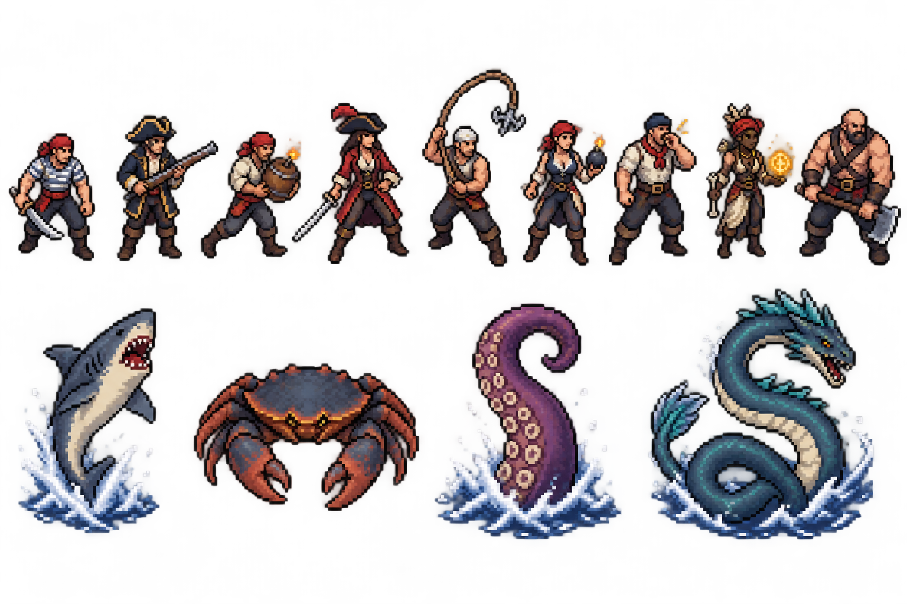

*The lineup:* the nine crew kinds, sexes as the proposal names them, and the four sea creatures.

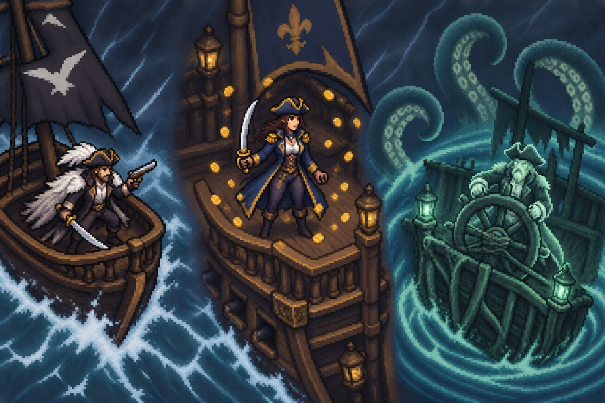

*The three captains:* Crow in his gull-feather cloak, Marrec on her quarterdeck with the cursed coins, and Vandermere at the wheel of the Hollow Queen.

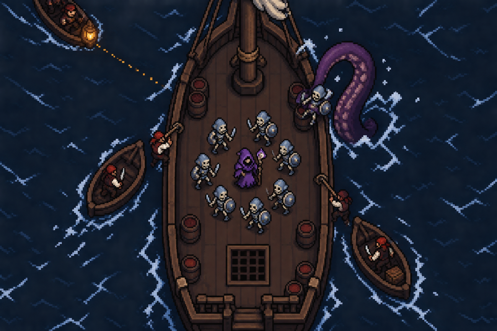

*Stage 4 in play:* the ring squeezed onto the beam, two boats hooked and boarding, the next boat's dotted lane and lantern, and a tentacle taking a skeleton overboard. The deck looks playable at this size, which is what the spike must confirm in the game.

## VI. The Hall of the Slain (Norse, new proposal)

In the north, the dead are not owned: they are **chosen**. A warrior who dies well is carried by a valkyrie to the god's hall to feast until the last battle. Since the necromancer took the world's dead, the benches of the hall stand empty, and Odin needs his army for the end of the world. So the raiders, the shield-maidens, the berserkers, the barrow-dead and the frost-giants come south, and the valkyries fly with them. The look is **frost white, iron grey, pine green-black and hearth amber**, with valkyrie gold and an ice-blue rune glow (kept clear of the undead's soul-teal). Stage key `norse`.

**How it differs from the built acts.** Act II's Claims take the necromancer's fallen summons; the Dynasty's Rebirth brings enemy dead back where they fell; Act IV's Phalanx is a shield wall. Here the question is **how** an enemy died: a good death feeds the hall, a cheap one does not.

### Shared rules

**1. The Choosing (the headline).** A Norse warrior killed by a **melee blow** (a summon's strike, a stomp, a dash) dies a good death: a valkyrie dives on the body (a gold shadow 1 s ahead), lifts it and flies for the arena's edge. If she escapes, the warrior returns 30 s later as an **Einherjar**, a gold-lit elite of the same kind. Kill her in flight and she drops the body as a corpse the necromancer can raise as a strong temporary **Risen Einherjar** (through the existing `spawn_temporary()`). Kills by spells, arrows, volleys or damage over time are inglorious and nobody comes for them. At most 3 valkyries at once. One path, `ValkyrieChoosing`, read from the kill's source in `CombatResolver`.

**2. Berserkergang.** A Norse warrior below 40% health goes berserk: +30% speed and damage, slows and stuns no longer hold, red eyes. Berserkers start in it. Chip damage and damage over time push enemies into the fury, so burst is the answer, and it pulls against the Choosing: melee finishes feed the hall, spells deny it but leave berserkers. One stat on the enemy, read where the enemy's damage and speed are already read.

**3. Rune-Stones.** Three or four carved stones per stage. Held by the hall, a stone wards Norse warriors within 300 px (−25% damage taken) and blows a horn that calls a squad every 60 s. The necromancer takes one by standing within 120 px with more bodies than the hall for 3 s (a ring fills around it): its ward and horn stop and it pays Soul Ash. Seers walk back to re-carve it. Taking a stone never buffs the army (summons never get act-only rules). One structure path, `RuneStones`.

### Roster

| Kind | Tier | What it does | How you beat it |
| --- | --- | --- | --- |
| Raider (male) | Fodder | Axe and round shield, in crowds | Anything; finish with spells to deny the Choosing |
| Shield-Maiden (female, figure style) | Soldier | Spear and shield; a shield bash that knocks one summon back | Flank her; Rogues |
| Berserker (male) | Elite | Bear pelt, two axes, always in fury | Burst; Bone Wall |
| Skald (male) | Support | War-song: Norse warriors near him attack faster | Priority target |
| Valkyrie (female, figure style) | Flying elite | The Choosing; a spear dive at the ring when no body waits | Archers, Gargoyles, spells |
| Draugr (male and female) | Soldier | Barrow-dead in rusted mail; armour 3; a cold touch that slows a summon | Wither, Rot |
| Wolf of the Wastes | Fodder pack | Packs of 5 that lunge | Blockers |
| Frost Giant (male) | Heavy | Throws boulders on a landing circle; a stomp | Siegecraft, Wither |
| Seer (female, figure style) | Support | Re-carves Rune-Stones; a curse that weakens one summon | Kill on the way to a stone |
| Rune-Stone | Structure | Rule 3 | Take it |

**Reckoning, Ragnarök:** at 0:00 the wolf swallows the sun and the arena goes dark red; every Einherjar the run created marches at once, fire-giants step out of the south edge, and every valkyrie dives at the ring.

### Stage 16: The Barrow Fields

Snowfields of burial mounds above a frozen fjord. Zones: the Longshore, the Barrows, the Frozen Fjord (snow slows everyone through `TerrainSlow`), the Jarl's Hall.

- **Open barrows:** mounds that crack open on a 2 s telegraph and let draugr out until the mound is broken.
- **Miniboss, the Barrow-Wight:** a draugr chieftain whose howl stuns the ring for 1 s.
- **Boss, Hrimgar the Draugr-King** (male): he rises three times. Each time he falls he sinks into his barrow and returns stronger 20 s later, unless the necromancer breaks the barrow while he is down. Phases: the Grave (frost mist and draugr from every mound), the Barrow Lord (a cleaving greatsword), the Last Rising (he drags summons into the mound with him).

### Stage 17: Valgard, the Hall of Heroes

A vast feast hall at the edge of the sky, long tables and shields on the walls. Zones: the Shield Yard, the Mead Hall, the Hall of Spears, the Valkyries' Gate.

- **The Feast:** Einherjar sit at the long tables as obstacles that wake whenever a horn blows, then fight.
- **Miniboss, the Einherjar Champion,** a gold-lit hero who fought in the hall for a thousand years.
- **Boss, Sigrun, the Shield-Queen** (female, figure style; an original valkyrie captain): **the Charge** (spear dives across the ring on telegraphed lines with her valkyrie wing), **the Holmgang** (she challenges the necromancer to a duel: a square of hazel rods closes around the two of them for 15 s, and summons cannot enter; spells and Grave Step only), **the Doors of the Hall** (every Einherjar chosen this run returns at her side).

### Stage 18: Vigrid, the Last Field (the finale)

The plain where the last battle is fought, under a sky going out. Zones: the Frozen Sea, the Ash Plain, the Giants' March, the Field of Vigrid.

- **The Long Winter:** the light fades zone by zone, and the Reckoning's dark arrives early in the last zone.
- **Miniboss, a Fire-Giant of the south,** who leaves burning tracks.
- **Boss, Odin and Fenrir** (the one-eyed god, male, and the great wolf): **the Wolf** (Fenrir breaks his chain and hunts the ring; he swallows a summon whole and spits it out 4 s later), **the All-Father** (Odin's spear that never misses: a throw at the strongest summon that no blocker stops, dodged only by Grave Step or a Bone Wall; his ravens mark the necromancer), **Ragnarök** (both at once, the arena burning, until one falls; the other follows within 30 s).

### Rewards

| Boss | Spell (paired passive) | Character |
| --- | --- | --- |
| Hrimgar | **Barrow Grasp**: cold hands burst from the ground in a ring and hold enemies → *Barrow-Lord's Embrace* (+ Grave Frost) | **The Rune-Seer** (female, figure style) |
| Sigrun | **Valkyrie Spear**: a spectral spear dives on the strongest enemy and chains to the next → *Chooser of the Slain* (+ Einherjar's Oath) | **The Shield-Maiden** (female, figure style) |
| Odin and Fenrir | **Gungnir**: a spear thrown at the strongest enemy on screen that pierces everything in its line → *Spear of the Hanged* (+ Runecraft) | **The Berserker** (male) |

Finale summon class **the Draugr Thane**: a heavy undead jarl, a blocker whose frost-axe slows what it hits (evolution *Barrow King*). Counter-passives (this act only): *Inglorious* (valkyries fly 30% slower and take more damage) and *Calm Blood* (berserk enemies deal 20% less damage to summons). Achievements: *None Chosen* (finish the Barrow Fields without a valkyrie escaping), *Holmgang* (win Sigrun's duel without Grave Step), *Twilight of the Wolf* (beat Odin and Fenrir; opens the act's epilogue part).

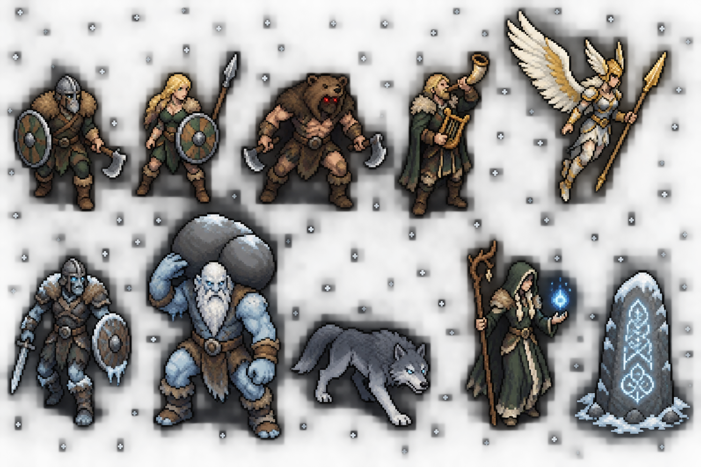

*The lineup:* raider, shield-maiden, berserker, skald, valkyrie, draugr, frost giant, wolf of the wastes, seer and a Rune-Stone. Frost white and iron grey with valkyrie gold read well against the undead.

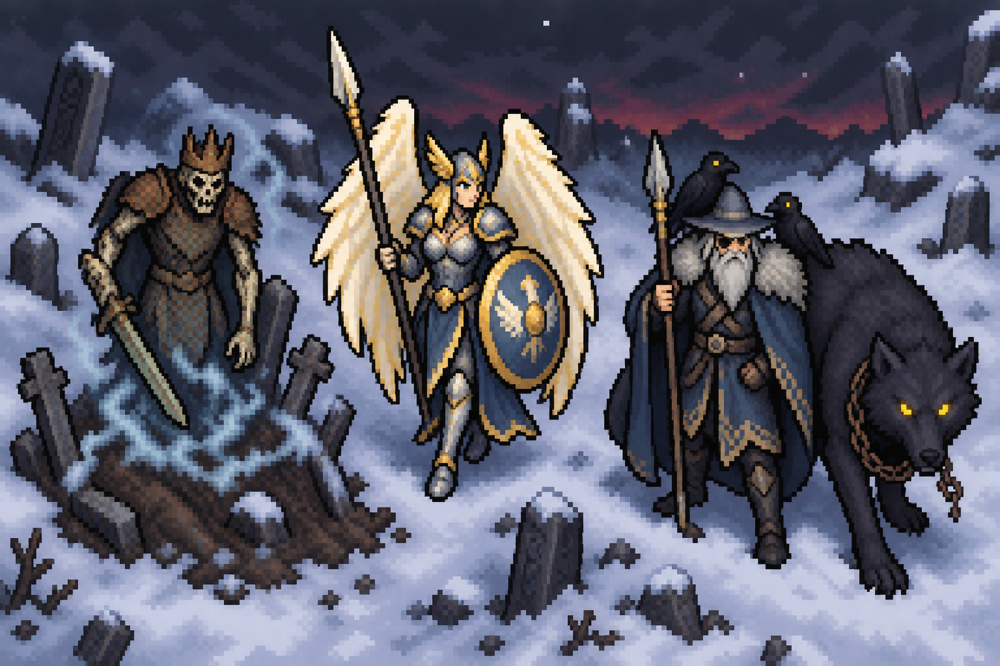

*The three bosses:* Hrimgar rising from his barrow, Sigrun, and Odin with his ravens beside Fenrir. Odin's wide hat and grey beard are his traditional look; the sprite can push him further from wizard silhouettes (an eyepatch, a darker cloak) if you prefer.

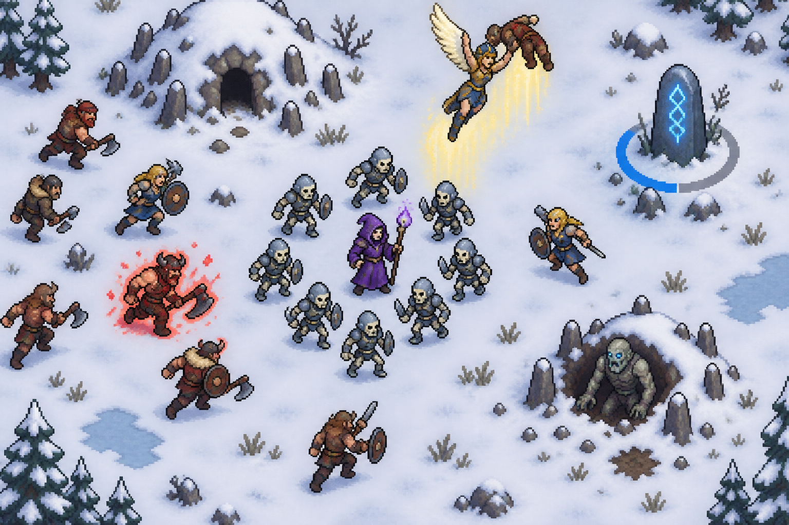

*Stage 16 in play:* all three rules at once: a valkyrie carrying a good death away, a berserker in fury, and a Rune-Stone with its capture ring half full; a draugr climbs out of an open barrow.

## VII. The Necropolis Dynasty (Egypt)

The oldest empire of the dead: for three thousand years every body was named, weighed and wrapped, and every mummy belongs to a god by name. The necromancer's army pulled at strings the Dynasty tied for millennia, and its priests, guardians, jackal-warriors and gods come to take their dead back. Look: a dull bronze-gold for enemies (true gold stays the player's reward colour), lapis, sandstone, carnelian and papyrus green under a blue-black desert night. Full proposal: `docs/proposals/NEW_ACTS_AND_ORDER.md`, Part 3. Stage key `dynasty`.

**Shared rules**

- **Rebirth** (the headline). A fallen mummy or guardian shows its Name on a gold cartouche for 6 s. Not raised or smashed in time, it **returns** at 70% health and hits harder (at most twice). Raising it steals the Name and makes it the necromancer's own: raising is the counter. Canopic Jars hold the Names within 300 px; break the jar and Rebirth stops there.
- **The Black Land.** Quicksand patches slow everyone, and every 5:00 a 40 s **Sandstorm** halves ranged reach for both armies and hides enemies past 300 px. Melee armies prosper while it blows.
- **Heka.** Priests write a gold glyph on a summon (−20% damage and speed) that jumps along the Bone Ring every 2 s. A Mender's heal, a Warder's ward or the priest's death clears it: the act that asks for priests.

| Stage | Arena and set piece | Boss |
| --- | --- | --- |
| 19. The Necropolis of Sand | Tomb road at dusk; Canopic Jars teach Rebirth | Anubis, Opener of the Way (a funeral procession, the embalming, then a jackal duel) |
| 20. The Temple of the Lioness | Colonnades and statue courts; rows of statues wake and walk | Sekhmet, the Lioness of Retribution (figure style; pillar leaps, the Red Wind, the Feast) |
| 21. The Hall of Two Truths | The judgment hall; the great Scales tip with every raise and every Rebirth | Osiris and Ammit the Devourer (the Judge, the Weighing of the necromancer's heart, the Devourer) |

| Boss | Spell (paired passive) | Character |
| --- | --- | --- |
| Anubis | Linen Bind → Eternal Shroud (+ Natron Salts) | The Embalmer (figure style) |
| Sekhmet | Burning Eye → Eye of Retribution (+ Desert Fury) | The Lion-Priestess (figure style) |
| Osiris and Ammit | Feather's Verdict → Heart Devoured (+ Heavy Heart) | The Pharaoh's Shade (male) |

Finale summon class **the Ushabti Sentinel** (a stone servant that reassembles once every 25 s; evolution Eternal Guard). Counter-passives *Embalmed Bones* and *Dune Walkers*. Achievements *Names Taken*, *No Jars Left*, *A Light Heart*.

**Note on the Norse act beside it:** both acts care how the enemy dead are handled, but differently. The Dynasty is a race to raise a corpse before it gets up; the Hall is about which weapon makes the kill.

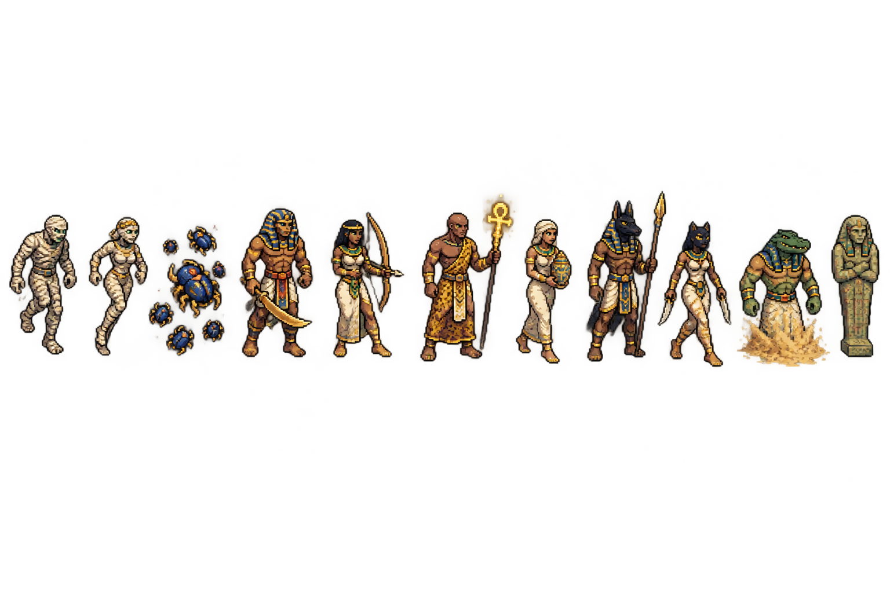

*The lineup:* mummies (male and female), scarab swarm, khopesh guard, Nile archer, Heka priest, embalmer, jackal warrior, Bastet hunter, crocodile warden and an ushabti.

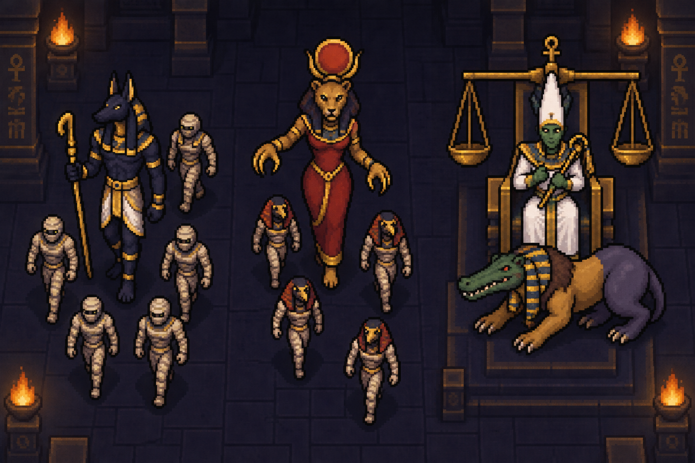

*The three bosses:* Anubis with his procession, Sekhmet, and Osiris before the Scales with Ammit crouched at his feet.

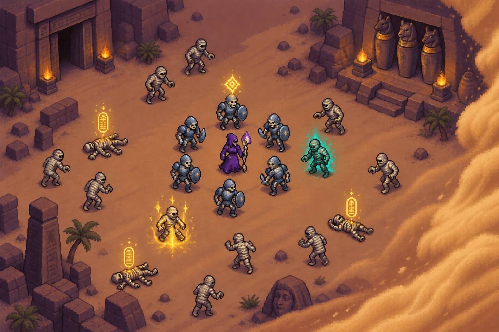

*Stage 19 in play:* Rebirth in every state at once: cartouches over fresh corpses, one mummy returning in gold, one raised in teal for the necromancer, and the Sandstorm wall rolling in from the right.

## XIII. The Age of Titans (prehistoric)

The Ark's vault holds a log of every world the Harvesters reaped. The oldest entry is this one: they seeded the world, let it grow, then called down a meteor to clear the beasts. The necromancer takes their tractor-beam array, follows the log through a rift to the day before the impact, and takes the **Call** for himself (Framing A; the Concord is built now, so this framing is unblocked). No gods, no armies, no walls: only animals the size of houses, and every one that falls leaves a skeleton to raise. Look: fern green, volcanic orange, tar black, dust ochre and bone white, with a white streak in the sky that grows through the act. Full proposal: `docs/proposals/NEW_ACTS_AND_ORDER.md`, Part 2. Stage key `primeval`.

**Shared rules**

- **Packs** (the headline). Predators circle the ring, hold 1.5 s, then rush together faster and from the flanks. Kill the **alpha** and the pack loses its bonus and charges in uncoordinated.
- **Herds.** Neutral giants (longnecks, duckbills) wander the arena, drop big XP and a heavy corpse when killed, and **stampede** when hurt or frightened: a 600 px living front on a telegraphed line that tramples both armies. Rocks are shelter; luring predators into the stampede is the play. A heavy corpse raises as a Fossil Giant.
- **Scavengers.** Pterosaurs dive and snatch piles of XP crystals to their nests; shoot one down and the pile drops. Anything within 200 px of the necromancer is safe. It pressures the economy, not the army.

| Stage | Arena and set piece | Boss |
| --- | --- | --- |
| 37. The Fern Basin | Jungle river; tar seeps that trap longnecks as free kills; crocodiles in the tar | Scarmaw, the Great Raptor (female alpha; three packs, fern ambushes, Blood Up) |
| 38. The Great Plain | Grassland; a watering hole where fights start stampedes; a canyon of narrow lanes | Old Ironbrow, the Horned Titan (male; leads the stampede, charges, breaks a horn) |
| 39. The Last Day | The impact basin under a white sky; meteorites strike faster each zone | Old Gravejaw, the Tyrant King (male; the Roar, the Hunt, the Last Day) |

**The meteor (recommended Option A):** on the Last Day the 20:00 clock still runs and the boss still comes at 3:00. At 0:00 the necromancer's meteor lands as the stage's Reckoning, **the Extinction**: a 5 s white-out under a one-time ward, every enemy on the map dies, every corpse rises as a temporary **Fossil Host**, and the run ends in victory. Only a Tyrant King killed before the impact gives his spell. Stages 37 and 38 keep a normal Reckoning, the Stampede of Ash.

| Boss | Spell (paired passive) | Character |
| --- | --- | --- |
| Scarmaw | Pack Leap → Apex Pack (+ Pack Instinct) | The Fern Huntress (figure style) |
| Old Ironbrow | Stampede → Herd of Ages (+ Calcified Hide) | The Herd-Warden (male) |
| Old Gravejaw | Meteor Call → Extinction Event (+ Cosmic Dust) | The Skywatcher (figure style) |

Finale summon class **the Bonehorn** (a skeletal horned charger that tramples through a pack and trots back; evolution Fossil Tyrant). Counter-passives *Hoarder's Bones* and *Thick Marrow*. Achievements *Nothing Taken*, *Trampled*, *The Day the Sky Fell*.

**Risk:** neutral herds and a mass raise are new; bodies are capped (herds 6, Fossil Giants 2, Fossil Host 60) and the white-out is flat rects, never a screen-reading shader.

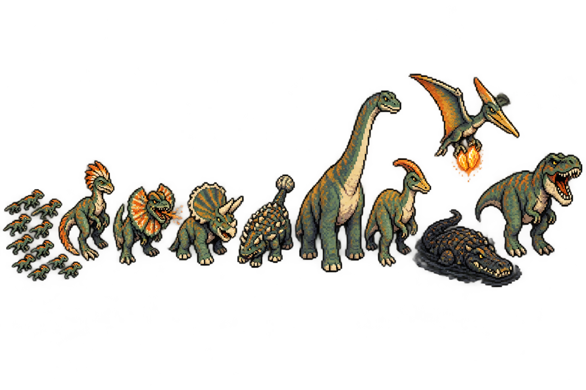

*The lineup:* scuttlers, razorclaw alpha, frill-spitter, horncharger, clubtail, longneck, duckbill, a skyraider carrying crystals, bog croc and a tyrant. No humans, as planned.

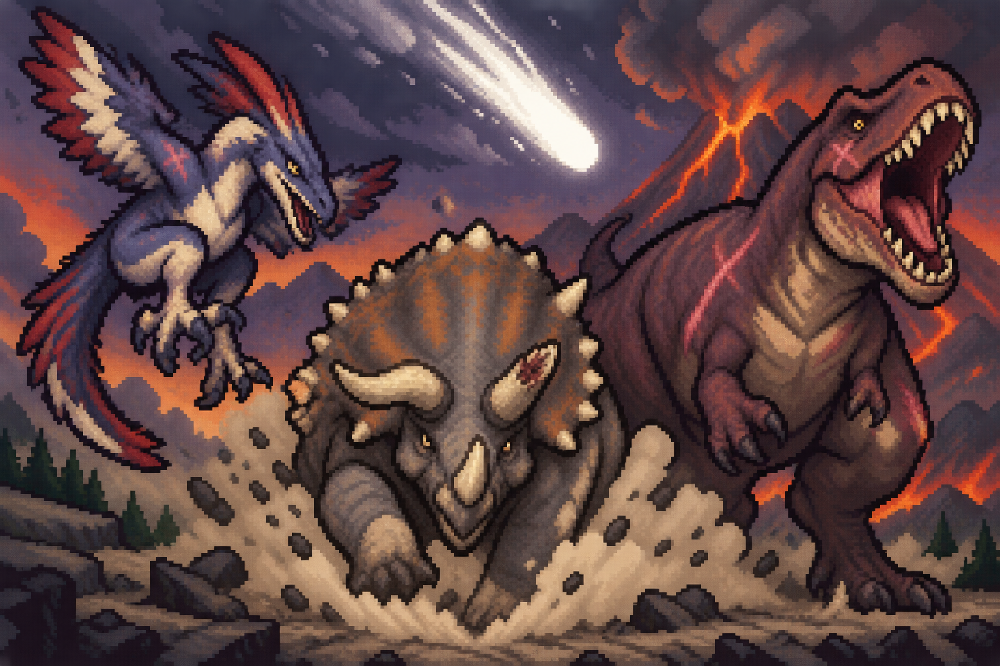

*The three bosses* under the falling meteor: Scarmaw, Old Ironbrow and Old Gravejaw.

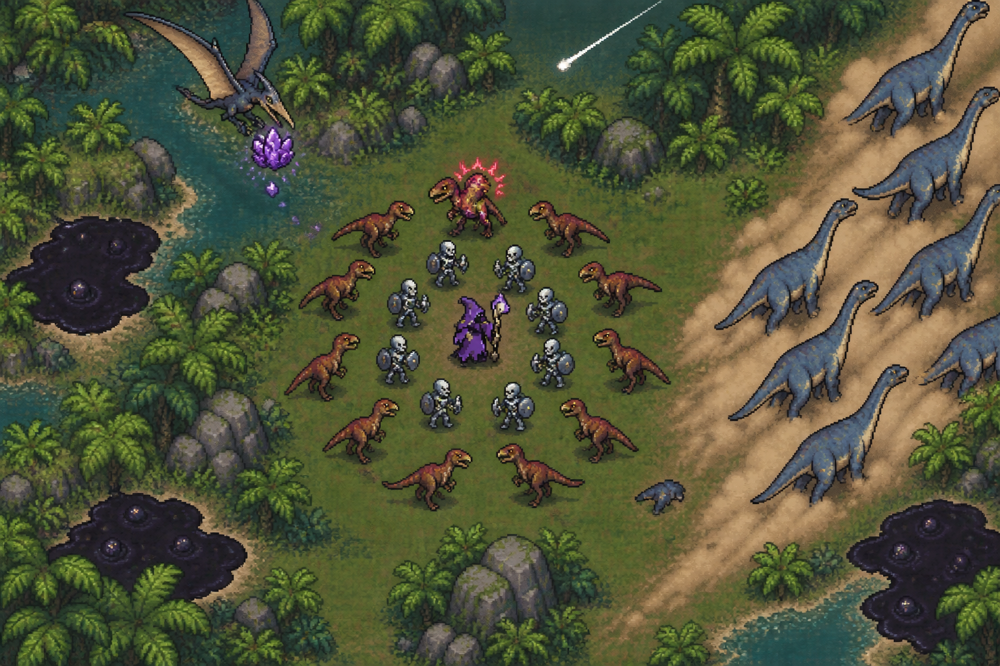

*Stage 37 in play:* a pack circling with its alpha marked, a longneck stampede on its dust line, a skyraider taking crystals, the tar seeps and the first streak in the sky.

## XIV. The Turning Year (nature, the finale, new proposal)

A star fell once and the world buried everything under it. Now it remembers how to bury things. Death was always part of the world's cycle (a body becomes soil, soil becomes spring), and the necromancer broke it: nothing he raises goes back to the earth. After heaven, hell, the stars and the deep past, **the world itself** rises to take its dead back: the Wild, with its dryads and treants, the fae courts, the great beasts, the Wild Hunt and the spirits of the four seasons. The look is moss, bark, blossom pink, gold leaves and frost white, and each season repaints the arena. Stage key `wild`.

**Kept apart from the acts before it.** The Titans have beasts and herds, so the Wild's beasts are few and fae-touched (a great stag, the Hunt's hounds). The Norse act has the winter cold, so here winter is one season of four, with the Winter Court of the fae, not giants and wolves.

### Shared rules

**1. The Turning Year (your seasons idea, the headline).** The 20:00 clock is one year: four seasons of 5 minutes, on one `SeasonCycle` path, shown as a wheel on the HUD. Each season changes the arena for both armies:

| Clock left | Season | The arena | Who comes |
| --- | --- | --- | --- |
| 20:00–15:00 | **Spring** | Roots grab anything that stands still for 2 s and hold it 1.5 s | Thornlings, dryads, treants |
| 15:00–10:00 | **Summer** | Wildfires sweep the dry grass on telegraphed fronts and burn both armies | Fae knights, the Wild Hunt |
| 10:00–5:00 | **Autumn** | Leaves hide the ground; corpses rot in 3 s, so raise fast | Spore mothers, will-o'-wisps, corpse-blooms |
| 5:00–0:00 | **Winter** | Snow slows everyone 20%; blizzards cut sight to 400 px; the boss comes at 3:00 in the dead of winter | The Winter Court |
| Reckoning | **Spring Returns** | Everything grows back at once and buries the dead | All of them |

**2. Bloom and Blight.** The ground is alive. Where the necromancer and his army stand, the grass slowly dies into **blight**; the Wild's creatures heal on living ground and not on blight. Holding ground builds a dead zone they cannot recover in, but Spring's roots punish standing still, so the act pulls between the two rules. Spring regrows blight quickly; Autumn spreads it. One ground path (`BloomField`, a coarse grid like the Sanctum's floor corruption).

**3. Overgrowth.** Dryads plant seeds that grow into **thorn thickets**: new obstacles that spread through the run and close lanes, and hold a summon caught in them. Fire (Summer's wildfires, burning spells), Rot and Wither burn them back. Over a careless run the open forest becomes a maze. Built on the obstacle code Act VIII's wrecks already use for obstacles added mid-run.

### Roster

| Kind | Tier | What it does | How you beat it |
| --- | --- | --- | --- |
| Thornling | Fodder swarm | Twig creatures in swarms of 12 | Anything |
| Dryad (female, figure style) | Support | Plants thicket seeds; heals the Wild on living ground | Priority target |
| Treant | Heavy | Slow; roots the summon it strikes | Fire, Wither, Siegecraft |
| Fae Knight (male) | Soldier | Leaf armour and a thorn sword; short blinks through the ring | Blockers inside the ring |
| Will-o'-Wisp | Lure | Draws summons away from the ring (the existing `misdirect()` hook) | Kill it; area damage |
| Great Stag (male) | Elite | A telegraphed antler charge that scatters the ring | Grave Step; Bone Wall |
| Rider of the Wild Hunt (male) | Elite | A spectral horseman and two hounds; sweeps across the arena in a line | Step out of the line; Archers |
| Spore Mother (female, figure style) | Support | Spores that rot summons and spread blight-killing mould | Kill early |
| Winter Fae (female, figure style) | Ranged | Frost bolts that chill summons; winter only | Fire; Mages |
| Corpse-Bloom | Structure | Eats corpses on the field and spawns thornlings | Break it |

### Stage 40: The Greenwood

An old forest that has never been cut. Zones: the Glade, the Deep Wood, the Hunting Grounds, the Stag's Hollow.

- **Sacred groves:** rings of standing trees that heal the Wild inside them; blighting a grove (holding the ring in it for 10 s) kills it for the run.
- **Miniboss, the Huntsman of the Wild Hunt,** who leads three riders in a sweeping line.
- **Boss, the Stag King** (male, stag-headed, the antlered lord of the forest): **the Hunt** (he leads the Wild Hunt across the arena in sweeping lines), **the Rut** (charges that crack trees into new thickets), **the Antler Crown** (his antlers grow a thicket ring around him that must be burned through before he can be hurt).

### Stage 41: The Fae Court

A court of endless summer under a sky that never sets. Zones: the Rose Maze, the Revel, the Mirror Lake, the Throne of Blossoms.

- **Fairy rings:** mushroom circles where time runs at half speed for whatever is inside, both armies.
- **Miniboss, the Winter Prince,** the Summer Queen's rival, who brings one minute of winter into her summer.
- **Boss, the Summer Queen** (female, figure style): **the Masque** (glamour: she and her court change faces, and only hits reveal which is real), **the Bargain** (she offers the necromancer a bargain on screen, a real choice: a strong boon at a price, such as +30% army damage for 60 s while the army no longer heals; refuse and she attacks harder), **the Court in Bloom** (she floods the arena with blossoms and thorns until she falls).

### Stage 42: The World-Tree (the campaign finale)

The tree at the centre of the world, its roots in the dead and its crown in the sky. Zones: the Roots, the Trunk Stair, the Crown, the Seed.

- **All four seasons in one stage:** the year turns twice as fast here (2:30 a season).
- **Miniboss, the Gardener of Roots,** a treant that tends the tree and calls every root in reach.
- **Boss, the Green Mother** (female, figure style, a colossal goddess grown from the tree):
  1. **The Turning:** she casts one season after another, each a different attack (spring roots, summer fire, autumn rot, winter frost).
  2. **The Burial:** she pulls the summons into the earth one by one; each buried summon becomes a thicket until the ring cuts it free.
  3. **The Last Claim** (the Morning Star's cut Throne phase, brought back as you decided): she remembers every power that ever claimed the dead, and the arena replays **one signature rule of every act** for about 10 s each, in campaign order: the Covenant's march, a boarding, the Blood Moon, the Wanted stars, the Draw, the Choosing, Rebirth, the Wrath of the Gods, the hell pits, the Claims, the Lock-On lines, the beams, a stampede. She can be hurt throughout. A boss rush of mechanics as the last fight of the game.
- **The ending:** beaten, she does not die. She takes the necromancer's dead back into the soil and gives him the one claim left: the dead are no longer buried, they are **planted**, and in spring they rise to him. The campaign ends on the first spring.

### Rewards

| Boss | Spell (paired passive) | Character |
| --- | --- | --- |
| The Stag King | **Wild Hunt**: spectral riders sweep across the screen in a line → *The Endless Hunt* (+ Horn of the Hunt) | **The Horned Herald** (male) |
| The Summer Queen | **Glamour**: illusory copies of the necromancer draw enemy attacks → *Court of Masks* (+ Changeling) | **The Changeling Princess** (female, figure style) |
| The Green Mother | **Root and Rot**: a ring of roots grows at the strongest enemy and rots everything inside → *Return to Earth* (+ Compost Heart) | **The Gravegardener** (female, figure style) |

Finale summon class **the Ossuary Oak**: a slow tree of bone that roots in place as a blocker and lashes everything around it with thorns (evolution *World-Root Warden*). Counter-passives (this act only): *Deadwood* (roots and thickets hold summons half as long) and *Fallow Ground* (blight spreads twice as fast). Achievements: *Scorched Earth* (blight half the Greenwood in one run), *A Fair Bargain* (accept every bargain the Summer Queen offers and still win), *The First Spring* (beat the Green Mother; opens the final epilogue part and the end of the campaign).

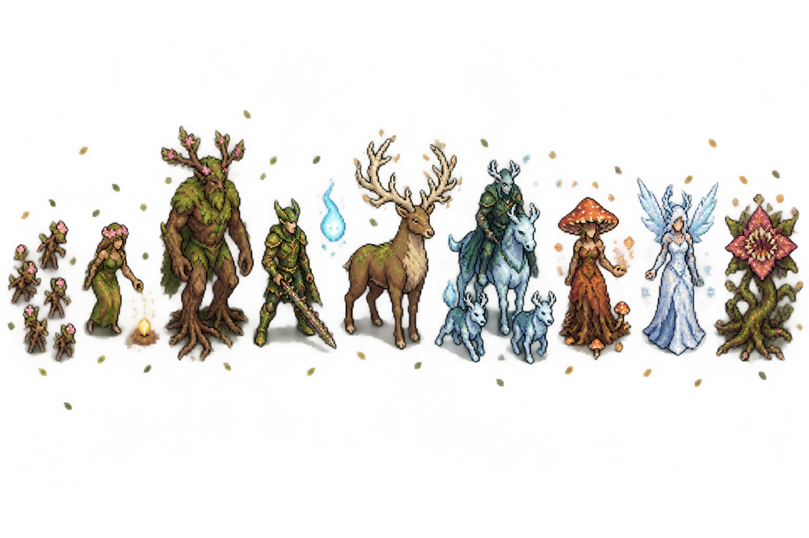

*The lineup:* thornlings, dryad, treant, fae knight, will-o'-wisp, great stag, a rider of the Wild Hunt with his hounds, spore mother, winter fae and a corpse-bloom.

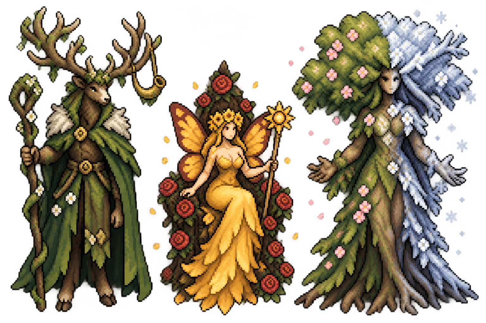

*The three bosses:* the Stag King, the Summer Queen on her throne of roses, and the Green Mother, half in bloom and half in frost: the whole year in one figure.

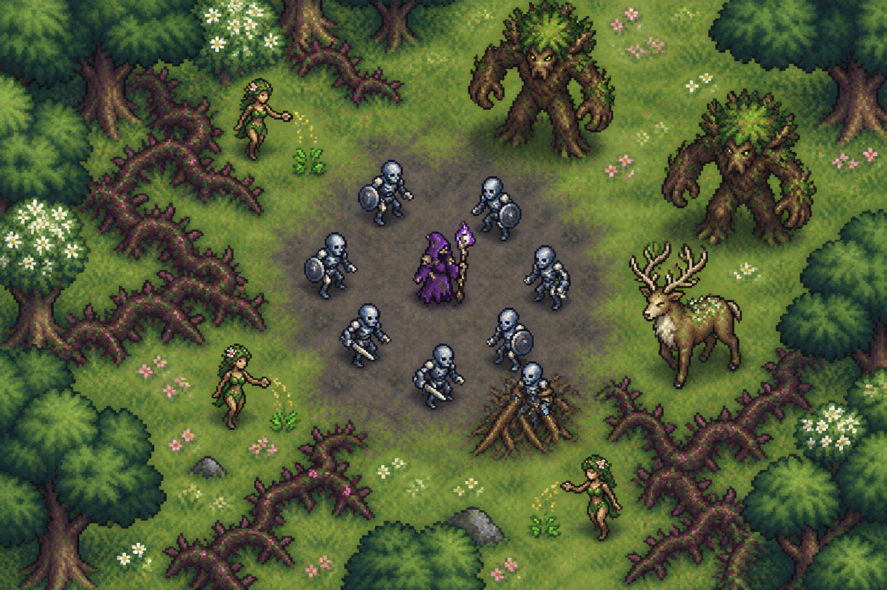

*Stage 40 in play:* the blight under the ring against living ground all around, dryads at work, thickets closing the paths, treants and the great stag closing in. The blight should read stronger than this in the game (a darker grey with dead grass).

## Open questions for you

Each has a recommendation; answer inline or in a comment and wave 1 starts.

- [ ] **The order:** fourteen acts as drawn above, with the Norse act at VI between the Shogunate and the Dynasty? Recommended. The alternative is the Norse act at VIII, just before Olympus, so the two pantheons sit side by side.
- [ ] **Pirates second:** the Black Tide at II, as the first act that bends the arena while the enemies are still mortal? Recommended.
- [ ] **The Titans' framing and meteor:** Framing A (the Harvesters' log, after the Concord) and Option A (the meteor is the finale's Reckoning, a victory, and the Fossil Host)? Recommended; the Concord now exists, so nothing blocks it.
- [ ] **Real mythology names:** Anubis, Sekhmet, Osiris, Ammit, Odin and Fenrir, as the Greek and Japanese acts use theirs? Recommended.
- [ ] **The Choosing:** melee kills feed the Norse hall, spell and ranged kills deny it. Is a rule that judges how you kill fun to you, or should the valkyries take every Norse death?
- [ ] **The Summer Queen's Bargain:** a real choice on screen mid-fight (two cards, the run paused in solo, a lockstep pick in co-op)? Recommended; it is the only boss in the game that asks the player a question.
- [ ] **The Last Claim:** the Green Mother's last phase replays one rule from each act for about 10 s each, roughly two and a half minutes. Keep it that long, or cut it to one rule per Part-Two act?
- [ ] **Soul Ash with fourteen acts:** keep the per-act restart (×1 / ×1.25 / ×1.5 per stage, every act a fresh start), or add a gentle ladder for the later acts? Recommended: keep it, and look again in the reorder pass with the economy tool.
- [ ] **The stage select:** a Part One / Part Two switch with the act tabs under it? Recommended (fourteen tabs do not fit in one row).
- [ ] **Wave 1:** the Necropolis Dynasty and the Hall of the Slain together, with the Black Tide deck spike beside them? Recommended.
- [ ] **Concept art:** any image to redo before sprites start? Two notes of mine: Odin could move further from a wizard silhouette, and the Turning Year's blight needs to read stronger in the game.
